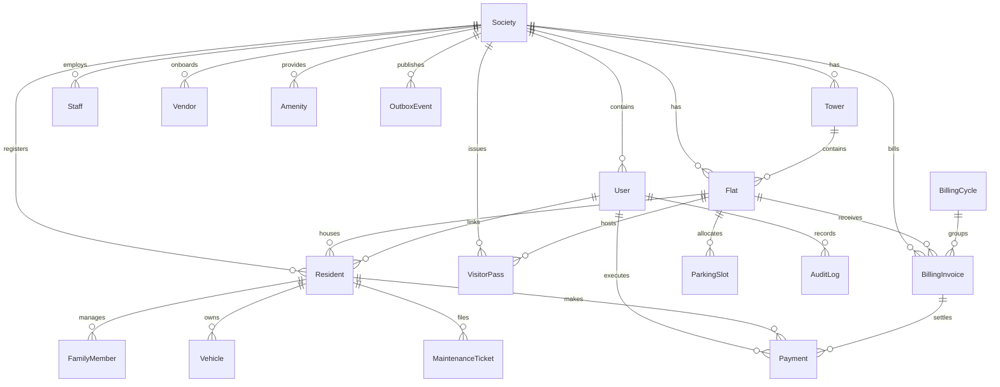
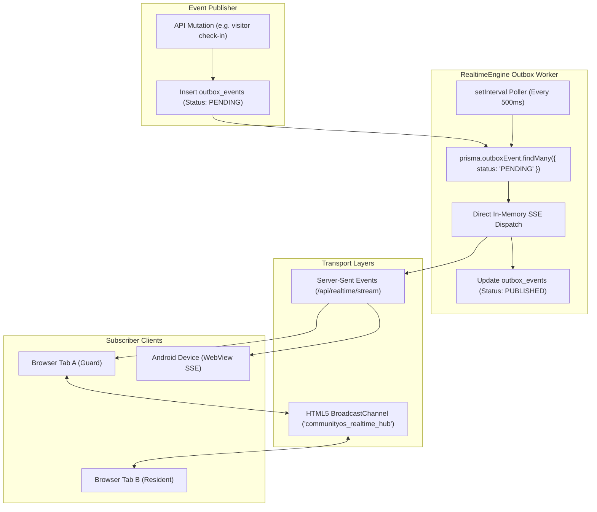

# AARIZO — DATABASE ARCHITECTURE & REALTIME ENGINE AUDIT
**Document Version:** 1.0.0  
**Audit Date:** November 14, 2026  
**Auditor Roles:** Senior Database Administrator, Realtime Systems Architect  

---

## 1. Relational Database Schema & Model Inventory

The authoritative database layer is built on **PostgreSQL 16** and mapped through **Prisma ORM 6.19.3** ([server/prisma/schema.prisma](file:///d:/AAZIRA/AARIZO/server/prisma/schema.prisma)).

The schema defines **31 relational models** and **8 enumerated types**:

### 1.1 Enumerated Types (Enums)
| Enum Name | Allowed Values | Usage |
| :--- | :--- | :--- |
| `UserRole` | `resident`, `guard`, `secretary`, `committee`, `facility_manager`, `vendor`, `admin` | User authentication & RBAC |
| `EntityStatus` | `ACTIVE`, `INACTIVE`, `SUSPENDED`, `PENDING`, `ARCHIVED` | Entity lifecycle control |
| `PassType` | `GUEST`, `DELIVERY`, `CAB`, `SERVICE`, `FREQUENT` | Visitor category classification |
| `PassStatus` | `PENDING`, `APPROVED`, `CHECKED_IN`, `CHECKED_OUT`, `EXPIRED`, `CANCELLED`, `REJECTED` | Gate pass lifecycle |
| `InvoiceStatus` | `PENDING`, `PAID`, `PARTIALLY_PAID`, `OVERDUE`, `CANCELLED` | Maintenance billing ledger |
| `TicketPriority` | `LOW`, `MEDIUM`, `HIGH`, `EMERGENCY` | Work order priority |
| `TicketStatus` | `OPEN`, `IN_PROGRESS`, `RESOLVED`, `CLOSED`, `REOPENED` | Maintenance resolution state |
| `IncidentSeverity`| `LOW`, `MEDIUM`, `HIGH`, `CRITICAL` | Emergency incident triage |

### 1.2 Core Domain Models & Relational Topology

### 1.3 Table Catalog & Constraints

| Model / Table | Primary Key | Foreign Keys & Relations | Unique Constraints & Indices | Tenant Boundary |
| :--- | :--- | :--- | :--- | :--- |
| `Society` (`societies`) | `id` (UUID) | None (Root tenant) | `code` (UNIQUE) | Self |
| `Tower` (`towers`) | `id` (UUID) | `societyId` -> `Society(id)` CASCADE | None | `societyId` |
| `Flat` (`flats`) | `id` (UUID) | `societyId`, `towerId` CASCADE | `[towerId, flatNumber]` (UNIQUE) | `societyId` |
| `User` (`users`) | `id` (String) | `societyId` SET NULL, `flatId` SET NULL | `email` (UNIQUE) | `societyId` |
| `Resident` (`residents`) | `id` (UUID) | `societyId`, `userId`, `flatId` | None | `societyId` |
| `FamilyMember` (`family_members`) | `id` (UUID) | `residentId` -> `Resident(id)` CASCADE | None | Via Resident |
| `Vehicle` (`vehicles`) | `id` (UUID) | `residentId` -> `Resident(id)` CASCADE | None | Via Resident |
| `Staff` (`staff`) | `id` (UUID) | `societyId`, `userId` | None | `societyId` |
| `DomesticWorker` (`domestic_workers`)| `id` (UUID) | `societyId` -> `Society(id)` CASCADE | None | `societyId` |
| `Vendor` (`vendors`) | `id` (UUID) | `societyId`, `userId` | None | `societyId` |
| `VisitorPass` (`visitor_passes`) | `id` (UUID) | `societyId`, `residentId`, `flatId` | None | `societyId` |
| `Parcel` (`parcels`) | `id` (UUID) | `societyId`, `residentId`, `flatId` | None | `societyId` |
| `BillingCycle` (`billing_cycles`) | `id` (UUID) | `societyId` -> `Society(id)` CASCADE | None | `societyId` |
| `BillingInvoice` (`billing_invoices`)| `id` (UUID) | `societyId`, `cycleId`, `residentId`, `flatId` | `invoiceNumber` (UNIQUE) | `societyId` |
| `Payment` (`payments`) | `id` (UUID) | `societyId`, `invoiceId`, `residentId`, `userId` | `razorpayOrderId`, `razorpayPaymentId` (UNIQUE), `[societyId, status]`, `[createdAt]` | `societyId` |
| `Amenity` (`amenities`) | `id` (UUID) | `societyId` -> `Society(id)` CASCADE | None | `societyId` |
| `AmenityBooking` (`amenity_bookings`)| `id` (UUID)| `societyId`, `amenityId`, `residentId` | `[societyId, amenityId, slotDate]`, `[residentId]` | `societyId` |
| `MaintenanceTicket` (`maintenance_tickets`) | `id` (UUID) | `societyId`, `residentId` | None | `societyId` |
| `EmergencyIncident` (`emergency_incidents`) | `id` (UUID) | `societyId` -> `Society(id)` CASCADE | None | `societyId` |
| `AuditLog` (`audit_logs`) | `id` (UUID) | `societyId`, `actorId` | None | `societyId` |
| `OutboxEvent` (`outbox_events`) | `id` (UUID) | `societyId` | `eventId` (UNIQUE), `[status, createdAt]`, `[societyId, eventType]` | `societyId` |
| `TrustScore` (`trust_scores`) | `id` (UUID) | `societyId` | `[societyId, entityType, entityId]` (UNIQUE) | `societyId` |
| `WalletTransaction` (`wallet_transactions`) | `id` (UUID) | `societyId`, `residentId` | `[societyId, residentId]` | `societyId` |

---

## 2. Transaction Boundaries, Atomicity & Concurrency

### 2.1 Multi-Entity Atomic Transactions
Verified in `server/src/provisioning.ts`:
- Society Provisioning: `UniversalProvisioningService.provisionSociety()` executes inside `prisma.$transaction(async (tx) => ...)`.
  - Atomically creates `Society`, `Tower`, `Flat`, `User` (with password hash and salt), `Resident`, and `OutboxEvent`.
  - If any step fails (e.g. duplicate email or schema validation error), the entire batch rolls back, guaranteeing zero orphaned records.
- Payment Settlement: `POST /api/payments/razorpay/verify` executes inside an atomic database transaction updating `BillingInvoice.status = 'PAID'` and `Payment.status = 'SUCCESS'`.

### 2.2 Concurrency & Race Condition Analysis
- **Amenity Double-Booking**:
  - `amenity_bookings` features a composite index `@@index([societyId, amenityId, slotDate])`.
  - While client code checks slot capacity before booking, concurrent parallel requests without a database-level `SELECT ... FOR UPDATE` lock can theoretically produce a minor over-booking race condition.
- **Invoice Double-Settlement**:
  - Mitigated by check: `if (invData.status === 'PAID') return;` and unique constraints on `razorpayPaymentId`.

---

## 3. Real-Time Engine & Transactional Outbox Audit

The application implements a multi-layer real-time synchronization architecture:

### 3.1 Realtime Delivery Mechanisms Distinguished
1. **Server-Sent Events (SSE)**:
   - **Endpoint**: `GET /api/realtime/stream?societyId=soc-gvs&userId=...&role=...`
   - **Implementation**: `server/src/realtimeEngine.ts` maintains active client response streams in a `Map<string, SSEClient>`.
   - **Telemetry & Keepalive**: Dispatches `PING` frames every 10 seconds to maintain connection health across intermediate reverse proxies and firewalls.
   - **Resilience**: Supports `Last-Event-ID` header; replays missed events from `outbox_events` table upon reconnection.
2. **HTML5 `BroadcastChannel` (`communityos_realtime_hub`)**:
   - Used for zero-latency cross-tab communication in the same browser.
   - Distinct from server-side SSE: operates purely client-side without network round-trips.
3. **Web Audio API Harmonic Chimes**:
   - Client synthesizes tones locally via `playAudioChime()` upon event arrival:
     - `emergency`: Alternating dual-tone sawtooth siren (880Hz -> 1174Hz).
     - `alert`: Ascending two-tone doorbell chime (G5 784Hz -> C6 1046Hz).
     - `info`: Subtle 987Hz sine ping.

### 3.2 Realtime Defect Discovered (Issue ID: ISSUE-08)
- The outbox poller in `server/src/realtimeEngine.ts` executes every 500 milliseconds via `setInterval`.
- When PostgreSQL is disconnected, every 500ms tick triggers an unhandled database connection error, flooding the Node.js console logs.
- Recommended Fix: Implement exponential backoff when database connectivity fails instead of fixed 500ms polling.

