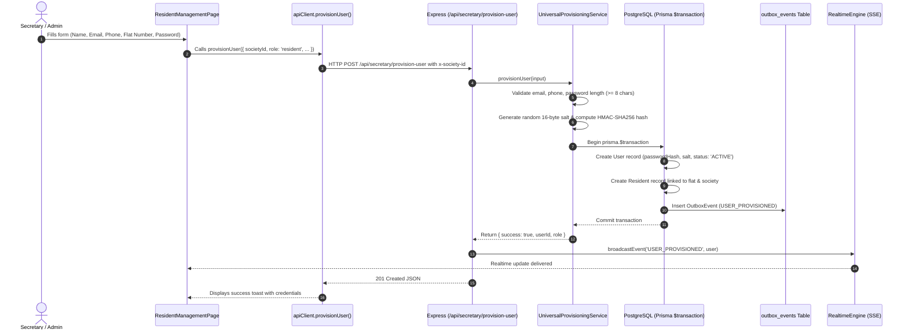
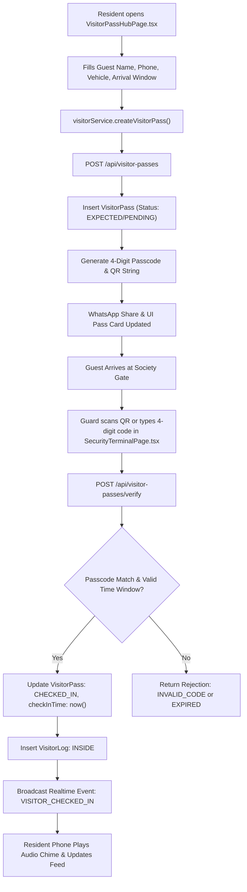
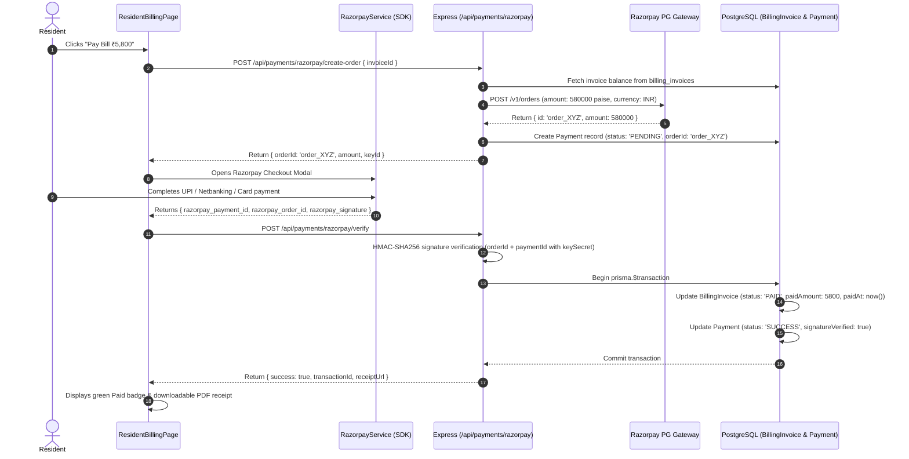

# AARIZO — COMPREHENSIVE BUSINESS WORKFLOW AUDIT
**Document Version:** 1.0.0  
**Audit Date:** November 14, 2026  
**Auditor Roles:** Senior Full-Stack Engineer, QA Automation Lead, Security Auditor  

---

## 1. Executive Summary & Workflow Inventory

This document details the exact, step-by-step data flow of every actual business workflow implemented in the AARIZO codebase.

Each workflow is traced from initial trigger through UI components, client services, network transport, authorization checks, database transactions, responses, and real-time event broadcasting:

$$\text{USER ACTION} \longrightarrow \text{FRONTEND COMPONENT} \longrightarrow \text{API REQUEST} \longrightarrow \text{AUTHORIZATION} \longrightarrow \text{BUSINESS LOGIC} \longrightarrow \text{DATABASE WRITE/READ} \longrightarrow \text{RESPONSE} \longrightarrow \text{UI UPDATE} \longrightarrow \text{NOTIFICATION / REALTIME EVENT}$$

### Verified Workflow Matrix
| # | Workflow Name | Frontend Surface | Backend Endpoint | Status in Codebase |
| :- | :--- | :--- | :--- | :--- |
| **WF-1** | Resident & User Provisioning | `ResidentManagementPage.tsx` | `POST /api/secretary/provision-user` | **Implemented & Verified** |
| **WF-2** | Email & Password Login | `LoginScreen.tsx` | `POST /api/auth/login` | **Implemented & Verified** |
| **WF-3** | Visitor Pass Lifecycle & Gate Check-in | `VisitorPassHubPage.tsx` / `SecurityTerminalPage.tsx` | `POST /api/visitor-passes` & `/verify` | **Implemented & Verified** |
| **WF-4** | Child Safety & Authorized Pickup Pass | `ResidentChildSafetyPage.tsx` / `ChildGateScannerPage.tsx` | `POST /api/children/passes` & `/verify` | **Implemented & Verified** |
| **WF-5** | Emergency SOS Broadcasting | `ResidentEmergencyPage.tsx` / `SecurityEmergencyTerminalPage.tsx` | `POST /api/realtime/broadcast` & `/children/sos` | **Implemented & Verified** |
| **WF-6** | Society Maintenance Billing & Razorpay Capture | `ResidentBillingPage.tsx` / `RazorpayService.ts` | `POST /api/payments/razorpay/create-order` & `/verify` | **Implemented & Verified** |
| **WF-7** | Unified Complaints & NOC Approval Lifecycle | `UnifiedRequestCenter.tsx` | `POST /api/maintenance` & Local/Firestore | **Implemented & Verified** |
| **WF-8** | Amenity Slot Booking & Availability Check | `ResidentAmenityBookingPage.tsx` | `GET /api/amenities` & `POST /api/amenity-bookings` | **Implemented & Verified** |
| **WF-9** | Domestic Worker Gate Attendance & Passcode | `DomesticHelpHubPage.tsx` / `StaffGateTerminalPage.tsx` | `GET /api/domestic-workers` & `/staff-attendance` | **Implemented & Verified** |
| **WF-10**| Parcel Delivery & Gate Pickup Code | `ResidentParcelWidget.tsx` / `DeliveryIntelligencePage.tsx` | `GET /api/parcels` & `/api/parcels/:id/pickup` | **Implemented & Verified** |
| **WF-11**| Parking Allocation & Violation Tracking | `ResidentParkingPage.tsx` / `ParkingGateScannerPage.tsx` | `GET /api/parking/slots` & `POST /api/parking/violations` | **Implemented & Verified** |
| **WF-12**| Society Creation & Secretary Onboarding | `SuperAdminSocietiesPage.tsx` | `POST /api/admin/provision-society` | **Implemented & Verified** |

---

## 2. Detailed End-to-End Workflow Traces

---

### WORKFLOW 1: Resident & Multi-Role User Provisioning

- **User Action**: Secretary opens `/admin/residents`, clicks `"+ Add Resident"`, fills resident profile, flat number, and explicit password, and submits.
- **Frontend Component**: `ResidentManagementPage.tsx` -> modal form.
- **Client Service**: `apiClient.provisionUser()` in `src/services/apiClient.ts`.
- **API Request**: `POST /api/secretary/provision-user`.
- **Authorization**: `requireRole(['secretary', 'admin'])`.
- **Business Logic**:
  1. Validates mandatory fields: name, email, phone, flatNumber, password.
  2. Ensures password meets minimum 8 characters constraint.
  3. Checks for duplicate existing email or phone in `prisma.user`.
  4. Generates unique 16-byte cryptographic salt via `crypto.randomBytes(16).toString('hex')`.
  5. Computes password hash via `crypto.createHmac('sha256', salt).update(password).digest('hex')`.
- **Database Write**: Executes within an atomic `prisma.$transaction`:
  - Inserts `User` record into `users` table.
  - Inserts `Resident` record into `residents` table.
  - Inserts `AuditLog` into `audit_logs` table.
  - Inserts `OutboxEvent` into `outbox_events` table.
- **Response**: `{ success: true, userId: string, role: 'resident', message: 'User provisioned successfully' }`.
- **UI Update**: Modal closes, resident table refreshes immediately, success toast shows.
- **Realtime Event**: Emits `USER_PROVISIONED` via Server-Sent Events to all subscribers in `societyId`.

---

### WORKFLOW 2: Email & Password Authentication

- **User Action**: User navigates to `/login`, enters email (e.g. `vikram.joshi@aarizo.com`) and password, and clicks `"Sign In"`.
- **Frontend Component**: `LoginScreen.tsx` -> `handleFormSubmit`.
- **Client Service**: `apiClient.loginWithPassword({ email, password })`.
- **API Request**: `POST /api/auth/login`.
- **Authorization**: Public endpoint; protected against brute-force attacks via sliding window rate limiter (`rateLimiter(200, 60000)`).
- **Business Logic**:
  1. Reads `email` and `password` from request body.
  2. Looks up user by lowercase normalized email in `prisma.user.findFirst`.
  3. Validates that `user.passwordHash` and `user.salt` are configured.
  4. Computes test hash using `UniversalProvisioningService.hashPassword(password, user.salt)`.
  5. Performs constant-time comparison via `timingSafeCompare(computedHash, user.passwordHash)` to prevent timing side-channel attacks.
- **Database Read**: Reads from `users`, `societies`, and `flats`.
- **Response**: `{ success: true, user: { id, name, email, phone, role, societyId, flatNumber, societyName } }`.
- **UI Update**:
  - `AuthContext.tsx` invokes `loginWithProfile(userProfile)`.
  - Sets `sessionStorage.setItem('dwellora_active_session', 'true')`.
  - Sets `localStorage.setItem('dwellora_user', JSON.stringify(profile))`.
  - Redirects to role default route (e.g. `/resident` or `/admin`).

---

### WORKFLOW 3: Visitor Pass Lifecycle & Security Gate Check-in

- **Phase 1: Resident Pass Creation**:
  - Resident opens `/resident/visitors`, clicks `"Create Pass"`.
  - Selects Pass Type: `GUEST`, `DELIVERY`, `CAB`, or `FREQUENT`.
  - Submits form -> calls `visitorService.createVisitorPass()` and `POST /api/visitor-passes`.
  - Server saves pass to `visitor_passes` table with status `APPROVED` or `PENDING`.
  - Generates unique 4-digit passcode (`passCode`) and QR token (`COMMUNITYOS:XXXX:SOC-GVS:FLAT-1204`).
  - Pass card rendered in UI with one-tap `"Share on WhatsApp"` link.
- **Phase 2: Gate Check-in**:
  - Guest arrives at gate; Guard uses `SecurityTerminalPage.tsx` or `ChildGateScannerPage.tsx`.
  - Guard scans QR code using device camera (`@capacitor/camera`) or enters passcode.
  - Client sends `POST /api/visitor-passes/verify` with `{ code, passId, gateId }`.
  - Server validates pass validity window (`validFrom <= now() <= validTo`) and usage count.
  - Server updates status to `CHECKED_IN`, sets `checkInTime = now()`.
  - Creates entry in `visitor_logs` table (`status: 'INSIDE'`).
- **Phase 3: Realtime Notification & Chime**:
  - Server emits `VISITOR_CHECKED_IN` to society SSE channel.
  - Resident app receives event, synthesizes harmonic audio chime (`playAudioChime('alert')`), triggers haptic vibration, and updates live visitor status card.
- **Phase 4: Gate Check-out & Overstay Detection**:
  - Guest exits; Guard taps `"Log Exit"` -> updates `checkOutTime = now()`, status `CHECKED_OUT`.
  - Background worker checks active passes against `maxAllowedDurationMinutes`; if exceeded, updates status to `OVERSTAY` and alerts Guard console.

---

### WORKFLOW 4: Child Safety Pass & Gate Verification

- **Step 1: Resident Configures Child & Caretakers**:
  - Resident navigates to `/resident/child-safety`.
  - Selects child (e.g. `Aarav Sharma, Flat A-101`), views authorized caretakers (Nanny, School Van Driver).
  - Taps `"Generate Pickup Pass"`, selects pickup person, sets expiry date/time.
  - App generates cryptographic Child Pickup Pass (`ChildPickupQR`) with QR string and temporary passcode.
- **Step 2: Gate Verification by Security Officer**:
  - Caretaker arrives at gate to escort child outside.
  - Guard navigates to `/security/child-safety` (`ChildGateScannerPage.tsx`).
  - Guard scans QR code or enters child pass ID.
  - Guard screen displays: Child photo, Caretaker authorized photo, Caretaker Aadhaar/DL proof, parent emergency contact number.
  - Guard physically matches person with photo and taps `"Approve & Log Exit"`.
- **Step 3: Real-Time Audit & Parent Alert**:
  - Calls `POST /api/children/passes/:id/verify`.
  - Logs exit in `child_safety_pickup_logs`.
  - Dispatches immediate high-priority push notification and SMS to both parents (`MultiChannelNotificationService`).

---

### WORKFLOW 5: Emergency SOS Broadcasting

- **Step 1: SOS Trigger**:
  - Resident taps red `"SOS"` button in `/resident/emergency` or `/resident` quick actions.
  - Confirmation sheet displays: `Medical Emergency`, `Fire Hazard`, `Security Intrusion`, `Elevator Stoppage`.
  - Resident taps confirmed hazard.
- **Step 2: Immediate Local Feedback**:
  - Web Audio API synthesizer activates siren oscillation (sawtooth wave ramp between 880Hz and 1174Hz).
  - Native haptics trigger repeated heavy impact pulses (`@capacitor/haptics`).
- **Step 3: Network Broadcast & Server-Side Persistence**:
  - Sends `POST /api/realtime/broadcast` and `POST /api/children/sos`.
  - Server creates `EmergencyIncident` in `emergency_incidents` table with `severity: 'CRITICAL'`, `dispatchStatus: 'DISPATCHED'`.
- **Step 4: Society-Wide Terminal Takeover**:
  - SSE stream delivers emergency payload to all connected clients in `soc-gvs`.
  - Security Guard terminal (`SecurityEmergencyTerminalPage.tsx`) shifts into red alert overlay showing caller name, exact flat number, and contact buttons.
  - Guard can tap `"Acknowledge & Dispatch"` or `"Resolve"`.

---

### WORKFLOW 6: Maintenance Billing & Razorpay Payment Capture

- **Step 1: Order Initiation**:
  - Resident views invoice on `/resident/billing`, clicks `"Pay Now"`.
  - Client calls `RazorpayService.createOrder(invoiceId)` -> `POST /api/payments/razorpay/create-order`.
  - Server verifies invoice ownership and fetches exact outstanding balance from PostgreSQL (never trusts client amount).
  - Server creates Razorpay order via REST API / Cloud Functions and saves `Payment` record with status `PENDING`.
- **Step 2: Client Modal Execution**:
  - Dynamically injects official `https://checkout.razorpay.com/v1/checkout.js`.
  - Opens modal with society branding, invoice number, and resident contact prefill.
- **Step 3: Signature Verification & Ledger Settlement**:
  - On checkout success, Razorpay callback returns `razorpay_payment_id`, `razorpay_order_id`, and `razorpay_signature`.
  - Client posts tokens to `POST /api/payments/razorpay/verify`.
  - Server computes expected HMAC-SHA256 signature using `RAZORPAY_KEY_SECRET`.
  - If valid, updates `BillingInvoice.status = 'PAID'`, `Payment.status = 'SUCCESS'`.
  - Emits `INVOICE_PAID` event to society real-time stream.

---

### WORKFLOW 7: Unified Request Center (Complaints, NOCs & Renovation)

- **Step 1: Resident Submits Request**:
  - Opens `/resident/requests` (`UnifiedRequestCenter.tsx`), clicks `"New Request"`.
  - Chooses category: `NOC`, `RENOVATION_PERMISSION`, `COMPLAINT`, `OWNERSHIP_CHANGE`, `MOVE_IN`.
  - Enters title, description, priority (`LOW`, `MEDIUM`, `HIGH`, `URGENT`), and attaches documents.
  - Automatically flags whether Committee approval is required (72h SLA for structural/renovations vs 24h for general complaints).
- **Step 2: Admin & Committee Review Drawer**:
  - Secretary views item in `/admin/requests`.
  - Committee member views high-impact items in `/committee/approvals`.
  - Reviewer transitions state: `OPEN` -> `IN_REVIEW` -> `ASSIGNED` -> `RESOLVED` / `APPROVED`.
  - Can attach formal stamped approval certificate or rejection notes.
- **Step 3: Resident Notification & Document Retrieval**:
  - Resident receives status update via SSE; detail drawer displays full timeline audit history with timestamps and approver name.

---

### WORKFLOW 8: Amenity Booking & Slot Availability

- **Step 1: Amenity Discovery**:
  - Resident navigates to `/resident/amenities` (`ResidentAmenityBookingPage.tsx`).
  - Views society amenities: Swimming Pool, Clubhouse, Tennis Court, Banquet Hall, Gymnasium.
- **Step 2: Slot Selection & Conflict Prevention**:
  - Resident selects date (e.g. `2026-11-20`) and time slot (e.g. `07:00 - 08:00 AM`).
  - Client queries slot capacity (`capacityPerSlot`) and active reservations in `amenity_bookings`.
  - If slot capacity is reached, slot button is disabled (`"Full / Unavailable"`).
- **Step 3: Booking Confirmation**:
  - Resident accepts amenity rules and submits booking.
  - Submits `POST /api/amenity-bookings`.
  - If paid amenity, redirects to Razorpay checkout; if free/quota-based, confirms immediately.
  - Server records booking in `amenity_bookings` and broadcasts `AMENITY_BOOKED` event.

