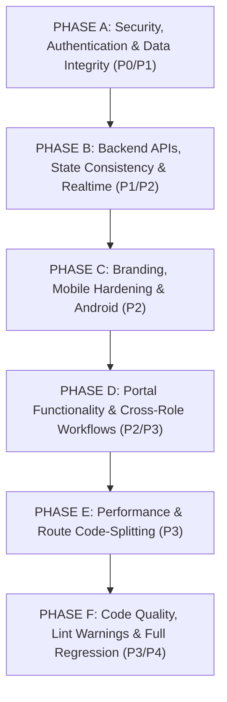

# AARIZO — PHASED IMPLEMENTATION ROADMAP & EXECUTION PLAN
**Document Version:** 1.0.0  
**Phase:** Phase 2 — Implementation Planning  
**Baseline Commit:** `4ace01876700d23af402ca785c48ae060b16e53d`  
**Execution Horizon:** Controlled, Non-Destructive Phased Execution  

---

## 1. Roadmap Architecture & Execution Principles

This roadmap organizes all necessary technical enhancements, security hardening, bug fixes, and performance optimizations into **6 structured execution phases**.

### Operating Rules for Implementation:
1. **Strict Dependency Order**: Security gates and data storage contracts must be resolved before workflow enhancements.
2. **Zero Inventions**: Every task directly maps to an authoritative issue in `AARIZO_MASTER_ISSUE_REGISTER.md`.
3. **No Breaking Framework Migrations**: All changes preserve the existing React 19, Vite 8, Tailwind CSS 4, Capacitor 8, Express, Prisma 6, and PostgreSQL architecture.
4. **Isolated Regression Verification**: Each phase concludes with independent build, lint, and test validation before proceeding to the next.

---

## 2. Phased Implementation Breakdown

---

### PHASE A: Security, Authentication & Data Integrity
**Objective**: Eliminate critical vulnerabilities, prevent client privilege escalation, and align authentication storage.
**Target Issues**: `ISSUE-01` [P0], `ISSUE-02` [P0], `ISSUE-03` [P1], `ISSUE-04` [P1], `ISSUE-05` [P1].

#### Tasks:
1. **Task A.1 [P0] — Secure Developer Database Studio**:
   - Files: [src/routes/index.tsx](file:///d:/AAZIRA/AARIZO/src/routes/index.tsx)
   - Action: Move `/dev/database` and `/dev/db` inside `ProtectedRoute` with `allowedRoles={['admin']}`, guarded by `import.meta.env.DEV`.
2. **Task A.2 [P0] — Enforce Authoritative Token Verification on Express Routes**:
   - Files: [server/src/index.ts](file:///d:/AAZIRA/AARIZO/server/src/index.ts), [server/src/auth.ts](file:///d:/AAZIRA/AARIZO/server/src/auth.ts)
   - Action: Prepend `authenticateFirebaseToken` to all protected `/api/*` endpoints to eliminate client header spoofing (`x-user-role`).
3. **Task A.3 [P1] — Unify Client Authentication Storage Keys**:
   - Files: [src/context/AuthContext.tsx](file:///d:/AAZIRA/AARIZO/src/context/AuthContext.tsx), [src/services/apiClient.ts](file:///d:/AAZIRA/AARIZO/src/services/apiClient.ts), [src/repositories/BaseRepository.ts](file:///d:/AAZIRA/AARIZO/src/repositories/BaseRepository.ts)
   - Action: Export shared constant `AUTH_USER_STORAGE_KEY = 'aarizo_user'`. Replace divergent `dwellora_user` key.
4. **Task A.4 [P1] — Provide Development Environment Configuration**:
   - Files: `.env`, `server/.env`
   - Action: Document and generate clean `.env` files from `.env.example` with local PostgreSQL connection parameters.
5. **Task A.5 [P1] — Compute Password Hashes for Seeded Accounts**:
   - Files: [server/src/seed.ts](file:///d:/AAZIRA/AARIZO/server/src/seed.ts)
   - Action: Update `seed.ts` to compute 16-byte salts and SHA-256 HMAC hashes for default users (`dwellora@2026`).

**Verification Gate A**:
- Unauthenticated visit to `/dev/database` redirects to `/login`.
- `curl -H "x-user-role: admin" http://localhost:5000/api/towers` returns HTTP 401.
- Logging in via `/login` sets `aarizo_user` and successfully calls `apiClient`.
- Default credentials for `vikram.joshi@aarizo.com` authenticate via `POST /api/auth/login`.

---

### PHASE B: Backend APIs, State Consistency & Realtime Stability
**Objective**: Fix split-brain state between local cache and database, and stabilize the realtime outbox worker.
**Target Issues**: `ISSUE-06` [P1], `ISSUE-07` [P2], `ISSUE-08` [P2].

#### Tasks:
1. **Task B.1 [P1] — Authoritative API Persistence with Offline Indicator**:
   - Files: [src/services/societyService.ts](file:///d:/AAZIRA/AARIZO/src/services/societyService.ts), [src/services/visitorService.ts](file:///d:/AAZIRA/AARIZO/src/services/visitorService.ts), [src/services/childSafetyService.ts](file:///d:/AAZIRA/AARIZO/src/services/childSafetyService.ts)
   - Action: Update client services to treat PostgreSQL Express API as the primary authority, using LocalStorage as cache rather than an independent split datastore.
2. **Task B.2 [P2] — Outbox Poller Failure Backoff**:
   - Files: [server/src/realtimeEngine.ts](file:///d:/AAZIRA/AARIZO/server/src/realtimeEngine.ts)
   - Action: Add exponential backoff (500ms -> 2s -> 5s -> 15s) in `startOutboxWorker()` when database errors occur, preventing terminal log flood.
3. **Task B.3 [P2] — Rate Limiter Hardening**:
   - Files: [server/src/auth.ts](file:///d:/AAZIRA/AARIZO/server/src/auth.ts)
   - Action: Add `trust proxy` configuration in Express for accurate client IP resolution behind reverse proxies.

**Verification Gate B**:
- Terminal logs remain clean when PostgreSQL is disconnected.
- Visitor pass created on one client syncs reliably to PostgreSQL and other connected clients via SSE.

---

### PHASE C: Branding, Mobile Hardening & Android Container
**Objective**: Unify application branding under AARIZO and prepare Android native container.
**Target Issues**: `ISSUE-09` [P2], `ISSUE-10` [P2], `ISSUE-13` [P3].

#### Tasks:
1. **Task C.1 [P2] — Unify Product Branding to AARIZO**:
   - Files: [src/components/auth/login/LoginScreen.tsx](file:///d:/AAZIRA/AARIZO/src/components/auth/login/LoginScreen.tsx), [index.html](file:///d:/AAZIRA/AARIZO/index.html), [package.json](file:///d:/AAZIRA/AARIZO/package.json), [server/package.json](file:///d:/AAZIRA/AARIZO/server/package.json)
   - Action: Update title from `"Sign In to Dwellora"` to `"Sign In to AARIZO"`. Update `<title>AARIZO</title>` in `index.html`. Update package names to `"aarizo"` and `"aarizo-backend"`.
2. **Task C.2 [P2] — Android FCM Configuration Template**:
   - Files: `android/app/`
   - Action: Document setup and place template `google-services.json` to enable push notification compilation.
3. **Task C.3 [P3] — Capacitor Sync Script Pre-requisite**:
   - Files: [package.json](file:///d:/AAZIRA/AARIZO/package.json)
   - Action: Update `"cap:sync": "npm run build && npx cap sync"`.

**Verification Gate C**:
- Browser tab displays `"AARIZO"`.
- Login page displays `"Sign In to AARIZO"`.
- `npm run cap:sync` executes cleanly on a fresh clone without manual build.

---

### PHASE D: Portal Functionality & Cross-Role Workflows
**Objective**: Verify and polish end-to-end workflows across all 7 discovered roles.
**Target Issues**: `ISSUE-06` [P1], Cross-role verification.

#### Tasks:
1. **Task D.1 — Resident & Visitor Pass Lifecycle**:
   - Verify pass creation -> QR generation -> Guard scanner check-in -> Resident real-time alert -> Overstay detection.
2. **Task D.2 — Child Safety & Caretaker Verification**:
   - Verify child enrollment -> pickup pass generation -> Guard photo match -> parent notification dispatch.
3. **Task D.3 — Society Secretary & Resident Provisioning**:
   - Verify atomic provisioning of society, towers, flats, and residents with explicit salted passwords.
4. **Task D.4 — Committee Approvals & Health Scorecard**:
   - Verify resolution uploading, high-value expense reviews, and trust score computation.
5. **Task D.5 — Facility Manager Work Orders & Shifts**:
   - Verify maintenance task assignment, priority triage, and AMC contract countdowns.

**Verification Gate D**:
- All 12 business workflows execute smoothly across respective portal layouts.

---

### PHASE E: Performance & Route Code-Splitting
**Objective**: Optimize frontend bundle size and initial mobile load times.
**Target Issues**: `ISSUE-11` [P3].

#### Tasks:
1. **Task E.1 [P3] — Route-Level Code Splitting via `React.lazy()`**:
   - Files: [src/routes/index.tsx](file:///d:/AAZIRA/AARIZO/src/routes/index.tsx)
   - Action: Convert synchronous dashboard page imports into `React.lazy(() => import(...))` wrapped with `<Suspense fallback={<SplashScreen />}>`.
2. **Task E.2 [P3] — Vite Chunk Splitting Strategy**:
   - Files: [vite.config.ts](file:///d:/AAZIRA/AARIZO/vite.config.ts)
   - Action: Configure `build.rollupOptions.output.manualChunks` for vendor dependencies (`react`, `react-router-dom`, `lucide-react`, `firebase`).

**Verification Gate E**:
- Vite build produces zero chunks exceeding 500 kB.
- Initial bundle size drops from 2.72 MB to under 350 kB.

---

### PHASE F: Code Quality, Lint Warnings & Regression Baseline
**Objective**: Eliminate all 216 Oxlint warnings and establish a comprehensive test regression suite.
**Target Issues**: `ISSUE-12` [P3], `ISSUE-14` [P4].

#### Tasks:
1. **Task F.1 [P3] — Fix Impure Function Calls During Render**:
   - Files: [src/pages/dashboard/resident/ResidentAmenityBookingPage.tsx](file:///d:/AAZIRA/AARIZO/src/pages/dashboard/resident/ResidentAmenityBookingPage.tsx)
   - Action: Move `Date.now()` calculation into state/event handlers instead of direct JSX attributes.
2. **Task F.2 [P3] — Fix Synchronous `setState` Inside `useEffect`**:
   - Files: `useMoves.ts`, `CommitteeDashboard.tsx`, `BillingManagementPage.tsx`
   - Action: Refactor effects to derive state during render or trigger updates from events.
3. **Task F.3 [P3] — Clean Up Unused Variables & Catch Parameters**:
   - Files: Repository mapper classes.
   - Action: Prefix unused variables with `_`.
4. **Task F.4 [P4] — Firebase Emulator Test Script**:
   - Files: `package.json`, `tests/security.test.ts`
   - Action: Add `"test:all"` script that boots Firebase emulator before running Jest.

**Verification Gate F**:
- `npm run lint` finishes with **0 errors and 0 warnings**.
- `npm test` runs 100% of tests including Firestore security rules.
- `npm run build` and `npm run server:build` succeed cleanly.

