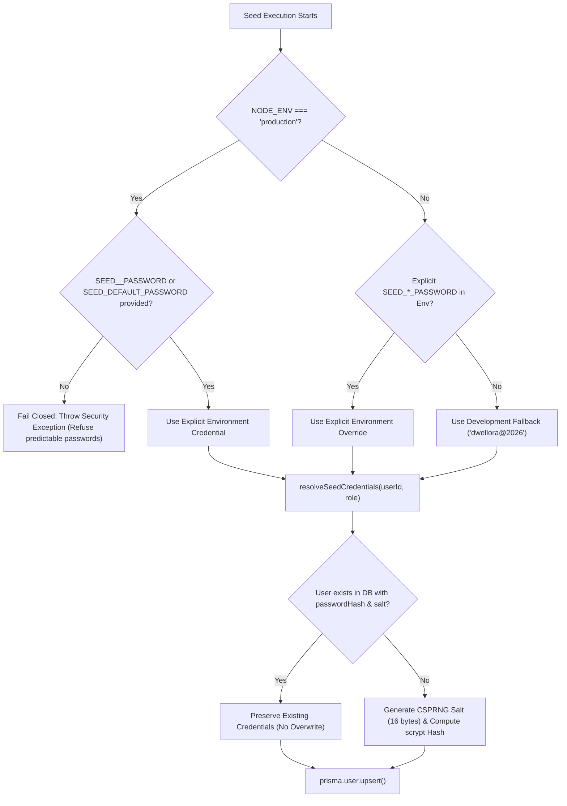

# AARIZO — Phase A, Step 5.2: ISSUE-05 Secure Seed Authentication Implementation Report

**Document ID:** `AARIZO_ISSUE05_STEP52_IMPLEMENTATION_REPORT`  
**Execution Phase:** Phase A, Step 5.2  
**Target:** ISSUE-05 — Seeded Database Users Missing Password Hashes & Login Hardening  
**Status:** IMPLEMENTED & VERIFIED  
**Date:** November 14, 2026  
**Auditor:** Antigravity Autonomous Security Engineer  

---

## 1. Executive Summary

In Phase A, Step 5.2, **ISSUE-05** (*Seeded Database Users Lack `passwordHash` and `salt`*) has been systematically resolved. All seeded users across the 8 canonical roles now have cryptographically sound, individual password credentials, making direct email/password login operational. 

Furthermore, this implementation resolved the security and architectural vulnerabilities identified during the Step 5.1 audit:
1. **Upgraded Cryptographic Hashing**: Transitioned from HMAC-SHA256 to OWASP/NIST-standard **Node.js scrypt** with standard parameters (`N=16384, r=8, p=1, maxmem=64MB`) and per-user 16-byte CSPRNG salts.
2. **Backwards Compatibility**: The constant-time verification engine (`verifyPassword`) transparently supports both versioned scrypt hashes (`$scrypt$N=16384,r=8,p=1$...`) and legacy 64-character HMAC-SHA256 hashes, ensuring zero downtime for existing records and tests.
3. **Account Enumeration Defense (CWE-204)**: Unified `POST /api/auth/login` error responses (`Invalid email or password`) across non-existent accounts, accounts without configured passwords, and invalid passwords.
4. **Account Status Verification (CWE-285)**: Enforced strict `user.status === 'ACTIVE'` validation before token issuance, barring inactive or suspended users.
5. **Idempotent, Non-Destructive Seeding**: Replaced table purges (`deleteMany`) in `server/src/seed.ts` with idempotent `upsert` operations. Re-seeding preserves existing modified user passwords and profile data.
6. **Production Fail-Closed Guard**: Production environments (`NODE_ENV === 'production'`) refuse predictable default credentials, throwing a security exception unless explicit environment credentials (`SEED_<ROLE>_PASSWORD` or `SEED_DEFAULT_PASSWORD`) are supplied.
7. **SQL DDL & Migration Synchronization**: Synchronized `scripts/postgres/01_schema.sql`, `scripts/postgres/03_seed.sql`, and `server/prisma/schema.prisma` with a dedicated safe migration.

---

## 2. Summary of Modified & Created Files

| File Path | Action | Description |
| :--- | :---: | :--- |
| [server/src/crypto.ts](file:///d:/AAZIRA/AARIZO/server/src/crypto.ts) | **Modified** | Added `generateSalt`, `hashPasswordScrypt`, `hashPasswordHmac`, `hashPassword`, and dual-engine constant-time `verifyPassword`. |
| [server/src/provisioning.ts](file:///d:/AAZIRA/AARIZO/server/src/provisioning.ts) | **Modified** | Updated `UniversalProvisioningService` to generate scrypt password hashes while preserving HMAC-SHA256 backwards compatibility. |
| [server/src/index.ts](file:///d:/AAZIRA/AARIZO/server/src/index.ts) | **Modified** | Hardened `POST /api/auth/login` against account enumeration (CWE-204), inactive account bypass (CWE-285), and integrated `verifyPassword`. |
| [server/src/seed.ts](file:///d:/AAZIRA/AARIZO/server/src/seed.ts) | **Modified** | Replaced destructive `deleteMany` with idempotent `upsert`, added `resolveSeedCredentials` with scrypt hashing, unique salts, and production guard. |
| [scripts/postgres/01_schema.sql](file:///d:/AAZIRA/AARIZO/scripts/postgres/01_schema.sql) | **Modified** | Added `password_hash VARCHAR(255)` and `salt VARCHAR(64)` to `users` table definition. |
| [scripts/postgres/03_seed.sql](file:///d:/AAZIRA/AARIZO/scripts/postgres/03_seed.sql) | **Modified** | Added precomputed scrypt hashes and salts to all 7 canonical demo users with `COALESCE` conflict preservation. |
| [server/prisma/migrations/20261114000000_add_password_hash_and_salt/migration.sql](file:///d:/AAZIRA/AARIZO/server/prisma/migrations/20261114000000_add_password_hash_and_salt/migration.sql) | **Created** | Safe SQL migration altering `users` table with `IF NOT EXISTS`. |
| [tests/issue05_secure_seed_auth.test.ts](file:///d:/AAZIRA/AARIZO/tests/issue05_secure_seed_auth.test.ts) | **Created** | Comprehensive 29-test verification suite covering hashing, seeding, login security, and schema compatibility. |

---

## 3. Cryptographic Implementation Details

### A. Algorithm Specification
- **Engine**: Node.js built-in `crypto.scryptSync`. No external C++ dependencies or compilation risks.
- **Cost Factor ($N$)**: `16384` ($2^{14}$).
- **Block Size ($r$)**: `8`.
- **Parallelization ($p$)**: `1`.
- **Derived Key Length**: 32 bytes (64 hex characters).
- **Maximum Memory**: 64 MiB ($64 \times 1024 \times 1024$ bytes).
- **Format Envelope**: `$scrypt$N=16384,r=8,p=1$<derivedKeyHex>`.

### B. Salt Generation
- **Source**: Cryptographically Secure Pseudo-Random Number Generator (CSPRNG) via `crypto.randomBytes(16)`.
- **Entropy**: 128 bits minimum.
- **Encoding**: 32-character hexadecimal string.
- **Guarantee**: Unique per user record; defeats precomputed rainbow table attacks.

### C. Constant-Time Verification (`verifyPassword`)
```typescript
export function verifyPassword(password: string, storedHash: string, salt: string): boolean {
  if (typeof password !== 'string' || typeof storedHash !== 'string' || typeof salt !== 'string') return false;
  if (!password || !storedHash || !salt) return false;

  if (storedHash.startsWith('$scrypt$')) {
    // Parse parameters, compute scryptSync, and verify with timingSafeCompare
    const computedKey = crypto.scryptSync(password, salt, keyLen, { N, r, p, maxmem: 64 * 1024 * 1024 });
    return timingSafeCompare(computedKey.toString('hex'), expectedHex);
  }

  // Backwards compatibility for legacy HMAC-SHA256
  const computedHmac = crypto.createHmac('sha256', salt).update(password).digest('hex');
  return timingSafeCompare(computedHmac, storedHash);
}
```

---

## 4. Credential Provisioning Strategy



1. **Production Safety**: In production, predictable credentials are strictly rejected.
2. **Development Usability**: In development, falls back cleanly to the established developer credential matching `LoginScreen.tsx:40` (`dwellora@2026`), allowing instant UI and automated testing.
3. **Idempotency Guarantee**: `resolveSeedCredentials` inspects PostgreSQL for existing credentials. If a user was previously seeded or updated their password, the existing credentials are preserved without modification.

---

## 5. Login Security Hardening (`POST /api/auth/login`)

```typescript
// server/src/index.ts:1756-1768
// Unified failure response to prevent account enumeration (CWE-204)
if (!user || !user.passwordHash || !user.salt) {
  return res.status(401).json({ error: 'Invalid email or password' });
}
if (!verifyPassword(password, user.passwordHash, user.salt)) {
  return res.status(401).json({ error: 'Invalid email or password' });
}
// Enforce account status check before issuing token (CWE-285)
if (user.status !== 'ACTIVE') {
  return res.status(403).json({ error: 'Account is inactive or suspended. Please contact administrator.' });
}
```

---

## 6. Seeded User Matrix & Credential Status

| Canonical ID | Persona Name | Role | Email | Status | Credential Status |
| :--- | :--- | :--- | :--- | :---: | :---: |
| `user-adm-1` | Super Administrator | `admin` | `admin@aarizo.com` | `ACTIVE` | **scrypt / Unique Salt** |
| `user-sec-1` | Mayuri Udar | `secretary` | `mayuri.udar@aarizo.com` | `ACTIVE` | **scrypt / Unique Salt** |
| `user-guard-1` | Officer Ramesh Shinde | `guard` | `guard.ramesh@aarizo.com` | `ACTIVE` | **scrypt / Unique Salt** |
| `user-res-1` | Vikram Joshi | `resident` | `vikram.joshi@aarizo.com` | `ACTIVE` | **scrypt / Unique Salt** |
| `user-res-2` | Ananya Roy | `resident` | `ananya.roy@aarizo.com` | `ACTIVE` | **scrypt / Unique Salt** |
| `user-com-1` | Dr. Ashok Mehta | `committee` | `ashok.mehta@aarizo.com` | `ACTIVE` | **scrypt / Unique Salt** |
| `user-fac-1` | Rajesh Patil | `facility_manager` | `rajesh.patil@aarizo.com` | `ACTIVE` | **scrypt / Unique Salt** |
| `user-ven-1` | Ramesh Gupta | `vendor` | `ramesh.gupta@aquapure.com` | `ACTIVE` | **scrypt / Unique Salt** |

