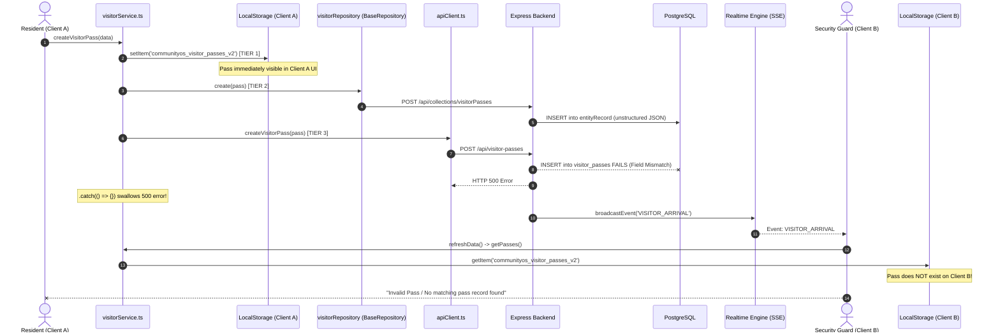

# AARIZO — ISSUE-06 Independent Code Audit

**Target**: ISSUE-06 — Tri-Tier State Desynchronization (LocalStorage vs PostgreSQL vs Firestore / BaseRepository)  
**Priority**: P1 (High Severity — Data Integrity & Cross-Device Operational Blocker)  
**Mode**: STRICT AUDIT ONLY — NO CODE MODIFICATIONS  
**Audit Date**: 2026-11-17  
**Workspace**: `D:\AAZIRA\AARIZO`  

---

## 1. Architectural Analysis: The Tri-Tier State Model

During the migration from the original Firebase/LocalStorage prototype to the production PostgreSQL backend, the application codebase retained three overlapping data access tiers that operate independently and contradict one another.

### The Three Incompatible Tiers:

1. **Tier 1 — Browser `localStorage` (Isolated Client Silos)**:
   - Implemented in `src/services/db.ts`, `src/services/visitorService.ts`, and `src/services/childSafetyService.ts`.
   - Synchronous, client-isolated key-value storage.
   - Pre-populated with hardcoded mock datasets (`SEED_PASSES`, `SEED_CHILDREN`, `SEED_SOCIETIES`).
   - Completely invisible to other browsers, mobile apps, or backend workers.
2. **Tier 2 — `BaseRepository` / Unstructured Entity Records**:
   - Implemented in `src/repositories/BaseRepository.ts` and inherited by `SocietyRepository`, `VisitorRepository`, `ChildRepository`, etc.
   - Submits requests to `/api/collections/:collection` using `authenticatedFetch`.
   - Handled in `server/src/index.ts#L3541-L3560` by inserting rows into `prisma.entityRecord` where the payload is stored as a generic JSON blob (`data`).
   - Completely bypassed by relational reporting queries, foreign keys, and Prisma relations.
3. **Tier 3 — Canonical Relational PostgreSQL Backend (`apiClient.ts` + Prisma)**:
   - Implemented in `src/services/apiClient.ts` and `server/src/index.ts`.
   - Relational tables defined in `server/prisma/schema.prisma` (`visitor_passes`, `children`, `societies`, `towers`, `flats`, `residents`).
   - Governed by ACID transactions, foreign keys, role-based access control, and domain validations.

---

## 2. In-Depth Lifecycle Traces

### 2.1 The Visitor Pass Lifecycle

| Step | Initiator | Code Path | Target Storage | Actual Result |
| :--- | :--- | :--- | :--- | :--- |
| **1. Pass Creation** | Resident on Mobile/Web | `VisitorPassHubPage.tsx` -> `visitorService.createVisitorPass()` | Tier 1 (`localStorage`), Tier 2 (`entityRecord`), Tier 3 (`visitor_passes`) | Tier 1 saves immediately. Tier 2 saves JSON blob. Tier 3 fails with HTTP 500 due to schema mismatch (`visitorPhone` vs `phone`), swallowed by `.catch()`. |
| **2. Pass Display** | Resident on Mobile/Web | `VisitorPassHubPage.tsx` -> `visitorService.getPasses()` | Tier 1 (`localStorage`) | Displays pass locally. Resident believes guest is authorized. |
| **3. Gate Arrival & Scan** | Security Guard on Terminal | `SecurityTerminalPage.tsx` -> `visitorService.validatePassCode()` | Tier 1 (`localStorage`) on Guard Terminal | Fails with `"Invalid Pass Code or QR. No matching pass record found"` because Guard `localStorage` does not contain the resident's pass. |
| **4. Guard Check-In** | Security Guard on Terminal | `visitorService.checkInVisitor()` | Tier 1 (`localStorage`), Tier 2 (`visitorRepository.update()`) | Does NOT call `apiClient.updateVisitorPass()` or `PATCH /api/visitor-passes/:id`. Even if checked in, the relational table never knows the visitor entered. |
| **5. Overstay & Checkout** | Background Engine / Guard | `POST /api/visitor-passes/check-overstay` & `visitorService.checkOutVisitor()` | Tier 3 (Relational DB) vs Tier 1 (`localStorage`) | Backend overstay detector queries `prisma.visitorPass`, finding no active check-in or outdated status; local client shows checked out. Complete split-brain. |

---

### 2.2 The Child Safety & Pickup QR Lifecycle

| Step | Initiator | Code Path | Target Storage | Actual Result |
| :--- | :--- | :--- | :--- | :--- |
| **1. Child Profile Creation** | Parent on Resident Portal | `ResidentChildSafetyPage.tsx` -> `childSafetyService.createChildProfile()` | Tier 1 (`localStorage`), Tier 2 (`childRepository`), Tier 3 (`apiClient.createChild`) | LocalStorage saved. Tier 2 & 3 fire unawaited background promises. If network drops, only local browser has record. |
| **2. Pickup QR Generation** | Parent on Resident Portal | `childSafetyService.generatePickupQR()` | Tier 1 (`localStorage`), Tier 3 (`apiClient.createChildPass`) | Unawaited `.catch(() => {})`. QR pass exists in parent's browser storage. |
| **3. Guard Gate Exit Scan** | Security Guard at Gate | `ChildGateScannerPage.tsx` -> `childSafetyService.verifyAndScanChildPickup()` | Tier 1 (`localStorage`) on Guard Terminal | Guard scans QR code. `verifyAndScanChildPickup` checks `this.getPickupQRs(societyId)` which reads Guard's `localStorage`. Fails with `"Invalid or unknown Child Pickup QR Code"`. Legitimate pickup is blocked. |
| **4. Missing Child Alert** | Parent or Admin | `childSafetyService.triggerMissingAlert()` | Tier 1 (`localStorage`) & `realtimeService.publish()` | Alert event broadcast over SSE, but Guard terminal re-reads local alerts from Guard `localStorage`. Alert fails to persist on Guard terminal. |

---

### 2.3 The Society, Flat & Resident Provisioning Lifecycle

| Step | Initiator | Code Path | Target Storage | Actual Result |
| :--- | :--- | :--- | :--- | :--- |
| **1. Society Setup** | Super Admin | `SocietySetupPage.tsx` -> `societyService.createSociety()` | Tier 1 (`localStorage`), Tier 2 (`societyRepository`), Tier 3 (`apiClient.createSociety`) | Unawaited dual writes. Society Admin logging in on another workstation cannot see newly created society if backend write lagged or failed. |
| **2. Tower Setup** | Society Secretary | `societyService.createTower()` | Tier 1 (`localStorage`), Tier 2 (`towerRepository`) | **`createTower` does not even call `apiClient.createTower`!** Towers exist only in `localStorage` and `entityRecord`, leaving relational `towers` table empty! |
| **3. Flat Creation** | Society Secretary | `FlatManagementPage.tsx` -> `societyService.createFlat()` | Tier 1 (`localStorage`), Tier 2 (`flatRepository`), Tier 3 (`apiClient.createFlat`) | Unawaited background promises. If flat creation fails on PostgreSQL, `societyService.createResident` proceeds anyway to create an orphan resident. |
| **4. Resident Provisioning** | Society Secretary | `FlatManagementPage.tsx` -> `apiClient.provisionUser()` & `societyService.createResident()` | PostgreSQL Users table vs Tier 1 / Tier 2 | User is created in auth database, but flat/resident record remains trapped in Secretary's `localStorage`. Resident logs in and sees no assigned flat or society! |

---

## 3. Root Cause Analysis

### RCA-1: Prototype Technical Debt (Mock Database Left in Place)
`src/services/db.ts` was initially written as an in-memory / `localStorage` prototype for UI demonstrations. When the PostgreSQL backend was built, the UI pages were never refactored to consume `apiClient` or async stores directly. Instead, wrapper services (`societyService`, `visitorService`, `childSafetyService`) continued reading from `db.ts` and `localStorage`, appending unawaited background calls to mimic server persistence.

### RCA-2: Dual Backend Systems (`BaseRepository` vs `apiClient`)
The codebase underwent a partial migration from Firebase Firestore to a custom NoSQL adapter (`BaseRepository` targeting `/api/collections/:collection` backed by `prisma.entityRecord`), and then to a typed relational REST API (`apiClient` targeting `/api/societies`, `/api/visitor-passes`, etc.). Domain services simultaneously wrote to both, fragmenting data between `entityRecord` and dedicated relational tables.

### RCA-3: Silent Fire-and-Forget Error Handling (`.catch(() => {})`)
Over 25 critical mutation calls across `societyService.ts`, `visitorService.ts`, and `childSafetyService.ts` use `.catch(() => {})` with empty callback handlers. Network failures, authorization rejections (HTTP 401/403), schema validation errors, and server crashes (HTTP 500) are silently discarded, creating false confidence in the UI that data was successfully stored.

### RCA-4: Mismatched Payloads and Prisma Schema Rejection
The frontend objects (`SmartVisitorPass`, `ChildProfile`) do not align with the Prisma schema fields:
- `SmartVisitorPass` uses `visitorPhone`, `category`, `validUntil`.
- Prisma `VisitorPass` requires `phone`, `passType`, `validTo`.
When `POST /api/visitor-passes` executes `prisma.visitorPass.create({ data: req.body })`, Prisma throws an `Unknown argument` validation exception, aborting the write and returning HTTP 500.

### RCA-5: SSE Cache Invalidation Disconnect
The realtime architecture properly pushes SSE events (`VISITOR_ARRIVAL`, `VISITOR_ENTRY`, etc.) to connected clients. However, the client event handlers simply invoke local getters (`visitorService.getPasses()`), which read from `localStorage`. Because the local cache was never rehydrated from the network, the incoming SSE trigger does not display the new data.

---

## 4. Edge Cases & Operational Failure Modes

1. **Multi-Device Gate Check-In Failure (Split-Brain)**:
   - Resident creates pass on phone.
   - Resident shares pass code `GVS-8492` or QR code with visitor.
   - Visitor arrives at gate.
   - Guard types `GVS-8492` or scans QR on Guard tablet.
   - **Failure**: Guard tablet reports "Pass Not Found". Guard denies entry or must manually bypass security.
2. **Offline Data Trapping**:
   - Secretary provisions flats while experiencing intermittent network disconnects.
   - Secretary sees flats in table and closes browser.
   - Database has zero records.
   - When Secretary returns on another browser or computer, all provisioned flats are gone.
3. **Ghost Users / Orphan Records**:
   - `FlatManagementPage.tsx` calls `apiClient.provisionUser()` and then `societyService.createResident()`.
   - If `createResident` backend call fails, user exists in `users` table with login credentials, but has no linked `resident` or `flat` record in PostgreSQL.
4. **Child Safety Critical Failure (Watchlist / Missing Alert)**:
   - Parent marks child as "MISSING" or revokes an authorized pickup person.
   - Alert saved only in parent's browser storage.
   - Security Guard scanner checks Guard's local storage and permits unauthorized pickup escort to exit with child.

---

## 5. Security & Compliance Impact Assessment

| Risk Category | Severity | Direct Impact |
| :--- | :--- | :--- |
| **Physical Security Breach** | **CRITICAL** | Guard terminal unable to validate resident passes leads guards to bypass electronic gates, rendering SafeGate physical security ineffective. |
| **Child Safety Non-Enforcement** | **CRITICAL** | Revoked escorts and missing child alerts failing to synchronize across gate checkpoints creates severe legal and physical liability. |
| **Audit Log Tampering & Loss** | **HIGH** | Audit events stored in client `localStorage` can be deleted or altered via browser developer tools. Non-blocking audit writes fail silently on network drop. |
| **Data Split-Brain & Inconsistency** | **HIGH** | Divergence between PostgreSQL database and local browsers causes phantom billing, incorrect occupancy figures, and unrecoverable data loss. |

---

## 6. Interplay with Completed Phase A Issues

- **ISSUE-01 (Database Access Control)**:
  - Ensured unauthenticated users cannot view raw data. `apiClient` now requires authenticated sessions.
- **ISSUE-02 (Unified Auth & SSE Authorization)**:
  - Hardened SSE streaming with session tokens. Realtime events now reach clients securely, making SSE cache rehydration feasible.
- **ISSUE-03 (Authentication Storage Consistency)**:
  - Standardized storage key to `aarizo_user` and token to `aarizo_token`. `apiClient` and `authenticatedFetch` now reliably attach valid Bearer tokens.
- **ISSUE-04 (Runtime Configuration & Shutdown)**:
  - Stabilized backend server runtime.
- **ISSUE-05 (Seed Password Hashing)**:
  - Demo accounts now have secure credentials in PostgreSQL, allowing API-first workflows to authenticate properly.

ISSUE-06 builds directly upon this hardened authentication and runtime foundation to make PostgreSQL the single authoritative source of truth.

