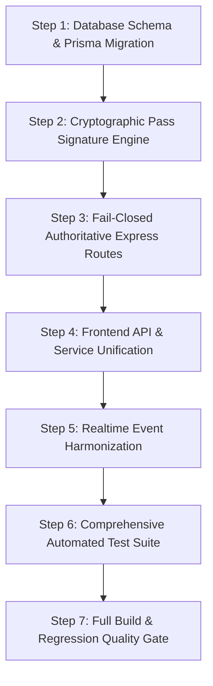

# AARIZO — ISSUE-06 Phase B.2: Approved Implementation Sequence

**Project:** `D:\AAZIRA\AARIZO`  
**Phase:** ISSUE-06 — B.2 Child Safety & Biometric Gate Radar  
**Document:** Phased Execution Sequence & Quality Gates  
**Status:** READY FOR IMPLEMENTATION APPROVAL — STRICT HOLD  

---

## 1. Safety Guardrails & Non-Negotiable Boundaries

Before commencing implementation of Phase B.2, the following boundaries must be maintained:
1. **Zero Regression on Phase B.1:** The 296 passing baseline tests across all 17 test suites must continue passing throughout all phases. No changes to `VisitorPass`, visitor entry logs, visitor routes, or visitor test suites are permitted.
2. **PostgreSQL Environment Safety:** The external container on port 5432 (`nexus-postgres`) must remain untouched. No live database migrations will be executed against it.
3. **Fail-Closed Multi-Tenancy:** Hardcoded `'soc-gvs'` fallback and query parameter/body overrides must be completely purged from all Child Safety code paths.
4. **No Silent Error Swallowing:** All remote operations must be `async/await` with real error propagation to the user interface.

---

## 2. Step-by-Step Implementation Sequence

---

### Step 1: Database Schema & Prisma Migration
- **Target File:** [server/prisma/schema.prisma](file:///D:/AAZIRA/AARIZO/server/prisma/schema.prisma)
- **Actions:**
  1. Add relations to existing models:
     - `Society`: Add `childProfiles ChildProfile[]`, `childPickups ChildAuthorizedPickup[]`, `childGatePasses ChildGatePass[]`, `childExitLogs ChildExitLog[]`.
     - `Resident`: Add `childProfiles ChildProfile[]`.
     - `Flat`: Add `childProfiles ChildProfile[]`.
  2. Add new models:
     - `ChildProfile`
     - `ChildAuthorizedPickup`
     - `ChildGatePass`
     - `ChildExitLog`
  3. Create migration SQL file: `server/prisma/migrations/20261118000000_add_child_safety_models/migration.sql`.
  4. Validate schema using pinned Prisma CLI:
     `npm --prefix server exec prisma -- validate --schema=server/prisma/schema.prisma`.

---

### Step 2: Cryptographic HMAC Pass Signature Engine
- **Target File:** [server/src/crypto.ts](file:///D:/AAZIRA/AARIZO/server/src/crypto.ts)
- **Actions:**
  1. Add `signChildPassPayload(payload: ChildPassPayload): string`.
  2. Add `verifyChildPassPayload(payload: ChildPassPayload, signature: string): boolean`.
  3. Ensure signature incorporates `passCode`, `childId`, `societyId`, `validUntil`, and secret pepper.
  4. Export client-compatible offline payload generator.

---

### Step 3: Hardened, Fail-Closed Express Endpoints
- **Target File:** [server/src/index.ts](file:///D:/AAZIRA/AARIZO/server/src/index.ts)
- **Actions:**
  Replace lines 2658–2786 with authoritative, role-protected, fail-closed endpoints:
  1. `GET /api/children`:
     - `requireRole(['resident', 'guard', 'secretary', 'admin'])`.
     - Fail closed on missing `req.societyId`. Reject foreign `?societyId=`.
     - If role is `resident`, filter strictly by `residentId === req.userId`.
  2. `POST /api/children`:
     - `requireRole(['resident', 'secretary', 'admin'])`.
     - Set `societyId` strictly from `req.societyId`.
     - If role is `resident`, set `residentId` strictly to `req.userId`.
  3. `GET /api/children/:id`:
     - Fail closed on tenant mismatch. Resident can only access child in their custody.
  4. `PATCH /api/children/:id`:
     - Update child profile, emergency contacts, medical notes, or solo exit flag.
  5. `GET /api/children/passes`:
     - `requireRole(['resident', 'guard', 'secretary', 'admin'])`.
     - If resident, scope to resident's children. If guard/admin, return society passes.
  6. `POST /api/children/passes`:
     - `requireRole(['resident', 'secretary', 'admin'])`.
     - Verify child belongs to resident.
     - Generate unique pass code (`CGP-...`) and HMAC signature.
     - Persist `ChildGatePass` to PostgreSQL.
  7. `POST /api/children/passes/verify`:
     - `requireRole(['guard', 'secretary', 'admin'])`.
     - Atomic verification: query by `passCode` scoped strictly to `societyId: req.societyId`.
     - Recheck: not expired (`validUntil >= now`), status is `ACTIVE`, child status is not `MISSING`, `currentUses < maxUses`.
     - Atomic transaction: increment `currentUses`, update child status to `OUT_OF_SOCIETY`, record immutable `ChildExitLog`.
  8. `POST /api/children/sos`:
     - `requireRole(['resident', 'guard', 'secretary', 'admin'])`.
     - Flag child as `MISSING`, create `EmergencyIncident`, broadcast alert.

---

### Step 4: Frontend API Client & Service Unification
- **Target Files:**
  - [src/services/apiClient.ts](file:///D:/AAZIRA/AARIZO/src/services/apiClient.ts)
  - [src/services/childSafetyService.ts](file:///D:/AAZIRA/AARIZO/src/services/childSafetyService.ts)
  - [src/domains/safety/services/safetyCommandEngine.ts](file:///D:/AAZIRA/AARIZO/src/domains/safety/services/safetyCommandEngine.ts)
  - [src/domains/safety/components/SafetyCommandHub.tsx](file:///D:/AAZIRA/AARIZO/src/domains/safety/components/SafetyCommandHub.tsx)
  - [src/pages/dashboard/security/ChildGateScannerPage.tsx](file:///D:/AAZIRA/AARIZO/src/pages/dashboard/security/ChildGateScannerPage.tsx)
- **Actions:**
  1. In `apiClient.ts`:
     - Update `verifyChildPass` signature to `{ code, gateId, guardName }`.
  2. In `childSafetyService.ts`:
     - Remove empty `.catch(() => {})` swallowers; make all calls awaited.
     - Query backend `/api/children` and `/api/children/passes` as authoritative data source.
     - Update local cache safely as secondary read cache.
  3. In `safetyCommandEngine.ts`:
     - Remove duplicate storage keys `aarizo_child_profiles_v3` and `aarizo_pickup_records_v3`.
     - Delegate child and pass management directly to `childSafetyService`.
  4. In `SafetyCommandHub.tsx`:
     - Connect modal buttons ("Generate Pass", "Add Child") to real service methods.
  5. In `ChildGateScannerPage.tsx`:
     - Connect scan handler to `childSafetyService.verifyAndScanChildPickup` which calls `apiClient.verifyChildPass`.
     - Provide fail-closed cryptographic offline verification fallback if network is unreachable.

---

### Step 5: Realtime Event Harmonization
- **Actions:**
  Harmonize backend event broadcasts and frontend subscription channels:
  - `CHILD_PROFILE_CREATED` -> Reloads lists in `SafetyCommandHub` and `AdminChildSafetyPage`.
  - `CHILD_GATE_PASS_GENERATED` -> Updates active pass lists on gate terminals.
  - `CHILD_GATE_PASS_VERIFIED` -> Notifies resident app in realtime that their child has exited the gate.
  - `CHILD_SAFETY_SOS_TRIGGERED` -> Displays high-priority visual alert on all security terminals.

---

### Step 6: Automated Test Suite Implementation
- **Target File:** `tests/issue06_child_safety_routes.test.ts`
- **Actions:**
  Build Supertest route integration tests covering:
  1. Rejection of unauthenticated requests with 401 `AUTH_TOKEN_MISSING`.
  2. Rejection of requests lacking society context with 403 `TENANT_CONTEXT_REQUIRED`.
  3. Rejection of cross-tenant query overrides with 403 `TENANT_ISOLATION_VIOLATION`.
  4. Resident role scoping (resident can only see their own children and passes).
  5. Guard and Admin permissions.
  6. Pass verification:
     - Cross-society pass verification rejection (Guard in Soc A verifying Soc B pass).
     - Replay protection (used pass cannot be re-verified).
     - Expiry protection (expired pass cannot be verified).
     - Missing child block (pass for child marked MISSING is denied and triggers alert).
     - Successful checkout flow and `ChildExitLog` creation.
  7. SOS alert triggering and incident creation.

---

### Step 7: Build & Regression Quality Gate
- **Actions:**
  1. Run `npm test` -> All 296 baseline tests + all new Child Safety tests must pass (Target: >= 315 tests passing, 0 failures).
  2. Run `npm --prefix server run build` -> Backend TypeScript build must succeed with zero errors.
  3. Run `npm run build` -> Frontend TypeScript build must succeed with zero errors.
  4. Conduct final independent read-only verification before conditional closure.

---

## 3. Approval Gate & Standstill

In accordance with strict safety instructions, implementation will **NOT** begin until the user reviews these validation reports and issues an explicit instruction to proceed with Phase B.2 implementation.

