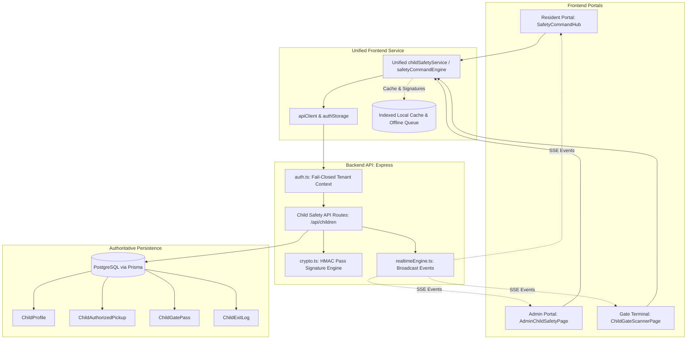

# AARIZO — ISSUE-06 Phase B.2: Child Safety Remediation Plan

**Project:** `D:\AAZIRA\AARIZO`  
**Phase:** ISSUE-06 — B.2 Child Safety & Biometric Gate Radar  
**Document:** Remediation & Technical Implementation Blueprint  
**Mode:** ARCHITECTURAL SPECIFICATION — PENDING IMPLEMENTATION APPROVAL  
**Status:** READY FOR REVIEW  

---

## 1. Architectural Remediation Overview

The objective of Phase B.2 is to eliminate the tri-tier state desynchronization in Child Safety by making PostgreSQL the single authoritative source of truth, while providing fail-closed cryptographically validated offline gate verification and multi-tenant security.



---

## 2. PostgreSQL & Prisma Schema Blueprint

We will define first-class relational models in `server/prisma/schema.prisma` replacing the unstructured `EntityRecord` JSON blobs.

### 2.1 Prisma Models Specification
```prisma
model ChildProfile {
  id                String                 @id @default(uuid())
  societyId         String                 @map("society_id")
  residentId        String                 @map("resident_id")
  flatId            String?                @map("flat_id")
  flatNumber        String                 @map("flat_number")
  fullName          String                 @map("full_name")
  dateOfBirth       DateTime               @map("date_of_birth")
  gender            String                 @default("MALE") // MALE, FEMALE, OTHER
  photoUrl          String?                @map("photo_url")
  medicalNotes      String?                @map("medical_notes")
  status            String                 @default("SAFE") // SAFE, OUT_OF_SOCIETY, MISSING
  allowedSoloExit   Boolean                @default(false) @map("allowed_solo_exit")
  guardianName      String                 @map("guardian_name")
  guardianPhone     String                 @map("guardian_phone")
  emergencyPhone    String?                @map("emergency_phone")
  createdAt         DateTime               @default(now()) @map("created_at")
  updatedAt         DateTime               @updatedAt @map("updated_at")

  society           Society                @relation(fields: [societyId], references: [id], onDelete: Cascade)
  resident          User                   @relation(fields: [residentId], references: [id], onDelete: Cascade)
  pickups           ChildAuthorizedPickup[]
  passes            ChildGatePass[]
  exitLogs          ChildExitLog[]

  @@index([societyId, status])
  @@index([residentId])
  @@index([societyId, flatNumber])
  @@map("child_profiles")
}

model ChildAuthorizedPickup {
  id                String       @id @default(uuid())
  childId           String       @map("child_id")
  societyId         String       @map("society_id")
  name              String
  phone             String
  relationship      String       // Parent, Nanny, Grandparent, Driver, Relative, Other
  idProofType       String       @map("id_proof_type") // Aadhaar, Passport, Driving License, Voter ID
  idProofNumber     String       @map("id_proof_number")
  photoUrl          String?      @map("photo_url")
  status            String       @default("ACTIVE") // ACTIVE, REVOKED, EXPIRED
  validUntil        DateTime?    @map("valid_until")
  createdAt         DateTime     @default(now()) @map("created_at")
  updatedAt         DateTime     @updatedAt @map("updated_at")

  child             ChildProfile @relation(fields: [childId], references: [id], onDelete: Cascade)
  passes            ChildGatePass[]

  @@index([childId, status])
  @@index([societyId])
  @@map("child_authorized_pickups")
}

model ChildGatePass {
  id                String                 @id @default(uuid())
  passCode          String                 @unique @map("pass_code")
  societyId         String                 @map("society_id")
  childId           String                 @map("child_id")
  pickupPersonId    String?                @map("pickup_person_id")
  pickupPersonName  String                 @map("pickup_person_name")
  pickupPersonPhone String?                @map("pickup_person_phone")
  validFrom         DateTime               @map("valid_from")
  validUntil        DateTime               @map("valid_until")
  status            String                 @default("ACTIVE") // ACTIVE, USED, EXPIRED, REVOKED
  maxUses           Int                    @default(1) @map("max_uses")
  currentUses       Int                    @default(0) @map("current_uses")
  signature         String?                // HMAC-SHA256 signature for offline gate validation
  notes             String?
  createdById       String                 @map("created_by_id")
  createdAt         DateTime               @default(now()) @map("created_at")
  updatedAt         DateTime               @updatedAt @map("updated_at")

  society           Society                @relation(fields: [societyId], references: [id], onDelete: Cascade)
  child             ChildProfile           @relation(fields: [childId], references: [id], onDelete: Cascade)
  pickupPerson      ChildAuthorizedPickup? @relation(fields: [pickupPersonId], references: [id], onDelete: SetNull)
  exitLogs          ChildExitLog[]

  @@index([societyId, status])
  @@index([childId])
  @@index([passCode])
  @@map("child_gate_passes")
}

model ChildExitLog {
  id                String        @id @default(uuid())
  societyId         String        @map("society_id")
  childId           String        @map("child_id")
  passId            String?       @map("pass_id")
  childName         String        @map("child_name")
  flatNumber        String        @map("flat_number")
  pickupPersonName  String        @map("pickup_person_name")
  pickupPersonPhone String?       @map("pickup_person_phone")
  gateId            String        @map("gate_id")
  guardId           String        @map("guard_id")
  guardName         String        @map("guard_name")
  status            String        // ALLOWED, DENIED, OFFLINE_VERIFIED, MISSING_ALERT_BLOCKED
  notes             String?
  timestamp         DateTime      @default(now())

  society           Society       @relation(fields: [societyId], references: [id], onDelete: Cascade)
  child             ChildProfile  @relation(fields: [childId], references: [id], onDelete: Cascade)
  pass              ChildGatePass? @relation(fields: [passId], references: [id], onDelete: SetNull)

  @@index([societyId, timestamp])
  @@index([childId])
  @@map("child_exit_logs")
}
```

---

## 3. Backend REST API Endpoints Specification

All endpoints in `server/src/index.ts` will strictly adopt fail-closed tenant validation, consistent with Phase B.1:
1. `societyId` is derived exclusively from `req.societyId` (verified JWT session context).
2. Missing, empty, or unassigned `societyId` causes immediate rejection with `HTTP 403 Forbidden` (`NO_SOCIETY_CONTEXT`).
3. Query and body overrides (`req.query.societyId`, `req.body.societyId`) are strictly forbidden.
4. Hardcoded `'soc-gvs'` fallback is completely eliminated.

### 3.1 Endpoint Specifications

#### 1. `GET /api/children`
- **Middleware:** `authenticateToken`, `requireRole(['resident', 'guard', 'secretary', 'admin'])`
- **Logic:**
  - If `userRole === 'resident'`: Query `prisma.childProfile.findMany({ where: { societyId, residentId: req.userId } })`.
  - If `guard`, `admin`, `secretary`: Query `prisma.childProfile.findMany({ where: { societyId } })`.
- **Response:** Array of child profiles including authorized pickups.

#### 2. `POST /api/children`
- **Middleware:** `authenticateToken`, `requireRole(['resident', 'secretary', 'admin'])`
- **Validation:**
  - `fullName`, `dateOfBirth`, `flatNumber`, `guardianName`, `guardianPhone` are mandatory.
  - If `userRole === 'resident'`, `residentId` is set strictly to `req.userId`.
- **Logic:** Inserts `ChildProfile`, broadcasts `CHILD_PROFILE_CREATED`.
- **Response:** 201 Created with persisted child profile.

#### 3. `GET /api/children/passes`
- **Middleware:** `authenticateToken`, `requireRole(['resident', 'guard', 'secretary', 'admin'])`
- **Logic:**
  - If `resident`: Query passes where `child.residentId === req.userId`.
  - If `guard`, `admin`, `secretary`: Query active/recent passes in society.
- **Response:** Array of child gate passes.

#### 4. `POST /api/children/passes`
- **Middleware:** `authenticateToken`, `requireRole(['resident', 'secretary', 'admin'])`
- **Validation:**
  - Validates `childId` belongs to `societyId`.
  - If caller is `resident`, verifies child belongs to resident's flat/custody.
  - Generates secure unique `passCode` (`CGP-...`) and HMAC-SHA256 signature `signChildPassPayload(...)` for offline gate verification.
- **Logic:** Inserts `ChildGatePass`, broadcasts `CHILD_GATE_PASS_GENERATED`.
- **Response:** 201 Created with pass details and signed QR payload.

#### 5. `POST /api/children/passes/verify`
- **Middleware:** `authenticateToken`, `requireRole(['guard', 'secretary', 'admin'])`
- **Body:** `{ code: string, gateId: string, guardName?: string }`
- **Atomic Verification Logic:**
  - Finds pass by `passCode` or `id` matching `societyId: req.societyId`.
  - Rejects if not found (404).
  - Checks child status: if `MISSING`, logs `MISSING_ALERT_BLOCKED`, broadcasts alert, and returns 403.
  - Checks pass status: if `USED`, `REVOKED`, or `EXPIRED`, logs `DENIED` and returns 400.
  - Checks validity window (`validFrom <= now <= validUntil`).
  - Checks usage limit (`currentUses < maxUses`).
  - Atomically inside transaction:
    - Increments `currentUses`.
    - If `currentUses >= maxUses`, updates status to `USED`.
    - Updates child status to `OUT_OF_SOCIETY`.
    - Inserts `ChildExitLog` with `status: 'ALLOWED'`.
  - Broadcasts `CHILD_GATE_PASS_VERIFIED` to connected residents and guards.
- **Response:** 200 OK with verification result and child exit log.

#### 6. `POST /api/children/sos`
- **Middleware:** `authenticateToken`, `requireRole(['resident', 'guard', 'secretary', 'admin'])`
- **Validation:** `childId`, `location`, `description`.
- **Logic:**
  - Flags child status to `MISSING`.
  - Creates `EmergencyIncident` in PostgreSQL linked to `societyId`.
  - Broadcasts `CHILD_SAFETY_SOS_TRIGGERED` and `EMERGENCY_INCIDENT_CREATED`.
- **Response:** 201 Created with emergency incident ID.

---

## 4. Frontend Unification & Migration

### 4.1 Consolidating Services
1. **Unify under `childSafetyService.ts`**:
   - `childSafetyService` becomes the single authoritative client library for all Child Safety operations.
   - All write operations (`createChildProfile`, `generateChildPickupQR`, `verifyAndScanChildPickup`, `triggerSOS`) become strictly `async/await` and call `apiClient`.
   - Silent error swallowing (`.catch(() => {})`) is removed. Failures trigger explicit user notifications and error states.
2. **Refactor `safetyCommandEngine.ts`**:
   - Strip internal storage keys `aarizo_child_profiles_v3` and `aarizo_pickup_records_v3`.
   - Forward all child operations in `safetyCommandEngine` directly to `childSafetyService`.
   - Update `SafetyCommandHub.tsx` to handle dynamic child selection rather than hardcoding `children[0]`.
3. **Refactor `ChildGateScannerPage.tsx`**:
   - Connect scanning flow to `apiClient.verifyChildPass(code, ...)`.
   - Implement fail-closed offline fallback verifying cryptographic signature against local cached society key if network is offline.

### 4.2 Realtime Event Harmonization
Ensure 100% synchronization between backend broadcasts and frontend subscriptions:
- `CHILD_PROFILE_CREATED` -> triggers list reload in `ResidentChildSafetyPage`, `AdminChildSafetyPage`, and `SafetyCommandHub`.
- `CHILD_GATE_PASS_GENERATED` -> refreshes gate scanner active pass queue.
- `CHILD_GATE_PASS_VERIFIED` -> notifies resident app that child has exited gate with authorized caretaker.
- `CHILD_SAFETY_SOS_TRIGGERED` -> triggers high-priority visual radar alert across all terminals in society.

---

## 5. Phased Execution Roadmap

| Phase | Milestone | Expected Deliverable |
| :--- | :--- | :--- |
| **Phase B.2.1** | Schema & Database Migration | Add `ChildProfile`, `ChildAuthorizedPickup`, `ChildGatePass`, `ChildExitLog` models to Prisma, generate migration SQL, validate schema. |
| **Phase B.2.2** | Authoritative Backend Routes | Implement hardened, role-checked, fail-closed endpoints in `server/src/index.ts` with HMAC signature generation and atomic verification. |
| **Phase B.2.3** | Frontend Service & Portal Unification | Refactor `childSafetyService.ts`, `safetyCommandEngine.ts`, `SafetyCommandHub.tsx`, and `ChildGateScannerPage.tsx` to use authoritative APIs. |
| **Phase B.2.4** | Automated Test Suites | Create comprehensive Supertest route test suite (`tests/issue06_child_safety_routes.test.ts`) covering all RBAC, tenant isolation, and verification cases. |
| **Phase B.2.5** | Independent Audit & Verification | Perform read-only independent re-audit to verify zero regressions across Phase B.1 (Visitor Pass) and full compliance. |

