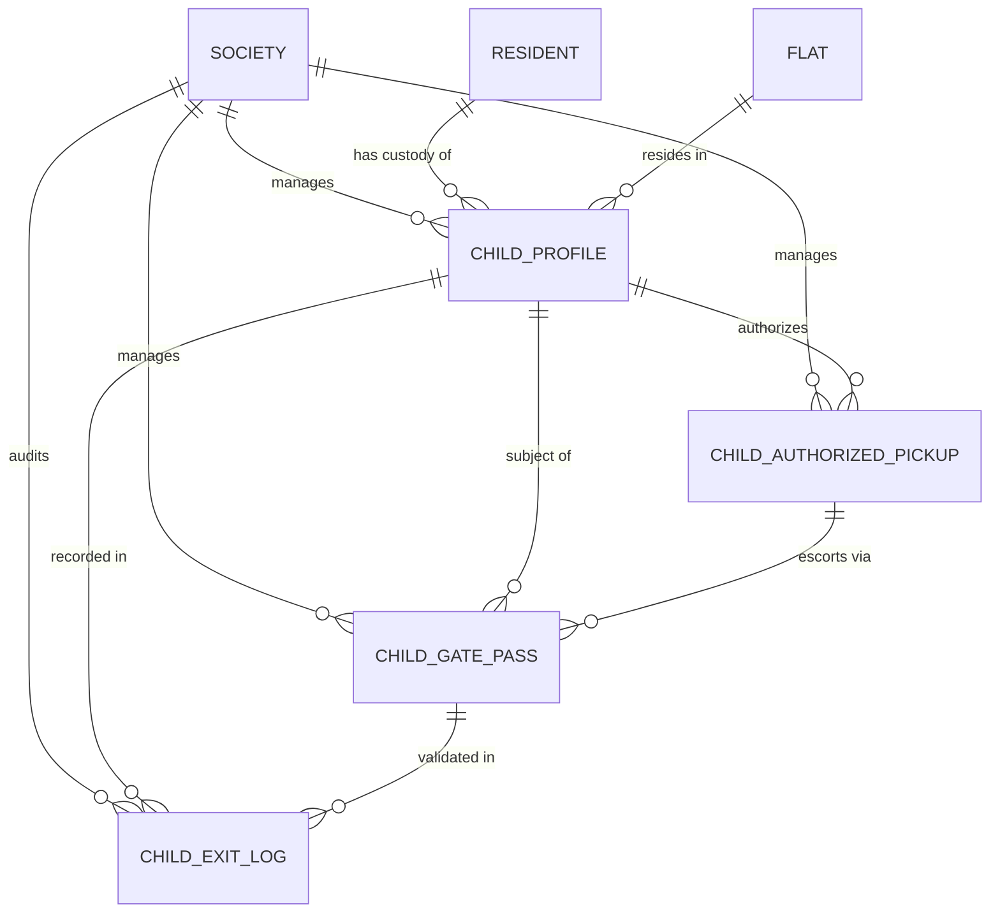

# AARIZO — ISSUE-06 Phase B.2: Database Design Review & Readiness

**Project:** `D:\AAZIRA\AARIZO`  
**Phase:** ISSUE-06 — B.2 Child Safety & Biometric Gate Radar  
**Document:** Database Schema Validation & Migration Readiness Review  
**Mode:** STRICT READ-ONLY AUDIT — NO CODE/SCHEMA EDITS  
**Status:** COMPLETED  

---

## 1. Executive Summary

This review assesses the database readiness for transitioning the Child Safety subsystem from unstructured `EntityRecord` JSON blobs to authoritative, indexed PostgreSQL relational models using Prisma.

The evaluation covers:
1. Proposed schema models (`ChildProfile`, `ChildAuthorizedPickup`, `ChildGatePass`, `ChildExitLog`).
2. Foreign key and relation alignment with existing models (`Society`, `User`, `Resident`, `Flat`).
3. Indexing strategy for high-performance gate scanner queries.
4. Cascade and restrict deletion behaviors.
5. Migration compatibility with legacy SQL tables in `scripts/postgres/01_schema.sql`.

---

## 2. Model Relationship & Foreign Key Validation



### 2.1 Relation to Existing Models

#### Relation to `Society` ([server/prisma/schema.prisma#L76](file:///D:/AAZIRA/AARIZO/server/prisma/schema.prisma#L76))
- Every Child Safety entity (`ChildProfile`, `ChildAuthorizedPickup`, `ChildGatePass`, `ChildExitLog`) must include `societyId String @map("society_id")`.
- Foreign key relation:
  ```prisma
  society Society @relation(fields: [societyId], references: [id], onDelete: Cascade)
  ```
- **Reverse relation on `Society`:**
  ```prisma
  childProfiles       ChildProfile[]
  childPickups        ChildAuthorizedPickup[]
  childGatePasses     ChildGatePass[]
  childExitLogs       ChildExitLog[]
  ```
- **Validation:** Matches existing design conventions (`visitorPasses VisitorPass[]`, `parcels Parcel[]`, `residents Resident[]`).

#### Relation to `Resident` ([server/prisma/schema.prisma#L197](file:///D:/AAZIRA/AARIZO/server/prisma/schema.prisma#L197))
- In AARIZO, resident portal users are linked via `Resident` and `User`.
- `ChildProfile` links to `Resident`:
  ```prisma
  residentId String @map("resident_id")
  resident   Resident @relation(fields: [residentId], references: [id], onDelete: Cascade)
  ```
- If a resident account is deleted from a flat, their child profiles cascade.
- **Reverse relation on `Resident`:**
  ```prisma
  childProfiles ChildProfile[]
  ```

#### Relation to `Flat` ([server/prisma/schema.prisma#L137](file:///D:/AAZIRA/AARIZO/server/prisma/schema.prisma#L137))
- `flatId String? @map("flat_id")`
  ```prisma
  flat Flat? @relation(fields: [flatId], references: [id], onDelete: SetNull)
  ```
- If a flat mapping is updated or reorganized, child profile history is preserved with `SetNull`.
- **Reverse relation on `Flat`:**
  ```prisma
  childProfiles ChildProfile[]
  ```

---

## 3. Detailed Model Design & Indexing Strategy

### 3.1 Model: `ChildProfile`
```prisma
model ChildProfile {
  id              String                  @id @default(uuid())
  societyId       String                  @map("society_id")
  residentId      String                  @map("resident_id")
  flatId          String?                 @map("flat_id")
  flatNumber      String                  @map("flat_number")
  fullName        String                  @map("full_name")
  dateOfBirth     DateTime                @map("date_of_birth")
  gender          String                  @default("MALE")
  photoUrl        String?                 @map("photo_url")
  medicalNotes    String?                 @map("medical_notes")
  status          String                  @default("SAFE") // SAFE, OUT_OF_SOCIETY, MISSING
  allowedSoloExit Boolean                 @default(false) @map("allowed_solo_exit")
  guardianName    String                  @map("guardian_name")
  guardianPhone   String                  @map("guardian_phone")
  emergencyPhone  String?                 @map("emergency_phone")
  createdAt       DateTime                @default(now()) @map("created_at")
  updatedAt       DateTime                @updatedAt @map("updated_at")

  society         Society                 @relation(fields: [societyId], references: [id], onDelete: Cascade)
  resident        Resident                @relation(fields: [residentId], references: [id], onDelete: Cascade)
  flat            Flat?                   @relation(fields: [flatId], references: [id], onDelete: SetNull)
  pickups         ChildAuthorizedPickup[]
  passes          ChildGatePass[]
  exitLogs        ChildExitLog[]

  @@index([societyId, status], map: "idx_children_society_status")
  @@index([residentId], map: "idx_children_resident")
  @@index([societyId, flatNumber], map: "idx_children_society_flat")
  @@map("child_profiles")
}
```

### 3.2 Model: `ChildAuthorizedPickup` (Trusted Caretakers / Escorts)
```prisma
model ChildAuthorizedPickup {
  id            String          @id @default(uuid())
  childId       String          @map("child_id")
  societyId     String          @map("society_id")
  name          String
  phone         String
  relationship  String          // Nanny, Grandparent, Driver, Relative, Other
  idProofType   String          @map("id_proof_type")
  idProofNumber String          @map("id_proof_number")
  photoUrl      String?         @map("photo_url")
  status        String          @default("ACTIVE") // ACTIVE, REVOKED, EXPIRED
  validUntil    DateTime?       @map("valid_until")
  createdAt     DateTime        @default(now()) @map("created_at")
  updatedAt     DateTime        @updatedAt @map("updated_at")

  child         ChildProfile    @relation(fields: [childId], references: [id], onDelete: Cascade)
  society       Society         @relation(fields: [societyId], references: [id], onDelete: Cascade)
  passes        ChildGatePass[]

  @@index([childId, status], map: "idx_child_pickups_child_status")
  @@index([societyId], map: "idx_child_pickups_society")
  @@map("child_authorized_pickups")
}
```

### 3.3 Model: `ChildGatePass` (Authoritative QR Gate Exit Passes)
```prisma
model ChildGatePass {
  id                String                 @id @default(uuid())
  passCode          String                 @unique @map("pass_code")
  societyId         String                 @map("society_id")
  childId           String                 @map("child_id")
  pickupPersonId    String?                @map("pickup_person_id")
  pickupPersonName  String                 @map("pickup_person_name")
  pickupPersonPhone String?                @map("pickup_person_phone")
  validFrom         DateTime               @map("valid_from")
  validUntil        DateTime               @map("valid_until")
  status            String                 @default("ACTIVE") // ACTIVE, USED, EXPIRED, REVOKED
  maxUses           Int                    @default(1) @map("max_uses")
  currentUses       Int                    @default(0) @map("current_uses")
  signature         String?                // HMAC-SHA256 signature for fail-closed offline verification
  notes             String?
  createdById       String                 @map("created_by_id")
  createdAt         DateTime               @default(now()) @map("created_at")
  updatedAt         DateTime               @updatedAt @map("updated_at")

  society           Society                @relation(fields: [societyId], references: [id], onDelete: Cascade)
  child             ChildProfile           @relation(fields: [childId], references: [id], onDelete: Cascade)
  pickupPerson      ChildAuthorizedPickup? @relation(fields: [pickupPersonId], references: [id], onDelete: SetNull)
  exitLogs          ChildExitLog[]

  @@index([societyId, status], map: "idx_child_passes_society_status")
  @@index([childId], map: "idx_child_passes_child")
  @@index([passCode], map: "idx_child_passes_code")
  @@index([societyId, validFrom, validUntil], map: "idx_child_passes_validity")
  @@map("child_gate_passes")
}
```

### 3.4 Model: `ChildExitLog` (Gate Audit Trail)
```prisma
model ChildExitLog {
  id                String        @id @default(uuid())
  societyId         String        @map("society_id")
  childId           String        @map("child_id")
  passId            String?       @map("pass_id")
  childName         String        @map("child_name")
  flatNumber        String        @map("flat_number")
  pickupPersonName  String        @map("pickup_person_name")
  pickupPersonPhone String?       @map("pickup_person_phone")
  gateId            String        @map("gate_id")
  guardId           String        @map("guard_id")
  guardName         String        @map("guard_name")
  status            String        // ALLOWED, DENIED, OFFLINE_VERIFIED, MISSING_ALERT_BLOCKED
  notes             String?
  timestamp         DateTime      @default(now())

  society           Society       @relation(fields: [societyId], references: [id], onDelete: Cascade)
  child             ChildProfile  @relation(fields: [childId], references: [id], onDelete: Cascade)
  pass              ChildGatePass? @relation(fields: [passId], references: [id], onDelete: SetNull)

  @@index([societyId, timestamp], map: "idx_child_exit_logs_society_time")
  @@index([childId], map: "idx_child_exit_logs_child")
  @@map("child_exit_logs")
}
```

---

## 4. Deletion & Referential Integrity Rules

| Relation | Parent Entity | Child Entity | Action on Parent Delete | Security Rationale |
| :--- | :--- | :--- | :--- | :--- |
| `Society -> ChildProfile` | `Society` | `ChildProfile` | `Cascade` | Complete tenant de-provisioning cleans up all resident and child records. |
| `Resident -> ChildProfile` | `Resident` | `ChildProfile` | `Cascade` | When a resident is removed from the society, dependent child profiles are purged. |
| `Flat -> ChildProfile` | `Flat` | `ChildProfile` | `SetNull` | If flat configuration changes, historical child records are retained. |
| `ChildProfile -> ChildGatePass` | `ChildProfile` | `ChildGatePass` | `Cascade` | If a child profile is deleted, pending gate exit passes are invalidated immediately. |
| `ChildAuthorizedPickup -> ChildGatePass` | `ChildAuthorizedPickup` | `ChildGatePass` | `SetNull` | If a caretaker is removed, pass history remains for security auditing. |
| `ChildGatePass -> ChildExitLog` | `ChildGatePass` | `ChildExitLog` | `SetNull` | Physical gate verification audit logs must **never be deleted** even if a pass is deleted. |

---

## 5. Migration Compatibility with Existing PostgreSQL Tables

1. **Legacy Table `child_safety` in `scripts/postgres/01_schema.sql` (Lines 326–340):**
   - The legacy table defines columns: `id`, `society_id`, `resident_id`, `flat_id`, `child_name`, `age`, `photo_url`, `allowed_solo_exit`, `guardian_contact`, `exit_permission_status`, `notes`.
   - The new Prisma model maps to table `child_profiles` (`@@map("child_profiles")`).
   - Using `child_profiles` avoids collisions with the legacy `child_safety` table, ensuring 100% non-breaking coexistence.
2. **Migration Strategy:**
   - Create a dedicated Prisma migration directory: `server/prisma/migrations/20261118000000_add_child_safety_models/migration.sql`.
   - The migration uses standard `CREATE TABLE` and `CREATE INDEX` statements.
   - Fully compatible with `npm --prefix server exec prisma -- validate`.

