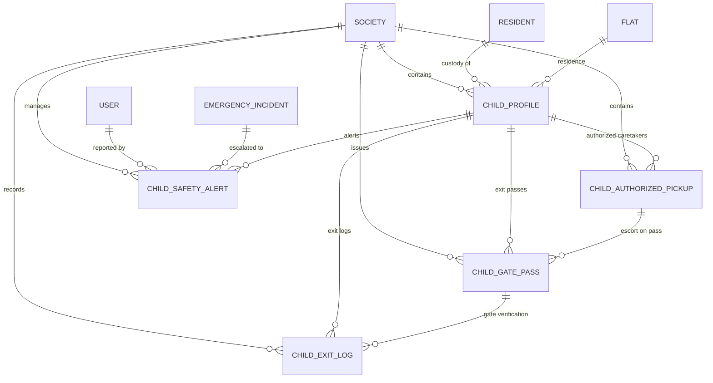

# AARIZO — ISSUE-06 Phase B.2, Step 2.1: Schema Relationship Matrix

**Project:** `D:\AAZIRA\AARIZO`  
**Phase:** ISSUE-06 — B.2.1 Child Safety Relational Database Foundation  
**Document:** Entity-Relationship & Multi-Tenant Constraint Matrix  
**Status:** COMPLETED & VERIFIED  

---

## 1. Entity-Relationship Overview

---

## 2. Comprehensive Model & Field Specifications

### 2.1 `ChildProfile` (`child_profiles`)

| Column Name | Prisma Type | PostgreSQL Type | Nullable | Default | Constraints & Foreign Keys | Purpose / Rationale |
| :--- | :--- | :--- | :--- | :--- | :--- | :--- |
| `id` | `String` | `TEXT` | No | `uuid()` | `PRIMARY KEY` | Globally unique identifier |
| `society_id` | `String` | `TEXT` | No | - | `FK -> societies(id) ON DELETE CASCADE` | Strict tenant isolation |
| `resident_id` | `String?` | `TEXT` | Yes | `NULL` | `FK -> residents(id) ON DELETE SET NULL` | Parent / primary guardian profile |
| `flat_id` | `String?` | `TEXT` | Yes | `NULL` | `FK -> flats(id) ON DELETE SET NULL` | Society flat association |
| `flat_number` | `String` | `TEXT` | No | - | - | Visual flat identifier for gate display |
| `full_name` | `String` | `TEXT` | No | - | - | Child legal name |
| `date_of_birth` | `DateTime` | `TIMESTAMP(3)` | No | - | - | Age computation & school verification |
| `gender` | `String` | `TEXT` | No | `'MALE'` | - | Gender identity |
| `photo_url` | `String?` | `TEXT` | Yes | `NULL` | - | Biometric visual reference |
| `medical_notes` | `String?` | `TEXT` | Yes | `NULL` | - | Allergies / critical medical instructions |
| `status` | `String` | `TEXT` | No | `'SAFE'` | - | Current state: `SAFE`, `OUT_OF_SOCIETY`, `MISSING` |
| `allowed_solo_exit`| `Boolean` | `BOOLEAN` | No | `false` | - | Whether child is authorized to leave gate unescorted |
| `guardian_name` | `String` | `TEXT` | No | - | - | Primary contact person name |
| `guardian_phone`| `String` | `TEXT` | No | - | - | Emergency primary contact phone |
| `emergency_phone`| `String?`| `TEXT` | Yes | `NULL` | - | Secondary emergency phone |
| `notes` | `String?` | `TEXT` | Yes | `NULL` | - | Administrative security notes |
| `created_at` | `DateTime` | `TIMESTAMP(3)` | No | `now()` | - | Audit creation timestamp |
| `updated_at` | `DateTime` | `TIMESTAMP(3)` | No | - | - | Automated update timestamp |

**Indexes:**
- `idx_child_profiles_society_status` ON (`society_id`, `status`)
- `idx_child_profiles_society_flat` ON (`society_id`, `flat_number`)
- `idx_child_profiles_resident` ON (`resident_id`)

---

### 2.2 `ChildAuthorizedPickup` (`child_authorized_pickups`)

| Column Name | Prisma Type | PostgreSQL Type | Nullable | Default | Constraints & Foreign Keys | Purpose / Rationale |
| :--- | :--- | :--- | :--- | :--- | :--- | :--- |
| `id` | `String` | `TEXT` | No | `uuid()` | `PRIMARY KEY` | Unique escort identifier |
| `society_id` | `String` | `TEXT` | No | - | `FK -> societies(id) ON DELETE CASCADE` | Tenant isolation |
| `child_id` | `String` | `TEXT` | No | - | `FK -> child_profiles(id) ON DELETE CASCADE` | Linked child profile |
| `name` | `String` | `TEXT` | No | - | - | Caretaker / escort full name |
| `phone` | `String` | `TEXT` | No | - | - | Mobile phone number |
| `relationship` | `String` | `TEXT` | No | - | - | E.g. Nanny, Grandparent, Driver, Relative |
| `id_proof_type`| `String` | `TEXT` | No | - | - | Aadhaar, Passport, DL, Voter ID |
| `id_proof_number`| `String` | `TEXT` | No | - | - | Document identification number |
| `photo_url` | `String?` | `TEXT` | Yes | `NULL` | - | Escort photo verification |
| `status` | `String` | `TEXT` | No | `'ACTIVE'` | - | `ACTIVE`, `REVOKED`, `EXPIRED` |
| `valid_until` | `DateTime?`| `TIMESTAMP(3)` | Yes | `NULL` | - | Authorization expiration date |
| `notes` | `String?` | `TEXT` | Yes | `NULL` | - | Administrative notes |
| `created_at` | `DateTime` | `TIMESTAMP(3)` | No | `now()` | - | Creation timestamp |
| `updated_at` | `DateTime` | `TIMESTAMP(3)` | No | - | - | Update timestamp |

**Indexes:**
- `idx_child_pickups_child_status` ON (`child_id`, `status`)
- `idx_child_pickups_society` ON (`society_id`)
- `idx_child_pickups_society_phone` ON (`society_id`, `phone`)

---

### 2.3 `ChildGatePass` (`child_gate_passes`)

| Column Name | Prisma Type | PostgreSQL Type | Nullable | Default | Constraints & Foreign Keys | Purpose / Rationale |
| :--- | :--- | :--- | :--- | :--- | :--- | :--- |
| `id` | `String` | `TEXT` | No | `uuid()` | `PRIMARY KEY` | Unique pass identifier |
| `society_id` | `String` | `TEXT` | No | - | `FK -> societies(id) ON DELETE CASCADE` | Tenant isolation |
| `child_id` | `String` | `TEXT` | No | - | `FK -> child_profiles(id) ON DELETE CASCADE` | Subject child |
| `pickup_person_id`| `String?` | `TEXT` | Yes | `NULL` | `FK -> child_authorized_pickups(id) ON DELETE SET NULL` | Linked escort |
| `pass_code` | `String` | `TEXT` | No | - | `UNIQUE` | Human-readable pass code (`CGP-...`) |
| `token_hash` | `String` | `TEXT` | No | - | `UNIQUE` | SHA-256 hash of bearer QR token (raw secret never stored) |
| `signature` | `String?` | `TEXT` | Yes | `NULL` | - | HMAC-SHA256 signature for offline gate verification |
| `pickup_person_name` | `String` | `TEXT` | No | - | - | Caretaker name snapshot |
| `pickup_person_phone`| `String?` | `TEXT` | Yes | `NULL` | - | Caretaker phone snapshot |
| `valid_from` | `DateTime` | `TIMESTAMP(3)` | No | - | - | Pass activation start window |
| `valid_until` | `DateTime` | `TIMESTAMP(3)` | No | - | - | Pass expiration timestamp |
| `status` | `String` | `TEXT` | No | `'ACTIVE'` | - | `ACTIVE`, `USED`, `EXPIRED`, `REVOKED` |
| `max_uses` | `Int` | `INTEGER` | No | `1` | - | Single-use vs multi-use authorization |
| `current_uses` | `Int` | `INTEGER` | No | `0` | - | Consumed uses counter |
| `first_used_at` | `DateTime?`| `TIMESTAMP(3)` | Yes | `NULL` | - | First scan timestamp |
| `last_used_at` | `DateTime?`| `TIMESTAMP(3)` | Yes | `NULL` | - | Most recent exit timestamp |
| `revoked_at` | `DateTime?`| `TIMESTAMP(3)` | Yes | `NULL` | - | Revocation timestamp |
| `revocation_reason`| `String?` | `TEXT` | Yes | `NULL` | - | Reason for emergency revocation |
| `created_by_id` | `String?` | `TEXT` | Yes | `NULL` | - | User ID who created the pass |
| `notes` | `String?` | `TEXT` | Yes | `NULL` | - | Notes |
| `created_at` | `DateTime` | `TIMESTAMP(3)` | No | `now()` | - | Creation timestamp |
| `updated_at` | `DateTime` | `TIMESTAMP(3)` | No | - | - | Update timestamp |

**Indexes:**
- `idx_child_passes_society_status` ON (`society_id`, `status`)
- `idx_child_passes_child` ON (`child_id`)
- `idx_child_passes_code` ON (`pass_code`)
- `idx_child_passes_validity` ON (`society_id`, `valid_from`, `valid_until`)

---

### 2.4 `ChildExitLog` (`child_exit_logs`)

| Column Name | Prisma Type | PostgreSQL Type | Nullable | Default | Constraints & Foreign Keys | Purpose / Rationale |
| :--- | :--- | :--- | :--- | :--- | :--- | :--- |
| `id` | `String` | `TEXT` | No | `uuid()` | `PRIMARY KEY` | Unique log entry ID |
| `society_id` | `String` | `TEXT` | No | - | `FK -> societies(id) ON DELETE CASCADE` | Tenant isolation |
| `child_id` | `String?` | `TEXT` | Yes | `NULL` | `FK -> child_profiles(id) ON DELETE SET NULL` | Preserves audit if child is deleted |
| `pass_id` | `String?` | `TEXT` | Yes | `NULL` | `FK -> child_gate_passes(id) ON DELETE SET NULL` | Preserves audit if pass is deleted |
| `child_name` | `String` | `TEXT` | No | - | - | Immutable child name snapshot |
| `flat_number` | `String` | `TEXT` | No | - | - | Immutable flat snapshot |
| `pickup_person_name` | `String` | `TEXT` | No | - | - | Immutable escort name snapshot |
| `pickup_person_phone`| `String?` | `TEXT` | Yes | `NULL` | - | Immutable escort phone snapshot |
| `gate_id` | `String` | `TEXT` | No | - | - | Gate terminal identifier |
| `guard_id` | `String` | `TEXT` | No | - | - | Gate guard user identifier |
| `guard_name` | `String` | `TEXT` | No | - | - | Gate guard name snapshot |
| `status` | `String` | `TEXT` | No | - | - | `ALLOWED`, `DENIED`, `OFFLINE_VERIFIED`, `MISSING_ALERT_BLOCKED` |
| `verification_mode` | `String` | `TEXT` | No | `'ONLINE'` | - | `ONLINE`, `OFFLINE_HMAC` |
| `notes` | `String?` | `TEXT` | Yes | `NULL` | - | Security guard remarks |
| `timestamp` | `DateTime` | `TIMESTAMP(3)` | No | `now()` | - | Physical verification timestamp |

**Indexes:**
- `idx_child_exit_logs_society_time` ON (`society_id`, `timestamp`)
- `idx_child_exit_logs_child` ON (`child_id`)
- `idx_child_exit_logs_pass` ON (`pass_id`)

---

### 2.5 `ChildSafetyAlert` (`child_safety_alerts`)

| Column Name | Prisma Type | PostgreSQL Type | Nullable | Default | Constraints & Foreign Keys | Purpose / Rationale |
| :--- | :--- | :--- | :--- | :--- | :--- | :--- |
| `id` | `String` | `TEXT` | No | `uuid()` | `PRIMARY KEY` | Unique alert ID |
| `society_id` | `String` | `TEXT` | No | - | `FK -> societies(id) ON DELETE CASCADE` | Tenant isolation |
| `child_id` | `String?` | `TEXT` | Yes | `NULL` | `FK -> child_profiles(id) ON DELETE SET NULL` | Linked child profile |
| `reported_by_id`| `String?` | `TEXT` | Yes | `NULL` | `FK -> users(id) ON DELETE SET NULL` | Reporting user account |
| `child_name` | `String` | `TEXT` | No | - | - | Subject child name |
| `flat_number` | `String` | `TEXT` | No | - | - | Flat number |
| `alert_type` | `String` | `TEXT` | No | - | - | `MISSING_CHILD`, `UNATTENDED_CHILD`, `UNAUTHORIZED_EXIT_ATTEMPT`, `EMERGENCY_SOS` |
| `severity` | `String` | `TEXT` | No | `'CRITICAL'` | - | `LOW`, `MEDIUM`, `HIGH`, `CRITICAL` |
| `status` | `String` | `TEXT` | No | `'ACTIVE'` | - | `ACTIVE`, `ACKNOWLEDGED`, `RESOLVED`, `FALSE_ALARM` |
| `location` | `String` | `TEXT` | No | - | - | Physical incident location |
| `description` | `String?` | `TEXT` | Yes | `NULL` | - | Circumstances / notes |
| `last_seen_details`| `String?` | `TEXT` | Yes | `NULL` | - | Clothing, time, direction of travel |
| `acknowledged_at`| `DateTime?`| `TIMESTAMP(3)` | Yes | `NULL` | - | Security acknowledgment time |
| `acknowledged_by`| `String?` | `TEXT` | Yes | `NULL` | - | Security guard / admin name |
| `resolved_at` | `DateTime?`| `TIMESTAMP(3)` | Yes | `NULL` | - | Alert resolution time |
| `resolved_by` | `String?` | `TEXT` | Yes | `NULL` | - | Resolver name |
| `resolution_notes`| `String?` | `TEXT` | Yes | `NULL` | - | Action taken |
| `emergency_incident_id`| `String?` | `TEXT` | Yes | `NULL` | `FK -> emergency_incidents(id) ON DELETE SET NULL` | Relational bridge to emergency dispatch |
| `created_at` | `DateTime` | `TIMESTAMP(3)` | No | `now()` | - | Alert creation time |
| `updated_at` | `DateTime` | `TIMESTAMP(3)` | No | - | - | Update timestamp |

**Indexes:**
- `idx_child_alerts_society_status` ON (`society_id`, `status`)
- `idx_child_alerts_child` ON (`child_id`)
- `idx_child_alerts_society_time` ON (`society_id`, `created_at`)

---

## 3. Tenant Consistency & Deletion Behavioral Rules

1. **Foreign Key Tenant Enforcement:**
   Every record includes an immutable `societyId`. Relationships across different societies are impossible because queries must scope by `societyId: req.societyId`. In backend transactions, any attempt to link a `ChildAuthorizedPickup` from Society A to a `ChildGatePass` from Society B will be rejected by foreign key consistency and service-layer validation.
2. **Audit Preservation (No Destructive Cascades on Logs):**
   - Deleting a `Resident` profile sets `residentId` to `NULL` on `ChildProfile`, retaining child records.
   - Deleting a `ChildProfile` sets `childId` to `NULL` on `ChildExitLog` and `ChildSafetyAlert`.
   - Deleting a `ChildGatePass` sets `passId` to `NULL` on `ChildExitLog`.
   - Physical gate exit records are immutable and permanently preserved.

