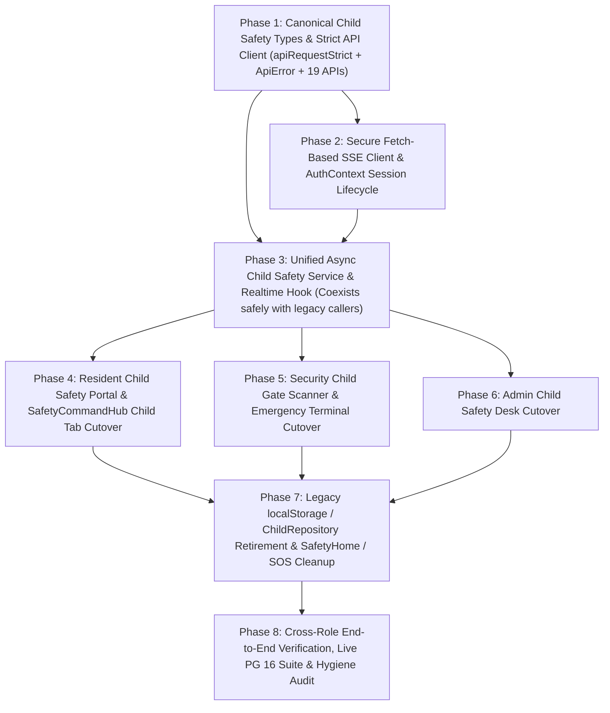

# AARIZO — ISSUE-06 Phase B.2.3: Final Implementation Plan (Approved Architecture)

**Review Date:** 2026-11-18  
**Status:** Planning & Verification Review Complete — **Zero source, test, schema, migration, or config edits made**  
**Decision:** `B.2.3 IMPLEMENTATION PLAN APPROVED FOR STEPWISE EXECUTION`

---

## 1. Planning Review Findings & Corrections Against Real Source Code

Independent review of all seven Phase B.2.3 audit deliverables against live source code (`server/src/childSafety/router.ts`, `server/src/childSafety/validation.ts`, `server/src/auth.ts`, `server/src/realtimeEngine.ts`, `server/src/index.ts`, `server/prisma/schema.prisma`, `src/services/apiClient.ts`, `src/services/childSafetyService.ts`, `src/domains/safety/services/safetyCommandEngine.ts`, `src/services/safetyCommandService.ts`, `src/pages/dashboard/admin/AdminChildSafetyPage.tsx`, `src/components/resident/safety/SafetyHome.tsx`) confirmed the audit's core conclusions and identified **four mandatory technical corrections** now incorporated into this finalized plan:

| # | Audit Draft Assumption | Source-Verified Reality | Mandatory Plan Correction |
| :--- | :--- | :--- | :--- |
| **C-01** | Proposed authenticating browser `EventSource` via `?token=<jwt>` query string. | Long-lived JWTs in URLs leak into server logs, proxies, browser history, and Referer headers. `server/src/auth.ts#L212-L214` already reads `Authorization: Bearer <token>`, `server/src/realtimeEngine.ts#L605` reads `Last-Event-ID` header, and `server/src/index.ts#L77` enables `cors()`. | **Use Fetch-based Authenticated SSE Streaming** (`Authorization: Bearer` + `Last-Event-ID` headers over `fetch()` + `ReadableStream` SSE parser). Zero JWTs in query strings; zero backend changes required. Document optional future ticket/query-token-removal hardening as separate backend task **`REQ-BE-02`**. |
| **C-02** | Proposed using `PATCH /api/children/:id` `{ status: 'SAFE' }` as a child return/check-in workflow. | Verified in `server/src/childSafety/router.ts#L1986-L2011` and `server/prisma/schema.prisma#L132-L148`: `PATCH /api/children/:id` is forbidden for `guard`, writes **zero** `ChildExitLog`, and emits only `CHILD_PROFILE_UPDATED` (not delivered to guards). `ChildExitLog` has no `RE_ENTRY` direction/event type. | **Do NOT simulate a gate re-entry event via `PATCH /api/children/:id`.** Document a dedicated guard/admin gate re-entry contract as a separate backend requirement (**`REQ-BE-01`**). Keep `PATCH /api/children/:id` strictly for administrative profile updates. |
| **C-03** | Audit contract table listed `POST /passes/verify` response as `{ verified: true, outcome: 'GRANTED' }`, `503` code as `'VERIFICATION_UNAVAILABLE'`, and `PASS_EXPIRED`/`PICKUP_REVOKED` as `422`. | Verified in `server/src/childSafety/router.ts#L470-L876`: `200` returns `{ authorized: true, outcome: 'ALLOWED', pass, exitLog }`; `503` returns `{ authorized: false, outcome: 'VERIFICATION_UNAVAILABLE', verificationChannel: 'BACKEND_UNAVAILABLE', code: 'BACKEND_UNAVAILABLE' }`; `PASS_EXPIRED`, `PASS_REVOKED`, `PICKUP_PERSON_UNAUTHORIZED`, `PASS_ALREADY_CONSUMED`, `CHILD_MISSING_ALERT_BLOCKED` all return **`409`**; `PASS_NOT_YET_VALID` and `ESCORT_REQUIRED` return **`422`**. Also `POST /passes` requires `pickupPersonId` (`422 AUTHORIZED_PICKUP_REQUIRED`) unless `SOLO_ALLOWED`. | Lock frontend DTOs, runtime response validators, and UI error mappers to the exact verified B.2.2 status codes and JSON fields in `AARIZO_ISSUE06_PHASE_B2_STEP23_API_CLIENT_DESIGN.md`. |
| **C-04** | Audit missed two additional safety consumers (`SafetyHome.tsx` & `societyIntelligenceService.ts`) and misdescribed `AdminChildSafetyPage.tsx` as already having Register/Pickup modals. | Verified directly: `AdminChildSafetyPage.tsx` (451 lines) is currently a read/view + resolve-alert desk; `src/components/resident/safety/SafetyHome.tsx#L21-L47` sets `isSOSActive(true)` optimistically *before* `apiClient.createEmergencyIncident()` and calls blocked `realtimeService.publish('EMERGENCY_ALERTS')`; `src/services/societyIntelligenceService.ts#L106` synchronously calls `safetyCommandService.getIncidents(socId)`. | Include `SafetyHome.tsx` and `societyIntelligenceService.ts` explicitly in the data-layer consolidation and cutover phases so zero imports or features break. |

---

## 2. Dependency-Ordered Implementation Architecture

**Why this 8-phase order is strictly safer than the earlier 7-step draft:**
- **Shared layers first (`P1` -> `P2` -> `P3`):** No page is touched until typed error semantics (`ApiError`), authenticated Fetch SSE streaming, and the unified async service layer are independently unit-tested.
- **No premature deletion (`P7` strictly AFTER `P4`, `P5`, `P6`):** Legacy sync methods (`childSafetyService` localStorage helpers, `safetyCommandEngine` child methods, `ChildRepository`) are NOT removed until every portal consumer has been migrated and verified, eliminating mid-migration compile breaks.

---

## 3. Detailed Phase Specifications (Phases 1–8)

### Phase 1: Canonical Child Safety DTOs & Strict API Client Layer
- **Objective:** Establish exact B.2.2 TypeScript DTOs, runtime response validators, `ApiError` semantics, and all 19 Child Safety API client methods without disturbing unrelated `apiClient` consumers.
- **Exact Files Expected to Change:**
  - `src/types/childSafety.ts` (add canonical B.2.2 DTO & request/response interfaces alongside temporary `@deprecated` legacy aliases until Phase 7)
  - `src/services/apiClient.ts` (add `ApiError`, `apiRequestStrict<T>()`, and all 19 Child Safety methods + strict Emergency Incident methods)
  - New: `tests/issue06_b23_api_client.test.ts`
- **Backend Dependencies:** Existing verified B.2.2 `/api/children/*` and `/api/emergency-incidents` routes (no backend changes).
- **Frontend Dependencies:** `src/services/authStorage.ts` (`getAuthHeaders`, `clearAuthSession`, `authenticatedFetch`).
- **Existing Features Affected:** None yet (unrelated `apiRequest()` methods remain backward-compatible; existing 3 fire-and-forget callers in `childSafetyService.ts` keep compiling until Phase 3/7).
- **Security Requirements:**
  - Never turn HTTP errors into `null` or empty arrays/objects in `apiRequestStrict`.
  - Distinguish network errors (`status: 0, code: 'NETWORK_UNAVAILABLE'`) from `401/403/404/409/422/429/500/503`.
  - Never attach spoofable `x-society-id`/`x-user-id`/`x-user-role` overrides on Child Safety requests (rely strictly on `Authorization: Bearer`).
  - Trigger `clearAuthSession()` + `aarizo:unauthorized` on `401`.
  - Strip/reject any forbidden raw ID keys (`idProofNumber`, `aadhaarNumber`, etc.) defensively before transmission.
- **Tests to Add:** `tests/issue06_b23_api_client.test.ts` (all 19 endpoints, every status code `200/201/400/401/403/404/409/422/429/500/503`, network error, runtime shape validation).
- **Existing Tests to Rerun:** `tests/issue03_auth_storage_consistency.test.ts`, `tests/issue06_visitor_pass_api.test.ts`, `npm run build`.
- **Acceptance Criteria:** All 19 strict methods match `server/src/childSafety/router.ts` contracts verbatim; 100% pass on new unit suite and frontend build.
- **Rollback Considerations:** Isolated to `apiRequestStrict` + new methods; revert cleanly without touching any UI component.

---

### Phase 2: Secure Fetch-Based SSE Client & `AuthContext` Session Lifecycle
- **Objective:** Replace unauthenticated `EventSource` (`?societyId=soc-gvs`, no auth) with Fetch-based authenticated SSE streaming (`Authorization: Bearer` + `Last-Event-ID` headers) integrated cleanly with `AuthContext` login, token refresh, logout, and `401` invalidation.
- **Exact Files Expected to Change:**
  - `src/services/realtimeService.ts` (Fetch-based SSE reader, `connect()` / `disconnect()`, `AbortController`, exponential backoff, `Last-Event-ID` header tracking, seen-event deduplication, connection status observable, `CHILD_*` topic routing & siren fixes, client-side guard blocking protected event `publish()` calls)
  - `src/context/AuthContext.tsx` (connect SSE on `AUTHENTICATED` + token refresh; disconnect SSE on `logout()`, `aarizo:unauthorized`, and multi-tab storage logout)
  - New: `tests/issue06_b23_realtime_sse.test.ts`
- **Backend Dependencies:** Existing `GET /api/realtime/stream` (`authenticateToken` accepts `Authorization: Bearer`, `handleSseSubscription` reads `Last-Event-ID` header, `cors()` allows custom headers). No backend change required.
- **Frontend Dependencies:** Phase 1 (`authStorage.ts` token retrieval & `aarizo:unauthorized`), `AuthContext.tsx`.
- **Existing Features Affected:** All live toast notifications, gate chimes, emergency sirens, and multi-tab updates across portals.
- **Security Requirements:**
  - **ZERO JWT in query string** (never append `?token=` to any URL).
  - Never connect SSE while unauthenticated.
  - Immediately abort stream and clear `lastEventId` on `logout()`, `401`, `403`, or user/society change.
  - Block frontend `publish()` from posting `CHILD_*`, `EMERGENCY_*`, `SOS_*`, or `GATE_PASS_*` to `/api/realtime/broadcast`.
- **Tests to Add:** `tests/issue06_b23_realtime_sse.test.ts` (chunked SSE frame parsing, `Authorization: Bearer` header verification, zero query-string token assertion, `Last-Event-ID` reconnect header, `401`/`403` immediate stop, logout cleanup, user/society switch reset, deduplication, `CHILD_*` routing & siren).
- **Existing Tests to Rerun:** `tests/issue02_gap03_sse_authorization.test.ts`, `tests/issue03_step33_hardening.test.ts`, `npm run build`.
- **Acceptance Criteria:** Zero unauthenticated SSE connections; zero JWTs in URLs; clean reconnect on transient disconnect; verified audio/deep-link routing for all 15 B.2.2 Child Safety events.
- **Rollback Considerations:** Isolated to `realtimeService.ts` + one `useEffect` in `AuthContext.tsx`; easily reverted without affecting REST APIs.

---

### Phase 3: Unified Async Child Safety Service & Debounced Realtime Hook
- **Objective:** Introduce the authoritative async Child Safety data layer (`childSafetyApiService` / async methods on `childSafetyService`) and shared `useChildSafetyRealtime` hook while keeping legacy sync wrappers temporarily intact (deprecated) so Phase 4–6 pages can cut over one portal at a time without breaking compilation.
- **Exact Files Expected to Change:**
  - `src/services/childSafetyService.ts` (add authoritative async methods delegating strictly to Phase 1 `apiClient` strict methods + structured UI error mapper; mark legacy sync methods `@deprecated` pending Phase 7 removal)
  - New: `src/hooks/useChildSafetyRealtime.ts` (subscribes to all 15 B.2.2 SSE events with 250ms trailing debounce per resource + 60s disconnected fallback sync)
  - New: `tests/issue06_b23_service_layer.test.ts`
- **Backend Dependencies:** Phase 1 (`apiClient` strict methods).
- **Frontend Dependencies:** Phase 1 & Phase 2.
- **Existing Features Affected:** None yet (legacy callers continue to compile until their respective cutover phase).
- **Security Requirements:**
  - Async methods NEVER read or write `localStorage` for child, pickup, pass, exit log, or alert records.
  - Async methods NEVER fall back to cached/local state on network or HTTP error — errors propagate as `ApiError`.
  - Ephemeral pass secrets (`bearerToken`, `qrPayload`) returned directly to caller memory only and never logged or cached.
- **Tests to Add:** `tests/issue06_b23_service_layer.test.ts` (delegation, error propagation, debounced SSE hook deduplicating paired events like `CHILD_GATE_PASS_VERIFIED` + `CHILD_EXIT_TRIGGERED`).
- **Existing Tests to Rerun:** `tests/issue06_b23_api_client.test.ts`, `tests/issue06_b23_realtime_sse.test.ts`, `npm run build`.
- **Acceptance Criteria:** Clean async facade + hook ready for all 3 portals; zero regressions; build green.
- **Rollback Considerations:** Additive service methods + new hook; zero consumer impact if reverted.

---

### Phase 4: Resident Child Safety Portal & `SafetyCommandHub` Cutover
- **Objective:** Cut over `ResidentChildSafetyPage.tsx` and the Child Safety portion of `SafetyCommandHub.tsx` (also mounted by `ResidentEmergencyPage.tsx` and `AdminSafetyCommandPage.tsx`) to live B.2.2 backend APIs, replacing fake no-op modals, hardcoded mock escorts/DOBs, and broken `localStorage` read/write divergence while preserving visual layout and responsive design.
- **Exact Files Expected to Change:**
  - New modular subcomponents preserving existing styling:
    - `src/domains/safety/components/childSafety/ChildSafetyWorkspace.tsx`
    - `src/domains/safety/components/childSafety/ChildProfileModal.tsx`
    - `src/domains/safety/components/childSafety/AuthorizedPickupModal.tsx`
    - `src/domains/safety/components/childSafety/OneTimeGatePassModal.tsx`
    - `src/domains/safety/components/childSafety/ChildSafetySosModal.tsx`
  - `src/domains/safety/components/SafetyCommandHub.tsx` (mount `ChildSafetyWorkspace` in `CHILD_SAFETY` tab; route `ONE_TAP_SOS` `CHILD_SAFETY` category to `ChildSafetySosModal` / `POST /api/children/sos`; restrict `GATE_VERIFIER` tab strictly to `guard`/`admin` delegating to authoritative pass verification; remove fake no-op modals and hardcoded fallback escorts)
  - `src/pages/dashboard/resident/ResidentChildSafetyPage.tsx` (pass role/refresh context cleanly if needed; preserve header & layout)
  - New: `tests/issue06_b23_resident_workflow.test.ts`
- **Backend Dependencies:** `GET/POST/PATCH/archive /api/children`, `/pickups`, `/passes`, `/passes/:id/revoke`, `/exit-logs`, `/sos`, `/alerts`.
- **Frontend Dependencies:** Phases 1–3, installed `qrcode.react` (`QRCodeSVG`).
- **Existing Features Affected:** Resident Child Safety dashboard, Child Profile create/edit/archive, Authorized Pickups, Gate Pass QR generation & revocation, Missing Child SOS, Child Exit History, `SafetyCommandHub` tabs.
- **Security Requirements:**
  - One-time `bearerToken`/`qrPayload` rendered immediately via `QRCodeSVG` (`qrcode.react`) and cleared from component state on modal close/unmount (never stored in `localStorage`/`sessionStorage` or console-logged).
  - Enforce `pickupPersonId` requirement in UI when `exitPermissionMode !== 'SOLO_ALLOWED'` (guide user to authorize a pickup person first).
  - Pickup form collects ONLY `idDocumentType` + optional `idDocumentLast4` (max 4 chars) — zero `idProofNumber`.
  - SOS modal never shows "Dispatched" before `POST /api/children/sos` returns `201`; handles `409 DUPLICATE_ACTIVE_SOS_ALERT` cleanly.
  - Hide `GATE_VERIFIER` tab for `resident`, `committee`, and `secretary`; hide write buttons for `committee`.
  - Do NOT simulate gate re-entry via `PATCH /api/children/:id`.
- **Tests to Add:** `tests/issue06_b23_resident_workflow.test.ts`.
- **Existing Tests to Rerun:** Phase 1–3 tests, `tests/route_protection.test.ts`, `npm run build`.
- **Acceptance Criteria:** Resident CRUD, pickup CRUD, one-time QR rendering, pass revocation, SOS creation, duplicate `409` handling, and SSE live refresh all verified against mocked API contracts; zero `localStorage` child state touched.
- **Rollback Considerations:** `SafetyCommandHub` delegates to `ChildSafetyWorkspace`; rollback is a clean swap in `SafetyCommandHub.tsx`.

---

### Phase 5: Security Child Gate Scanner & Emergency Terminal Cutover
- **Objective:** Cut over `ChildGateScannerPage.tsx` strictly to fail-closed backend gate verification (`POST /api/children/passes/verify`), live guard-scoped active passes, live exit logs, and live Child Safety alerts (Acknowledge + Resolve with mandatory `resolutionNotes` + Guard SOS trigger), and align `SecurityEmergencyTerminalPage.tsx` SSE handling for child emergencies.
- **Exact Files Expected to Change:**
  - `src/pages/dashboard/security/ChildGateScannerPage.tsx` (full backend cutover + fail-closed `503`/offline UX + Acknowledge & Resolve-with-notes modal + Guard SOS modal + honest SSE status indicator + `secretary` read-only verify guard; remove click-to-scan demo buttons)
  - `src/pages/dashboard/security/SecurityEmergencyTerminalPage.tsx` (listen for `CHILD_SAFETY_SOS_TRIGGERED` / `EMERGENCY_INCIDENT_CREATED`, surface deep-link banner to `/security/child-safety` when active child alerts exist, remove blocked `realtimeService.publish('EMERGENCY_ALERTS')` calls)
  - New: `tests/issue06_b23_security_scanner.test.ts`
- **Backend Dependencies:** `GET /api/children/passes` (guard-scoped ACTIVE only), `POST /api/children/passes/verify`, `GET /api/children/exit-logs`, `GET /api/children/alerts`, `POST /api/children/sos`, `POST /api/children/alerts/:id/acknowledge`, `POST /api/children/alerts/:id/resolve`.
- **Frontend Dependencies:** Phases 1–3.
- **Existing Features Affected:** Security Child Gate Scanner, Active Passes panel, Gate Exit Logs, Missing Child Alert banner, Emergency Terminal coordination, Security Terminal navigation link (`SecurityTerminalPage.tsx` remains intact).
- **Security Requirements:**
  - **Strict Fail-Closed Verification:** On `503 BACKEND_UNAVAILABLE` or `NETWORK_UNAVAILABLE`, render unmistakable critical hold verdict (*"VERIFICATION UNAVAILABLE — DO NOT RELEASE CHILD"*). Zero offline approval fallback.
  - On `409 CHILD_MISSING_ALERT_BLOCKED`, render flashing crimson lockdown + emergency siren.
  - On `400 BEARER_TOKEN_REQUIRED`, instruct guard to scan caretaker's QR code / bearer token (never self-verify using `passCode`).
  - Disable/hide verification action for `secretary` (who has route access to `/security/child-safety` but is not in backend `GATE_VERIFY_ROLES = ['guard', 'admin']`).
  - Require non-empty `resolutionNotes` before calling `POST /api/children/alerts/:id/resolve`.
- **Tests to Add:** `tests/issue06_b23_security_scanner.test.ts` (all verify outcomes `200 ALLOWED`, `400`, `404`, `409` variants, `422` variants, `429`, `503`, offline, Acknowledge, Resolve-with-notes, Guard SOS, `secretary` RBAC guard).
- **Existing Tests to Rerun:** Phase 1–4 tests, `tests/issue06_visitor_pass_routes.test.ts`, `npm run build`.
- **Acceptance Criteria:** Guard scanner authorizes/denies strictly via B.2.2 backend; fail-closed on `503`/offline; zero localStorage verification; live SSE updates working.
- **Rollback Considerations:** Contained within 2 security page files; clean git revert possible without affecting Resident or Admin portals.

---

### Phase 6: Admin Child Safety Desk Cutover
- **Objective:** Cut over `AdminChildSafetyPage.tsx` to live B.2.2 backend APIs (`GET /api/children`, `/passes`, `/exit-logs`, `/alerts`, Acknowledge, Resolve-with-notes, plus optional admin Register Child with verified same-society `residentId`+`flatId` selector, pickup management, and live SSE refresh) while preserving its responsive `DataTable` + `MobileDataCard` layout.
- **Exact Files Expected to Change:**
  - `src/pages/dashboard/admin/AdminChildSafetyPage.tsx` (replace `localStorage` calls with async `childSafetyService` + `useChildSafetyRealtime`; replace hardcoded `"Green Valley Society"` & `'soc-gvs'` with `currentUser.societyName`; add Acknowledge + Resolve-with-notes modal + optional `includeArchived` filter + admin Register Child modal using `/api/residents` & `/api/flats` selector + Pickup revoke/add without raw IDs; hide write actions for `committee`; require target society selector for platform `admin` with `societyId === '*'`)
  - New: `tests/issue06_b23_admin_workflow.test.ts`
- **Backend Dependencies:** `GET/POST/PATCH/archive /api/children`, `/pickups`, `/passes`, `/exit-logs`, `/alerts`, `/acknowledge`, `/resolve`, plus existing `GET /api/residents` and `GET /api/flats` for admin resident/flat selection.
- **Frontend Dependencies:** Phases 1–3, reusable `AuthorizedPickupModal` / `OneTimeGatePassModal` from Phase 4.
- **Existing Features Affected:** Admin Child Safety Desk (`ALL`, `INSIDE`, `LOGS`, `ALERTS` tabs, search, child detail modal, mobile cards, alert resolution).
- **Security Requirements:**
  - Same-society `residentId` + `flatId` strictly selected from backend society roster (never free-text flat guesses).
  - Zero raw government ID fields.
  - Mandatory `resolutionNotes` on alert resolution; `RESOLVED` vs `FALSE_ALARM` choice supported.
  - No `localStorage` fallback on API errors; show explicit retryable error state.
- **Tests to Add:** `tests/issue06_b23_admin_workflow.test.ts`.
- **Existing Tests to Rerun:** Phase 1–5 tests, `npm run build`.
- **Acceptance Criteria:** Admin desk reflects live PostgreSQL state and updates automatically over SSE; responsive table/mobile views preserved; all RBAC rules enforced.
- **Rollback Considerations:** Contained within `AdminChildSafetyPage.tsx`.

---

### Phase 7: Legacy `localStorage` & `ChildRepository` Retirement + `SafetyHome` Hardening
- **Objective:** Once Phases 4, 5, and 6 are verified, permanently delete all deprecated Child Safety `localStorage` code, mock seeds (`SEED_CHILDREN` with raw fake IDs), broken `ChildRepository` (`/api/collections/children`), `safetyCommandEngine` child `localStorage` keys (`aarizo_child_profiles_v3`, `aarizo_pickup_records_v3`), and fix `SafetyHome.tsx` optimistic SOS bug & blocked broadcast call — while safely preserving `safetyCommandService.ts` for its non-child consumers (`societyIntelligenceService.ts`, non-child `SecurityEmergencyTerminalPage` incidents) with blocked broadcasts removed.
- **Exact Files Expected to Change:**
  - `src/services/childSafetyService.ts` (remove all `@deprecated` sync `localStorage` methods, `SEED_CHILDREN`, `db.ts`/`societyService` synthesis, `childRepository` import, and blocked `realtimeService.publish` calls)
  - `src/repositories/childSafety/ChildRepository.ts` (remove or replace with explicit deprecation stub throwing if accidentally invoked — zero active callers)
  - `src/domains/safety/services/safetyCommandEngine.ts` (remove `STORAGE_KEY_CHILDREN`, `STORAGE_KEY_PICKUPS`, `INITIAL_CHILDREN`, `getChildren`, `getPickupRecords`, `addChildProfile`, `addAuthorizedPickup`, `verifyChildPickupAtGate`; retain general non-child emergency methods until separate general-emergency backend migration)
  - `src/services/safetyCommandService.ts` (remove blocked `realtimeService.publish('EMERGENCY_ALERTS', ...)` calls while preserving `getIncidents` / `getEmergencyContacts` interface for `societyIntelligenceService.ts`)
  - `src/components/resident/safety/SafetyHome.tsx` (wait for `apiClient.createEmergencyIncidentStrict` `201` confirmation before setting `isSOSActive(true)`, remove hardcoded `'soc-gvs'`, remove blocked `realtimeService.publish('EMERGENCY_ALERTS')`)
  - `src/types/childSafety.ts` (remove `@deprecated` legacy `idProofNumber` types once zero references remain)
  - New: `tests/issue06_b23_hygiene_retirement.test.ts`
- **Backend Dependencies:** None new.
- **Frontend Dependencies:** Phases 4, 5, and 6 MUST be 100% complete and passing first.
- **Existing Features Affected:** Removes dead/conflicting local stores; hardens `SafetyHome.tsx` SOS confirmation; preserves `societyIntelligenceService.ts` and non-child emergency features.
- **Security Requirements:** Static assertion test proves zero `communityos_children_profiles`, `communityos_child_pickup_qrs`, `communityos_child_pickup_logs`, `communityos_child_safety_alerts`, `aarizo_child_profiles_v3`, `aarizo_pickup_records_v3`, `/api/collections/children`, `idProofNumber`, or `CP-QR-` remain in active frontend Child Safety paths.
- **Tests to Add:** `tests/issue06_b23_hygiene_retirement.test.ts`.
- **Existing Tests to Rerun:** All Phase 1–6 tests + full Jest offline suite + `npm run build`.
- **Acceptance Criteria:** Zero Child Safety `localStorage` persistence; zero legacy collection calls; zero fake seeds; zero compile errors across entire app (`tsc -b && vite build`).
- **Rollback Considerations:** Isolated cleanup commit/step; prior phases already run entirely on backend APIs.

---

### Phase 8: Cross-Role End-to-End Verification, Live PostgreSQL 16 Suite & Final Audit Gate
- **Objective:** Prove full end-to-end cross-role integration (Resident -> Guard -> Admin) using the actual frontend `apiClient` + `childSafetyService` + Fetch SSE client against the real Express B.2.2 backend and an isolated disposable PostgreSQL 16 container (keeping `nexus-postgres` untouched).
- **Exact Files Expected to Change:**
  - New: `tests/issue06_b23_live_e2e_pg.test.ts`
- **Backend Dependencies:** Running B.2.2 Express app + isolated PG 16 test DB (`AARIZO_ISOLATED_TEST_DATABASE_URL`).
- **Frontend Dependencies:** Phases 1–7 complete.
- **Existing Features Affected:** None (verification only).
- **Security Requirements:** Verify cross-tenant isolation (Society A vs Society B), `MISSING_CHILD` gate lockdown (`409`), single-use replay block (`409`), revoked pickup block (`409`), fail-closed `503` handling, Fetch SSE delivery with `Authorization: Bearer` (zero query-string JWT), and audience filtering (resident receives own child events only; `vendor`/`facility_manager` receive zero Child Safety events).
- **Tests to Add:** `tests/issue06_b23_live_e2e_pg.test.ts`.
- **Existing Tests to Rerun:** Full offline suite (363+ existing tests + all B.2.3 suites), existing 11 live PG 16 tests (`issue06_child_safety_api_pg_integration.test.ts`, `issue06_child_safety_db_constraints.test.ts`), `npm run build`, `npm run server:build`, `npx prisma validate`.
- **Acceptance Criteria:** 100% pass across offline, live PG 16, frontend build, and backend build; all 6 B.2.1 pre-cutover risks explicitly preserved as open until cutover phase.
- **Rollback Considerations:** Verification-only phase.

---

## 4. Separate Unresolved Backend Requirements (Documented — NOT Assumed in B.2.3)

| Req ID | Requirement | Why Separate from B.2.3 | Impact on B.2.3 Frontend |
| :--- | :--- | :--- | :--- |
| **`REQ-BE-01`** | **Dedicated Child Gate Re-Entry / Check-In Endpoint** (e.g., `POST /api/children/:id/re-entry` for `guard`/`admin`, creating immutable gate audit log with `direction: 'RE_ENTRY'` and emitting `CHILD_REENTRY_RECORDED`) | B.2.2 `ChildExitLog` has no `RE_ENTRY` direction and `PATCH /api/children/:id` is not callable by guards and creates no gate audit log. | B.2.3 does **NOT** simulate gate re-entry via `PATCH /api/children/:id`. Gate scanner handles authoritative exit verification only until `REQ-BE-01` is implemented. |
| **`REQ-BE-02`** | **Optional Backend SSE Hardening:** Remove legacy `req.query.token` fallback in `server/src/auth.ts#L215-L218` (or replace with short-lived single-use `POST /api/realtime/ticket` if native `EventSource` is ever needed) | B.2.3 uses Fetch-based SSE with `Authorization: Bearer` header, so frontend never sends query-string JWTs. Removing the backend fallback is a backend security hardening follow-up. | Zero blocker for B.2.3; frontend is already 100% compliant without query-string tokens. |
| **`REQ-BE-03`** | **General `EmergencyIncident` Workflow Parity** (`acknowledge` / `assignResponder` / timeline endpoints for non-child incidents) | `EmergencyIncident` model only has `GET`, `POST`, and `PATCH /:id/resolve` (`dispatchStatus: 'RESOLVED'`); no `RESPONDING` or responder assignment columns exist. | B.2.3 does **NOT** invent `RESPONDING` for Child Safety Alerts (uses `ACTIVE -> ACKNOWLEDGED -> RESOLVED \| FALSE_ALARM` only) and leaves non-child emergency hub untouched beyond SSE/broadcast hygiene. |
| **`REQ-BE-04`** | **Camera QR Hardware Scanner Dependency** (e.g., `html5-qrcode` or Capacitor barcode plugin) | Not currently installed in `package.json`; out of scope for B.2.3 API cutover. | B.2.3 provides clean `onScan(qrPayload)` callback over scanner input (supporting USB/Bluetooth QR guns + manual paste) so camera plugin drops in cleanly later. |

