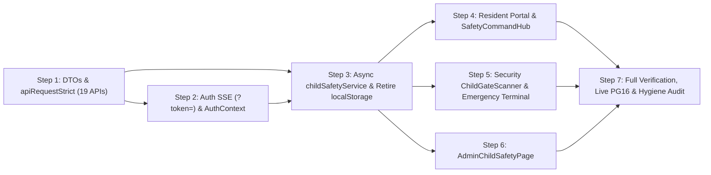

# AARIZO — ISSUE-06 Phase B.2.3: Phased Implementation Plan

**Objective:** Replace all frontend-only / `localStorage`-backed Child Safety state and broken realtime wiring with a strict, fail-closed, authenticated integration against the verified Phase B.2.2 backend APIs (`/api/children/*` and `/api/realtime/stream`), broken into **7 small, independently testable vertical steps** with explicit rollback/verification gates.

**Hard Security Invariants (Non-Negotiable Across Every Step):**
1. **Zero offline / `localStorage` pass authorization fallback.** Network failure or HTTP `503` MUST display a fail-closed gate hold message (`VERIFICATION UNAVAILABLE — DO NOT RELEASE CHILD`).
2. **Zero raw government ID fields** (`idProofNumber`, Aadhaar, PAN, DL, Passport). Use only `idDocumentType` + optional `idDocumentLast4` (max 4 chars).
3. **Zero client persistence of one-time `bearerToken` or `qrPayload`.** Hold strictly in ephemeral React modal state and clear on modal close/unmount.
4. **Zero calls to legacy `/api/collections/children`** (`ChildRepository`) and **zero client-side `POST /api/realtime/broadcast`** for Child Safety or Emergency event types.
5. **Zero hardcoded `'soc-gvs'` / `'soc-1'` tenant overrides** in Child Safety API requests; backend derives tenant strictly from verified Bearer JWT + DB membership.
6. **Zero weakening of B.2.2 backend security or schema.** This phase is frontend-only (no backend security relaxations).

---

## Step-by-Step Implementation Sequence

### Step 1: Canonical Child Safety DTOs & Strict `apiClient` Layer
**Scope:**
- `src/types/childSafety.ts`: Define authoritative B.2.3 TypeScript DTO & request/response interfaces matching `server/src/childSafety/validation.ts` verbatim (`ChildProfileDto`, `AuthorizedPickupDto`, `ChildGatePassDto`, `ChildGatePassCreatedDto` [with one-time `bearerToken` & `qrPayload`], `ChildExitLogDto`, `ChildSafetyAlertDto`, `ChildSosCreatedDto`, `VerifyChildPassResponseDto`, `ChildSafetyApiError`). Remove `idProofNumber` from active DTOs.
- `src/services/apiClient.ts`:
  - Add a reusable `ApiError` class (`status: number`, `code: string`, `message: string`, `details?: unknown`) and `apiRequestStrict<T>(endpoint, options)` helper that calls `authenticatedFetch`, parses JSON errors, and throws `ApiError` on any non-2xx or network error (network failure -> `status: 0, code: 'NETWORK_UNAVAILABLE'`).
  - Keep existing non-child `apiRequest()` untouched so unrelated modules do not regress.
  - Implement all **19 authoritative Child Safety API methods** using `apiRequestStrict`:
    - Profiles: `getChildren`, `getChildById`, `createChild`, `updateChild`, `archiveChild`
    - Pickups: `getChildPickups`, `addChildPickup`, `updateChildPickup`, `revokeChildPickup`, `archiveChildPickup`
    - Passes: `getChildPasses`, `getChildPassById`, `createChildPass`, `revokeChildPass`, `verifyChildPass` (`POST /api/children/passes/verify` with `{ qrPayload?, bearerToken?, gateId?, notes? }`)
    - Logs & SOS: `getChildExitLogs`, `triggerChildSOS`, `getChildAlerts`, `acknowledgeChildAlert`, `resolveChildAlert`
**Verification Gate:** TypeScript build (`npm run build`) + unit tests for `apiRequestStrict` covering `200`, `201`, `400`, `401`, `403`, `404`, `409`, `422`, `429`, `503`, and network error rejection.

---

### Step 2: Authenticated Realtime SSE Lifecycle (`realtimeService.ts` & `AuthContext.tsx`)
**Scope:**
- `src/services/realtimeService.ts`:
  - Remove unauthenticated constructor auto-connect (`initSseStream()` with `'soc-gvs'`).
  - Add `connect({ token, societyId })` and `disconnect()` (closes `EventSource`, clears timers, resets `lastEventId = null`).
  - Pass `?token=<jwt>` (and `societyId` if concrete, `lastEventId` on reconnect) to `EventSource('/api/realtime/stream?...')`.
  - Add exponential backoff reconnect (2s -> 30s) gated on `isSessionValid() && getAuthToken()`.
  - Expose connection status subscription (`CONNECTED` | `RECONNECTING` | `DISCONNECTED`).
  - Add bounded seen-event-ID deduplication set (`max 500`) and check `societyId` on `BroadcastChannel` relay.
  - Fix notification routing & audio alerts: handle `CHILD_*` topics before `GATE`, trigger emergency siren on `CHILD_SAFETY_SOS_TRIGGERED` & `EMERGENCY_INCIDENT_CREATED`, and route clicks to role-appropriate Child Safety route.
  - Guard `publish()` so protected `CHILD_*` / `EMERGENCY_*` / `SOS_*` / `GATE_PASS_*` events are never posted to `/api/realtime/broadcast`.
- `src/context/AuthContext.tsx`:
  - Add `useEffect` synced to `status` and `currentUser`: call `realtimeService.connect(...)` when authenticated with token, reconnect when Firebase `onIdTokenChanged` refreshes token, and call `realtimeService.disconnect()` on `logout()` / `aarizo:unauthorized`.
**Verification Gate:** Unit tests for SSE URL `?token=` construction, disconnect/reset on logout & 401, backoff stop when unauthenticated, event deduplication, and `CHILD_*` routing/siren behavior.

---

### Step 3: Refactor `childSafetyService.ts` & Retire Legacy `localStorage` / `ChildRepository`
**Scope:**
- `src/services/childSafetyService.ts`:
  - Convert `childSafetyService` into a clean, stateless, **strictly async** domain facade over `apiClient` Child Safety methods (plus pure helper functions for error-code-to-UI-message mapping, age calculation from `dateOfBirth`/`reportedAge`, and pass expiry formatting).
  - **Delete:** `SEED_CHILDREN`, all 4 `localStorage` keys (`communityos_children_profiles`, `communityos_child_pickup_qrs`, `communityos_child_pickup_logs`, `communityos_child_safety_alerts`), `societyService.getFamilyMembers()` synthesis, `db.getResidents()`/`db.getFlats()` lookups, `childRepository.create()`, client-side `CP-QR-...` generation, client-side `verifyAndScanChildPickup()`, and blocked `realtimeService.publish()` calls.
- `src/repositories/childSafety/ChildRepository.ts`:
  - Remove all references from active code; mark deprecated (or delete if no external test imports it — verify grep first).
- Create a shared lightweight React hook `src/hooks/useChildSafetyRealtime.ts` that subscribes to the 15 authoritative B.2.2 SSE events with 250ms debounced resource refresh callbacks (`onProfilesChange`, `onPassesChange`, `onExitLogsChange`, `onAlertsChange`) and 60s disconnected fallback sync.
**Verification Gate:** Grep verifies zero `localStorage` Child Safety keys and zero `ChildRepository` / `api/collections/children` calls remain; unit tests confirm all service methods delegate strictly to `apiClient` and propagate `ApiError` untouched.

---

### Step 4: Integrate Resident Child Safety Portal (`ResidentChildSafetyPage` & `SafetyCommandHub`)
**Scope:**
- Extract Child Safety UI from the 1,773-line `SafetyCommandHub.tsx` into clean modular subcomponents under `src/domains/safety/components/childSafety/`:
  - `ChildSafetyWorkspace.tsx` (orchestrates live `GET /api/children`, `/passes`, `/exit-logs`, `/alerts` + `useChildSafetyRealtime`)
  - `ChildProfileModal.tsx` (Create & Edit via `POST/PATCH /api/children`, Archive via `POST .../archive`, "Mark Returned Safe" action)
  - `AuthorizedPickupModal.tsx` (`POST/PATCH/revoke` `/api/children/:childId/pickups` strictly bound to selected `childId`; `idDocumentType` + optional `idDocumentLast4` <= 4 chars; zero hardcoded fallback escorts)
  - `OneTimeGatePassModal.tsx` (`POST /api/children/passes` -> renders `QRCodeSVG` from `qrcode.react` with `qrPayload`, `passCode`, Share/Copy/Download, explicit one-time security warning; clears `bearerToken`/`qrPayload` on close; lists existing passes with Revoke action)
  - `ChildSafetySosModal.tsx` (`POST /api/children/sos` with mandatory `location`, `childId`, `alertType`, `severity`, `lastSeenDetails`, `description`; handles `409 DUPLICATE_ACTIVE_SOS_ALERT` gracefully)
- `src/domains/safety/components/SafetyCommandHub.tsx`:
  - Mount `<ChildSafetyWorkspace />` inside the `CHILD_SAFETY` tab.
  - Route `ONE_TAP_SOS` `CHILD_SAFETY` category cleanly to `ChildSafetySosModal` / `POST /api/children/sos`.
  - Hide `GATE_VERIFIER` tab for `resident`, `committee`, and `secretary`; for `guard`/`admin`, render the authoritative gate pass verification component (same logic as `ChildGateScannerPage`) instead of name-based `localStorage` verification.
  - Remove hardcoded `DOB 14 May 2018`, hardcoded fallback escorts (`Radha Bai`, `Santosh Yadav`), and fake no-op `GENERATE_PASS` / `MISSING_ALERT` buttons.
- `src/domains/safety/services/safetyCommandEngine.ts`:
  - Remove Child Safety `localStorage` keys (`aarizo_child_profiles_v3`, `aarizo_pickup_records_v3`) and broken `childSafetyService.getChildren('soc-gvs')` bridge while preserving general non-child emergency hub behavior until emergency-incidents migration.
**Verification Gate:** Frontend build + mocked-API integration tests covering Resident create child, add/revoke pickup (no raw ID), generate & display one-time QR pass, revoke pass, trigger SOS, duplicate `409` handling, and SSE live update.

---

### Step 5: Integrate Security Child Gate Scanner (`ChildGateScannerPage` & `SecurityEmergencyTerminalPage`)
**Scope:**
- `src/pages/dashboard/security/ChildGateScannerPage.tsx`:
  - Replace all `localStorage` calls with live async `childSafetyService`:
    - `GET /api/children/passes` (guard-scoped active unexpired passes — read-only situational reference)
    - `GET /api/children/exit-logs`
    - `GET /api/children/alerts`
  - Remove **"Quick Demo Passes (Click to test scan)"** self-verification buttons.
  - Wire gate verification input (`qrPayload` or `bearerToken` + `gateId` selector + optional `notes`) strictly to `POST /api/children/passes/verify`.
  - Enforce RBAC in UI: disable/hide verify action if role is `secretary` (not in `['guard', 'admin']`) with clear read-only notice.
  - Render distinct, unambiguous fail-closed verdict panels:
    - `200 GRANTED` (green)
    - `409 CHILD_MISSING_ALERT_BLOCKED` (flashing crimson lockdown + siren)
    - `409 PASS_ALREADY_CONSUMED` / `422 PASS_EXPIRED` / `PASS_REVOKED` / `PICKUP_REVOKED` / `404 INVALID_PASS_TOKEN` (red denied with exact reason)
    - `429 RATE_LIMIT_EXCEEDED` (amber cooldown warning)
    - **`503 VERIFICATION_UNAVAILABLE` / network offline** (critical fail-closed hold: *"VERIFICATION UNAVAILABLE — DO NOT RELEASE CHILD"*)
  - Replace one-click resolve with **Acknowledge** (`POST /api/children/alerts/:id/acknowledge`) + **Resolve / False Alarm Modal** requiring non-empty `resolutionNotes` (`POST /api/children/alerts/:id/resolve`).
  - Add Guard **"Report Missing / Unattended Child"** modal (`POST /api/children/sos`).
  - Connect `useChildSafetyRealtime` with honest SSE status indicator (`Live` vs `Reconnecting`).
- `src/pages/dashboard/security/SecurityEmergencyTerminalPage.tsx`:
  - Update SSE listener to recognize `CHILD_SAFETY_SOS_TRIGGERED` and `EMERGENCY_INCIDENT_CREATED`, display a prominent deep-link card to `/security/child-safety` when active child alerts exist, and remove blocked `realtimeService.publish({ type: 'EMERGENCY_ALERTS', ... })` calls.
**Verification Gate:** Mocked-API tests for `ChildGateScannerPage` covering `200 GRANTED`, `409 CHILD_MISSING_ALERT_BLOCKED`, `409 PASS_ALREADY_CONSUMED`, `422`, `429`, **`503` fail-closed**, network offline fail-closed, Acknowledge, Resolve-with-notes, and `secretary` read-only verify guard.

---

### Step 6: Integrate Admin / Secretary Child Safety Portal (`AdminChildSafetyPage`)
**Scope:**
- `src/pages/dashboard/admin/AdminChildSafetyPage.tsx`:
  - Replace all `localStorage` calls with live async `GET /api/children`, `GET /api/children/passes`, `GET /api/children/exit-logs`, and `GET /api/children/alerts` (with optional `includeArchived` toggle).
  - Subscribe to `useChildSafetyRealtime` so SOS alerts, gate scans, and new profiles update live without manual reload.
  - Update **"Register Child"** modal to select a verified same-society Resident & Flat (`residentId` + `flatId`) sourced from backend resident/flat endpoints before calling `POST /api/children`.
  - Update **"Authorize Pickup"** modal to replace `idProofNumber` with `idDocumentType` + optional `idDocumentLast4`, calling `POST /api/children/:childId/pickups` and `POST .../revoke`.
  - Add **Edit / Archive Child**, **Mark Returned Safe**, **Generate / Revoke Pass**, **Acknowledge Alert**, and **Resolve / False Alarm (with required `resolutionNotes`)** modals.
  - Respect role capabilities: hide write actions if viewed by `committee` (read + alert manage only), and require target society selection for platform `admin` when `societyId === '*'`.
**Verification Gate:** Mocked-API tests for `AdminChildSafetyPage` covering resident/flat-bound child creation, pickup management without raw IDs, alert acknowledge/resolve-with-notes, pass revocation, and SSE live refresh.

---

### Step 7: End-to-End Verification, Live PostgreSQL 16 Validation & Security Audit Checks
**Scope:**
- Run full Jest unit & frontend integration test suite (`npm test`).
- Run live isolated PostgreSQL 16 cross-role end-to-end verification (Resident -> Guard -> Admin workflows + SSE delivery + fail-closed `503` + cross-society isolation).
- Run `npm run build` (TypeScript + Vite production bundle) and `npm run server:build`.
- Static hygiene audit verifying zero remaining Child Safety `localStorage` persistence, zero `ChildRepository` calls, zero `idProofNumber` fields in Child Safety forms, and zero `POST /api/realtime/broadcast` calls for protected event types.
- Preserve and re-confirm status of all 6 Phase B.2.1 pre-cutover risks.

---

## Dependency Graph

