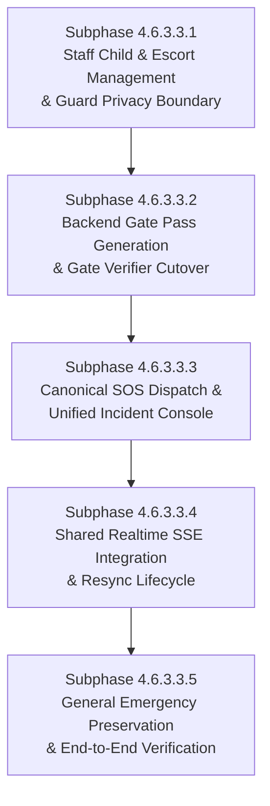

# AARIZO — ISSUE-06 / B.2.3 / PHASE 4.6.3.3
# SAFETY COMMAND HUB — IMPLEMENTATION PLAN

**Repository:** `D:\AAZIRA\AARIZO`  
**Phase:** Issue-06 / Phase B.2.3 — Subphase 4.6.3.3  
**Plan Status:** IMPLEMENTATION-READY (STRICTLY AWAITING APPROVAL)  
**Execution Mode:** Divided into 5 atomic, independently testable subphases  
**Date:** 2026-11-19  

---

## 1. Architectural Strategy & Guiding Principles

1. **Zero Fake Success:** Eliminate all local timeouts simulating pass generation, fake alert confirmations, and in-memory escort mutations. All state changes must originate from or be verified by backend PostgreSQL transactions.
2. **Elimination of Deprecated Synchronous Adapters:** Completely remove invocations of `safetyCommandEngine.getChildren()`, `safetyCommandEngine.addChildProfile()`, `safetyCommandEngine.addAuthorizedPickup()`, and `safetyCommandEngine.verifyChildPickupAtGate()`.
3. **Role & Privacy Defense-in-Depth:**
   - Align `isStaffRole` to `['admin', 'secretary', 'committee', 'guard']`.
   - Protect guard privacy boundary: Guards cannot browse the household child roster (`CHILD_SAFETY` tab); they are directed to the **Gate Scanner**.
   - Ensure `committee` has full read/review access to the `COMMAND_CONSOLE`.
4. **Unified Live Incident Console:**
   - Merge active Child Safety alerts (`childSafetyService.listAlerts({ status: 'ACTIVE' })`) with general emergency incidents (`safetyCommandEngine.getIncidents()`).
   - Wire **Acknowledge Alert** to `childSafetyService.acknowledgeAlert(id)`.
   - Wire **Mark Resolved** to `childSafetyService.resolveAlert(id, { status: 'RESOLVED', resolutionNotes })`.
   - Preserve general emergency responder assignment exclusively on general incidents.
5. **Single Shared Realtime SSE Subscription:**
   - Subscribe via `useSecurityChildSafetyRealtime` for staff sessions (or `useChildSafetyRealtime` when mounted for residents).
   - Coalesce auto-refresh across `activeAlerts`, `activePasses`, and `exitLogs` scopes.
   - Zero duplicated EventSource or Fetch connections. Zero memory leaks. Zero React Strict Mode issues.
6. **Strict Preservation of General Emergencies:**
   - Retain full functionality of One-Tap SOS for `MEDICAL`, `FIRE`, `SECURITY`, `LIFT`, `ELECTRICAL`.
   - Retain general emergency timeline logs, responder dispatching, and resolution.

---

## 2. Phased Implementation Roadmap



---

### Subphase 4.6.3.3.1: Staff Child & Escort Management & Guard Privacy Boundary
- **Files Modified:** `src/domains/safety/components/SafetyCommandHub.tsx`
- **Actions:**
  1. Align staff role checking:
     ```typescript
     const isStaffRole = ['admin', 'secretary', 'committee', 'guard'].includes(activeRole);
     const canManageProfiles = ['admin', 'secretary'].includes(activeRole);
     const canViewRoster = ['admin', 'secretary', 'committee'].includes(activeRole);
     ```
  2. In `CHILD_SAFETY` tab:
     - If `activeRole === 'guard'`: Render an authorized privacy banner explaining that guards access child safety via the **Gate Scanner**, providing a direct link/button to `/security/scanner`.
     - If `canViewRoster` (`admin`, `secretary`, `committee`): Replace `safetyCommandEngine.getChildren()` with async `childSafetyService.listChildren()`.
  3. Replace `handleAddChildSubmit`:
     - Restrict visibility to `canManageProfiles`.
     - When submitting, call `childSafetyService.createChildProfileAsync(...)`.
     - Handle errors cleanly via UI error banner instead of unhandled throws.
  4. Replace `handleAddPickupSubmit` and `handleRemoveEscort`:
     - Call `childSafetyService.addAuthorizedPickup(childId, sanitizePickupPayload)`.
     - Call `childSafetyService.revokeAuthorizedPickup(childId, escortId)` instead of local array filtering.
- **Verification:** Unit test that guard cannot view roster; secretary/admin can list and create children; pickup creation uses canonical API.

---

### Subphase 4.6.3.3.2: Backend-Authoritative Gate Pass Generation & Gate Verifier Cutover
- **Files Modified:** `src/domains/safety/components/SafetyCommandHub.tsx`
- **Actions:**
  1. Modernize `GENERATE_PASS` modal:
     - Remove fake timeout handler:
       ```typescript
       // REMOVE:
       setAlertSuccess('Child Gate Exit Pass generated and active for 4 hours!');
       ```
     - Wire to `childSafetyService.createGatePass({ childId, pickupPersonId, validUntil })`.
     - Display newly issued display code (`passCode`) and temporary QR payload in the modal on success.
  2. Cut over `GATE_VERIFIER` tab:
     - Remove call to deprecated `safetyCommandEngine.verifyChildPickupAtGate(...)`.
     - Provide a prominent CTA linking to the full production scanner at `/security/scanner` (`ChildGateScannerPage.tsx`).
     - Optionally support direct bearer-token verification by calling `childSafetyService.verifyGatePass({ bearerToken })`.
- **Verification:** Unit test proving "Confirm Pass" calls `childSafetyService.createGatePass` and handles 201 response with real token/passCode.

---

### Subphase 4.6.3.3.3: Canonical Child SOS Dispatch & Unified Incident Console
- **Files Modified:** `src/domains/safety/components/SafetyCommandHub.tsx`
- **Actions:**
  1. Modernize Staff Child Safety SOS:
     - When staff clicks Child Safety SOS in `ONE_TAP_SOS` or "Report Missing" on a child card, invoke `childSafetyService.triggerSos(...)` with:
       ```typescript
       await childSafetyService.triggerSos({
         location: `Flat ${flatNumber}`,
         childId: selectedChild?.id,
         childName: selectedChild?.fullName,
         flatNumber: selectedChild?.flatNumber || flatNumber,
         alertType: 'MISSING_CHILD',
         severity: 'CRITICAL',
         description: 'Emergency missing child reported from Safety Command Console',
       });
       ```
  2. Unified Live Incident Feed in `COMMAND_CONSOLE`:
     - Fetch active child alerts: `const childAlerts = await childSafetyService.listAlerts({ status: 'ACTIVE' })`.
     - Fetch general incidents: `const generalIncidents = safetyCommandEngine.getIncidents()`.
     - Render both feeds cleanly with category tags (`CHILD_SAFETY` vs `MEDICAL`, `FIRE`, etc.).
  3. Real Alert Actions:
     - When user clicks "Acknowledge Alert" on a `CHILD_SAFETY` alert: call `childSafetyService.acknowledgeAlert(alert.id)`.
     - When user clicks "Mark Resolved" on a `CHILD_SAFETY` alert: prompt for resolution notes and call `childSafetyService.resolveAlert(alert.id, { status: 'RESOLVED', resolutionNotes })`.
     - Disable or hide "Assign Responder" for `CHILD_SAFETY` alerts since backend schema does not track responders on `ChildSafetyAlert`.
- **Verification:** Unit test proving acknowledge/resolve calls `childSafetyService`, while general incidents call `safetyCommandEngine`.

---

### Subphase 4.6.3.3.4: Shared Realtime SSE Integration & Resync Lifecycle
- **Files Modified:** `src/domains/safety/components/SafetyCommandHub.tsx`
- **Actions:**
  1. Remove deprecated subscriptions:
     ```typescript
     // REMOVE:
     realTimeSync.subscribe('EMERGENCY_ALERTS', ...);
     realTimeSync.subscribe('CHILD_SAFETY_UPDATED', ...);
     ```
  2. Wire `useSecurityChildSafetyRealtime`:
     ```typescript
     const {
       connectionStatus,
       refreshNonce,
       invalidationScope,
     } = useSecurityChildSafetyRealtime({
       enabled: isStaffRole,
       onRefresh: async (scopes) => {
         await loadData();
       },
     });
     ```
  3. Ensure zero connection leaks:
     - Subscription cleanly unmounts when component unmounts or user logs out.
     - Reconnect automatically triggers full authoritative resync (`loadData()`).
- **Verification:** Unit test proving SSE event trigger invokes `loadData()` and updates UI state without multiple connections.

---

### Subphase 4.6.3.3.5: General Emergency Preservation & End-to-End Verification
- **Files Modified:** `src/domains/safety/components/SafetyCommandHub.tsx`
- **Actions:**
  1. Verify that `MEDICAL`, `FIRE`, `SECURITY`, `LIFT`, and `ELECTRICAL` SOS dispatches continue to function via `safetyCommandEngine.triggerOneTapSOS()`.
  2. Verify that general emergency timeline entries, responder assignment, and resolution notes remain fully intact.
  3. Run full regression test suites, TypeScript validation, and production build.
- **Verification:**
  - `npx jest --runInBand "tests/issue06_b23_safety_command_hub"`
  - `npx jest --runInBand` (full suite: 572+ passed tests, 0 failed)
  - `npx tsc -b` (exit code 0)
  - `npm run build` (exit code 0)

