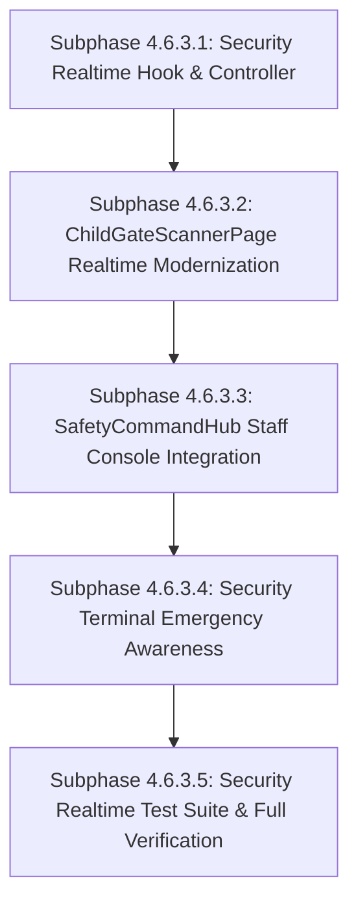

# AARIZO — ISSUE-06 / B.2.3 / PHASE 4.6.3
# SECURITY COMMAND HUB REALTIME INTEGRATION — IMPLEMENTATION PLAN

**Repository:** `D:\AAZIRA\AARIZO`  
**Phase:** Issue-06 / Phase B.2.3 — Subphase 4.6.3 (Security Command Hub Realtime Integration)  
**Status:** PROPOSED & READY FOR SEQUENTIAL IMPLEMENTATION  
**Date:** 2026-11-19  

---

## 1. IMPLEMENTATION PRINCIPLES & GOALS

1. **Server-Authoritative Only:** Completely eliminate client-side event broadcast (`realtimeService.publish`) from `ChildGateScannerPage.tsx`. Events must be generated strictly by backend REST endpoints upon verified transaction commit.
2. **Zero LocalStorage Dependencies:** Eliminate all calls to deprecated synchronous `childSafetyService.get*` methods in security components. All gate passes, logs, and alerts must be queried asynchronously from canonical PostgreSQL endpoints via `childSafetyService`.
3. **Role-Enforced Event Subscriptions:** Guards must subscribe only to the 8 authorized topics (`CHILD_GATE_PASS_*`, `CHILD_EXIT_*`, `CHILD_SAFETY_*`), never household child rosters.
4. **General Emergency Invariant:** Preserve all non-child emergency workflows (`MEDICAL`, `FIRE`, `SECURITY`, `LIFT`, `ELECTRICAL`) in `SafetyCommandHub` and `safetyCommandEngine`.
5. **Fail-Closed Gate Clearance:** In offline or degraded network states, cached records cannot authorize gate exit. Realtime status badge must clearly communicate connection status (`CONNECTED`, `RECONNECTING`, `OFFLINE`).

---

## 2. SUBPHASE BREAKDOWN

---

### SUBPHASE 4.6.3.1: Security Child Safety Realtime Hook & Controller

- **Target Files:**
  - `src/hooks/useSecurityChildSafetyRealtime.ts` (NEW or extension in `src/hooks/useChildSafetyRealtime.ts`)
- **Key Deliverables:**
  - A lightweight hook tailored for security officers and gate scanners.
  - Subscribes exclusively to the 8 guard-permitted topics:
    - `CHILD_GATE_PASS_GENERATED`
    - `CHILD_GATE_PASS_VERIFIED`
    - `CHILD_GATE_PASS_REVOKED`
    - `CHILD_EXIT_TRIGGERED`
    - `CHILD_EXIT_DENIED`
    - `CHILD_SAFETY_SOS_TRIGGERED`
    - `CHILD_SAFETY_ALERT_ACKNOWLEDGED`
    - `CHILD_SAFETY_ALERT_RESOLVED`
  - Encapsulates 50ms coalescing debounce controller for gate log updates.
  - Exposes connection status (`CONNECTED`, `RECONNECTING`, `OFFLINE`).
  - Implements automatic full-resync on reconnection (`onReconnect`).
  - Cleans up all listeners cleanly on unmount or session switch.
- **Verification Commands:**
  - `npx jest tests/issue06_b23_child_safety_realtime_hook.test.ts`
  - `npx tsc -b`

---

### SUBPHASE 4.6.3.2: ChildGateScannerPage Realtime Modernization

- **Target Files:**
  - `src/pages/dashboard/security/ChildGateScannerPage.tsx`
- **Key Deliverables:**
  - **Eliminate Deprecated Methods:** Replace `getSafetyAlerts`, `getPickupQRs`, `getPickupLogs`, `verifyAndScanChildPickup`, and `resolveSafetyAlert` with canonical async service methods:
    - `childSafetyService.listActiveGatePasses()`
    - `childSafetyService.verifyGatePass({ qrPayload, gateId })`
    - `childSafetyService.listExitLogs()`
    - `childSafetyService.listSafetyAlerts()`
    - `childSafetyService.resolveSafetyAlert()`
  - **Remove Client-Side Event Publishing:** Delete `realtimeService.publish({ type: 'CHILD_EXIT_SCANNED' })` and `realtimeService.publish({ type: 'CHILD_SAFETY_UPDATED' })`. Rely exclusively on backend-emitted SSE events.
  - **Integrate Realtime Hook:** Wire `useSecurityChildSafetyRealtime` to refresh active alerts, gate passes, and recent logs upon incoming events.
  - **Add Realtime Status Indicator:** Embed `RealtimeStatusBadge` in header top bar to show live sync state.
  - **Add Monotonic Sequence Guards:** Guard `scanRequestIdRef` to ensure slow out-of-order scan responses cannot overwrite fresh scan results.
- **Verification Commands:**
  - `npx jest tests/issue06_b23_phase4_6_resident_realtime.test.ts`
  - `npx tsc -b`

---

### SUBPHASE 4.6.3.3: SafetyCommandHub Staff Console Integration

- **Target Files:**
  - `src/domains/safety/components/SafetyCommandHub.tsx`
- **Key Deliverables:**
  - **Fix Broken Staff Adapters:** In `!isResidentRole` mode, remove broken "Add Child" and "Add Pickup" buttons (which crash with `LEGACY_SYNC_API_DEPRECATED`). Replace with informative callout directing staff to administrative desk registration.
  - **Staff Gate Verifier Tab:** Cut over `handleGateVerifySubmit` from broken `safetyCommandEngine.verifyChildPickupAtGate()` to canonical `childSafetyService.verifyGatePass()`.
  - **Realtime Integration:** Wire shared guard/staff realtime callbacks so active emergencies and gate logs refresh upon SSE events.
  - **Preserve General Emergency SOS:** Keep `safetyCommandEngine.triggerOneTapSOS` and general incident management for non-child categories (`MEDICAL`, `FIRE`, `SECURITY`, `LIFT`, `ELECTRICAL`) 100% intact.
- **Verification Commands:**
  - `npx jest tests/issue06_b23_child_safety_data_layer.test.ts`
  - `npx jest tests/issue06_b23_phase4_2_resident_panel_render.test.ts`
  - `npx tsc -b`

---

### SUBPHASE 4.6.3.4: Security Terminal Emergency Awareness

- **Target Files:**
  - `src/pages/dashboard/security/SecurityTerminalPage.tsx`
- **Key Deliverables:**
  - Add lightweight emergency awareness hook to `SecurityTerminalPage.tsx`:
    - Listens for `CHILD_SAFETY_SOS_TRIGGERED` and `CHILD_SAFETY_ALERT_RESOLVED`.
    - If a critical missing-child alert is active in the society, displays a prominent top alert banner with a one-click link to `/security/child-safety`.
  - Preserves all existing visitor pass management (`visitorService`), blacklist, and walk-in flows without regression.
- **Verification Commands:**
  - `npx jest tests/issue06_visitor_pass_api.test.ts`
  - `npx tsc -b`

---

### SUBPHASE 4.6.3.5: Security Realtime Test Suite & Full Verification

- **Target Files:**
  - `tests/issue06_b23_phase4_6_security_realtime.test.ts` (NEW comprehensive test suite)
- **Key Deliverables:**
  - Test coverage for:
    1. Single shared guard realtime subscription across the 8 permitted topics.
    2. Event-driven gate scanner cache invalidation.
    3. Replay protection and concurrent guard double-spend prevention.
    4. Missing-child emergency banner activation and audio chime trigger.
    5. Alert acknowledgement and resolution state synchronization.
    6. Offline state handling and reconnection full resynchronization.
    7. Society isolation and session switch teardown.
    8. Preservation of non-child emergency incident workflows.
- **Verification Commands:**
  - `npx jest tests/issue06_b23_phase4_6_security_realtime.test.ts`
  - `npx jest --runInBand "tests/issue06_b23_.*realtime|tests/issue06_b23_child_safety_data_layer"`
  - `npx jest --runInBand` (full 542+ tests pass)
  - `npx tsc -b` (exit code 0)
  - `npm run build` (exit code 0)

---

## 3. ROLLBACK & RISK MITIGATION STRATEGY

1. **Independent Subphases:** Each subphase can be developed, verified, and reviewed independently without breaking the existing resident portal.
2. **Zero Schema Modifications:** The backend and database are already fully compliant. Subphase 4.6.3 is strictly a frontend service and UI integration.
3. **No Visitor Pass Regressions:** SecurityTerminalPage visitor flows use completely separate services (`visitorService`), guaranteeing visitor gate operations are undisturbed.

