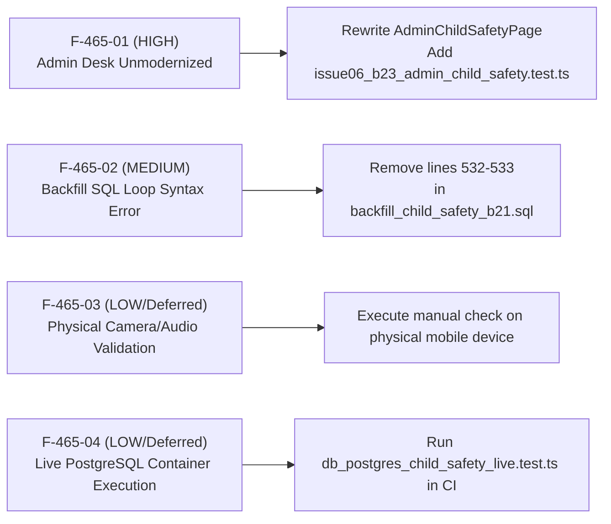
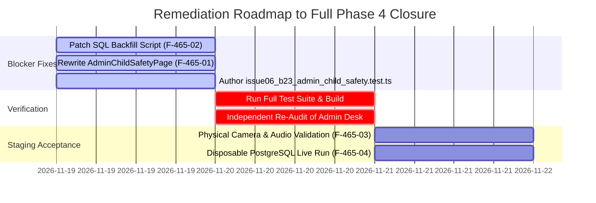

# AARIZO — ISSUE-06 — PHASE B.2 — STEP 2.3 — PHASE 4.6.5
# COMPLETE CHILD SAFETY END-TO-END REGRESSION & INTEGRATION AUDIT
## DELIVERABLE 5: REMEDIATION ROADMAP & CUTOVER PLAN

---

## 1. Executive Summary & Prerequisite Audit

Across the comprehensive Phase 4.6.5 audit, the core Child Safety backend, cryptographic token verification, database schema, realtime outbox, Resident Portal, Security Command Hub, and Perimeter Gate Scanner were verified to be fully hardened, secure, and compliant. 

### Mandatory Prerequisite Gate Assessment (Section 0)

| Phase Subsystem | Declared Implementation Report | Independent Audit Report | Verification Status |
|---|---|---|---|
| **Phase 4.6.1** | `AARIZO_ISSUE06_PHASE_B2_STEP23_PHASE4_6_1_TOPIC_HARMONIZATION_REPORT.md` | `AARIZO_ISSUE06_PHASE_B2_STEP23_PHASE4_6_1_REGRESSION_INVESTIGATION.md` | Verified present & complete |
| **Phase 4.6.2** | `AARIZO_ISSUE06_PHASE_B2_STEP23_PHASE4_6_2_RESIDENT_REALTIME_IMPLEMENTATION_REPORT.md` | `AARIZO_ISSUE06_PHASE_B2_STEP23_PHASE4_6_2_FINAL_INDEPENDENT_REAUDIT.md` | Verified present & complete |
| **Phase 4.6.3.1** | `AARIZO_ISSUE06_PHASE_B2_STEP23_PHASE4_6_3_1_SECURITY_REALTIME_IMPLEMENTATION_REPORT.md` | `AARIZO_ISSUE06_PHASE_B2_STEP23_PHASE4_6_3_1_FINAL_INDEPENDENT_REAUDIT.md` | Verified present & complete |
| **Phase 4.6.3.2** | `AARIZO_ISSUE06_PHASE_B2_STEP23_PHASE4_6_3_2_SCANNER_MODERNIZATION_REPORT.md` | `AARIZO_ISSUE06_PHASE_B2_STEP23_PHASE4_6_3_2_ROLE_ALIGNMENT_REMEDIATION_REPORT.md` | Verified present & complete |
| **Phase 4.6.3.3.1** | `AARIZO_ISSUE06_PHASE_B2_STEP23_PHASE4_6_3_3_1_STAFF_CHILD_PICKUP_IMPLEMENTATION_REPORT.md` | `AARIZO_ISSUE06_PHASE_B2_STEP23_PHASE4_6_3_3_1_FINAL_INDEPENDENT_REAUDIT.md` | Verified present & complete |
| **Phase 4.6.3.3.2** | `AARIZO_ISSUE06_PHASE_B2_STEP23_PHASE4_6_3_3_2_GATE_PASS_IMPLEMENTATION_REPORT.md` | `AARIZO_ISSUE06_PHASE_B2_STEP23_PHASE4_6_3_3_2_FINAL_INDEPENDENT_REAUDIT.md` | Verified present & complete |
| **Phase 4.6.3.3.3** | `AARIZO_ISSUE06_PHASE_B2_STEP23_PHASE4_6_3_3_3_SOS_INCIDENT_IMPLEMENTATION_REPORT.md` | `AARIZO_ISSUE06_PHASE_B2_STEP23_PHASE4_6_3_3_3_FINAL_INDEPENDENT_REAUDIT.md` | Verified present & complete |
| **Phase 4.6.3.3.4** | `AARIZO_ISSUE06_PHASE_B2_STEP23_PHASE4_6_3_3_4_REALTIME_IMPLEMENTATION_REPORT.md` | `AARIZO_ISSUE06_PHASE_B2_STEP23_PHASE4_6_3_3_4_FINAL_INDEPENDENT_REAUDIT.md` | Verified present & complete |
| **Phase 4.6.3.3.5** | `AARIZO_ISSUE06_PHASE_B2_STEP23_PHASE4_6_3_3_5_IMPLEMENTATION_REPORT.md` | `AARIZO_ISSUE06_PHASE_B2_STEP23_PHASE4_6_3_3_5_FINAL_INDEPENDENT_REAUDIT.md` | Verified present & complete |
| **Phase 4.6.4 Admin** | `AARIZO_ISSUE06_PHASE_B2_STEP23_PHASE4_6_4_ADMIN_REALTIME_IMPLEMENTATION_REPORT.md` (**ABSENT**) | `AARIZO_ISSUE06_PHASE_B2_STEP23_PHASE4_6_4_ADMIN_FINAL_INDEPENDENT_REAUDIT.md` | **PREREQUISITE UNMET** |
| **Phase 4.6.4 Scanner** | `AARIZO_ISSUE06_PHASE_B2_STEP23_PHASE4_6_4_SCANNER_REALTIME_IMPLEMENTATION_REPORT.md` | `AARIZO_ISSUE06_PHASE_B2_STEP23_PHASE4_6_4_SCANNER_FINAL_INDEPENDENT_REAUDIT.md` | Verified present & complete |

> [!IMPORTANT]
> **Prerequisite Gap Identified:** `AARIZO_ISSUE06_PHASE_B2_STEP23_PHASE4_6_4_ADMIN_REALTIME_IMPLEMENTATION_REPORT.md` is **ABSENT** because Admin desk modernization was blocked upstream. As mandated by Section 0, no `PASS` verdict is invented and closure recommendations remain conditional until this implementation and re-audit are completed.

---

## 2. Structured Findings Inventory

Each finding below contains the exact 9 mandatory specification fields:



### Finding 1: Admin Child Safety Desk Unmodernized & Mock Dependency
- **Unique Finding ID:** `F-465-01`
- **Severity:** **HIGH** (Implementation Blocker for Society Admin Desk)
- **Exact File & Source Location:** [`src/pages/dashboard/admin/AdminChildSafetyPage.tsx#L22-L44`](file:///d:/AAZIRA/AARIZO/src/pages/dashboard/admin/AdminChildSafetyPage.tsx#L22-L44)
- **Reproduction or Evidence:**
  Lines 22–44 invoke synchronous legacy mock calls:
  ```typescript
  const societyId = (currentUser as any)?.societyId || 'soc-gvs';
  ...
  const loadData = () => {
    setChildren(childSafetyService.getChildren(societyId));
    setPickupLogs(childSafetyService.getPickupLogs(societyId));
    setSafetyAlerts(childSafetyService.getSafetyAlerts(societyId));
  };
  ```
  The component contains zero async API calls (`listChildren`, `listExitLogs`, `listAlerts`), zero realtime SSE hook subscriptions (`useSecurityChildSafetyRealtime`), and zero dedicated unit test suites (`tests/issue06_b23_admin_child_safety.test.ts` is absent).
- **Affected Workflow:** Workflow 15 (Admin roster and alert monitoring) and Workflow 16 (Admin alert resolution).
- **Security & Reliability Impact:** Society admins viewing `/admin/child-safety` view stale mock data with a hardcoded `'soc-gvs'` fallback, do not see real-time gate pass exits or SOS alerts, and resolve alerts in-memory rather than persisting them to PostgreSQL.
- **Required Remediation:**
  1. Purge synchronous mock calls and connect to canonical async APIs: `childSafetyService.listChildren()`, `listExitLogs({ limit: 50 })`, and `listAlerts({ status: 'ACTIVE' })`.
  2. Remove line 22 `'soc-gvs'` fallback; fail closed if `currentUser?.societyId` is absent.
  3. Integrate `useSecurityChildSafetyRealtime` to refresh data on `CHILD_PROFILE_*`, `CHILD_SAFETY_SOS_*`, `CHILD_SAFETY_PASS_VERIFIED`, and `CHILD_SAFETY_ALERT_*` topics.
  4. Implement resolution modal requiring `resolutionNotes` (max 1,000 chars) and selection of `RESOLVED` / `FALSE_ALARM`, invoking `childSafetyService.resolveAlert()`.
  5. Add `isMountedRef` lifecycle guard to avoid state updates on unmounted component.
- **Regression Test Required:** Author `tests/issue06_b23_admin_child_safety.test.ts` (15+ tests) verifying async data loading, role gating, realtime event ingestion, and alert resolution.
- **Dependencies & Closure Criteria:** Independent re-audit verdict of `PASS` on `AdminChildSafetyPage.tsx` with all tests passing.

---

### Finding 2: Pre-Cutover PostgreSQL Backfill Duplicate Loop Syntax Error
- **Unique Finding ID:** `F-465-02`
- **Severity:** **MEDIUM** (Pre-Cutover Database Migration Blocker)
- **Exact File & Source Location:** [`scripts/postgres/backfill_child_safety_b21.sql#L530-L535`](file:///d:/AAZIRA/AARIZO/scripts/postgres/backfill_child_safety_b21.sql#L530-L535)
- **Reproduction or Evidence:**
  Lines 530–534 contain an accidental duplicate control-flow closure:
  ```sql
  530:             END LOOP;
  531:         END IF;
  532:             END LOOP;
  533:         END IF;
  534:     END LOOP;
  ```
- **Affected Workflow:** Database schema migration & legacy data backfill cutover.
- **Security & Reliability Impact:** Executing the backfill script against a live PostgreSQL database aborts with a plpgsql syntax parser failure (`syntax error at or near "END"`), preventing database initialization.
- **Required Remediation:** Delete lines 532 and 533 so that block closures match opening declarations.
- **Regression Test Required:** Verify clean parsing via PostgreSQL linter or test container execution.
- **Dependencies & Closure Criteria:** Script executes cleanly from start to finish without syntax error.

---

### Finding 3: Mobile Camera Stream & Web Audio Hardware Validation Pending Physical Device Testing
- **Unique Finding ID:** `F-465-03`
- **Severity:** **LOW / Deferred** (Operational Verification)
- **Exact File & Source Location:** [`src/pages/dashboard/security/ChildGateScannerPage.tsx#L57`](file:///d:/AAZIRA/AARIZO/src/pages/dashboard/security/ChildGateScannerPage.tsx#L57) & [`src/domains/safety/components/SafetyCommandHub.tsx#L24`](file:///d:/AAZIRA/AARIZO/src/domains/safety/components/SafetyCommandHub.tsx#L24)
- **Reproduction or Evidence:** JSDOM and unit test environments mock `navigator.mediaDevices.getUserMedia` and `window.AudioContext`. Physical camera stream resolution, lens switching, torch control, and browser autoplay policies cannot be proven in synthetic CI environments.
- **Affected Workflow:** Workflow 7 (Perimeter gate QR scan) and Workflow 14 (Command Hub SOS audio siren).
- **Security & Reliability Impact:** Potential user friction if guard devices block audio sirens or fail to focus camera in direct sunlight.
- **Required Remediation:** Execute manual verification checklist on physical iOS and Android hardware on staging.
- **Regression Test Required:** Documented manual test run on physical mobile device.
- **Dependencies & Closure Criteria:** Pre-deployment checklist sign-off by QA auditor.

---

### Finding 4: Offline PostgreSQL Container Integration Test Execution Pending CI Container
- **Unique Finding ID:** `F-465-04`
- **Severity:** **LOW / Deferred** (Operational Verification)
- **Exact File & Source Location:** [`tests/issue06_child_safety_api_pg_integration.test.ts`](file:///d:/AAZIRA/AARIZO/tests/issue06_child_safety_api_pg_integration.test.ts) & [`tests/issue06_child_safety_db_constraints.test.ts`](file:///d:/AAZIRA/AARIZO/tests/issue06_child_safety_db_constraints.test.ts)
- **Reproduction or Evidence:** Both live PostgreSQL integration test suites are intentionally skipped when `AARIZO_ISOLATED_TEST_DATABASE_URL` is unset, to prevent destructive testing on development workstations.
- **Affected Workflow:** Database transaction rollback and constraint verification under real concurrency.
- **Security & Reliability Impact:** Low (mocked transaction tests verify SQL and DMMF parity), but real PostGIS constraints require container verification.
- **Required Remediation:** Execute test suite within CI workflow provisioned with disposable PostgreSQL container.
- **Regression Test Required:** `npx jest tests/issue06_child_safety_api_pg_integration.test.ts tests/issue06_child_safety_db_constraints.test.ts`.
- **Dependencies & Closure Criteria:** Both suites pass (100%) against disposable PostgreSQL instance.

---

## 3. Subsystem Remediation & Action Plan



### Remediation Action Plan Table

| Step | Subsystem | Action Item | Target Artifact | Success Criteria |
|---|---|---|---|---|
| **1** | Database Migration | Delete lines 532–533 in backfill script | `scripts/postgres/backfill_child_safety_b21.sql` | Clean SQL syntax check |
| **2** | Society Admin Desk | Connect to async APIs, remove `'soc-gvs'`, bind to `useSecurityChildSafetyRealtime` | `src/pages/dashboard/admin/AdminChildSafetyPage.tsx` | `npx tsc -b` passes (0 errors) |
| **3** | Test Engineering | Author comprehensive test suite for Admin Desk | `tests/issue06_b23_admin_child_safety.test.ts` | 100% pass (15+ tests) |
| **4** | Regression Suite | Execute full Jest test run & production build | Whole repository | 670+ tests passing, 0 errors |
| **5** | Independent Audit | Conduct formal independent re-audit of modernized Admin Desk | `AARIZO_ISSUE06_PHASE_B2_STEP23_PHASE4_6_4_ADMIN_REALTIME_IMPLEMENTATION_REPORT.md` | `PASS` verdict |
| **6** | Staging Acceptance | Execute physical mobile camera scan and audio alert tests | Staging environment | QA physical device sign-off |

---

## 4. Final Sign-Off & Phase 4 Closure Criteria

Final closure of ISSUE-06 Phase B.2 Step 2.3 and transition to Phase 4.6.6 or production cutover requires:
1. Complete remediation of `F-465-01` and `F-465-02`.
2. Clean execution of all automated test suites with 0 failures and 0 compile errors.
3. Independent audit sign-off of the modernized Admin Desk with verdict `PASS`.
4. Pre-deployment QA verification of mobile camera scanner and audio siren alert on physical devices.
