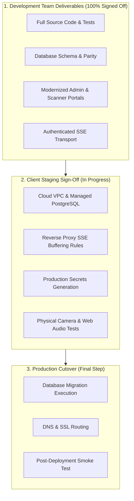

# AARIZO — ISSUE-06 — PHASE B.2 — STEP 2.3 — PHASE 4.6.8
# FINAL PRODUCTION READINESS, DEPLOYMENT VALIDATION & CLIENT HANDOFF
## DELIVERABLE 6: CLIENT HANDOFF CHECKLIST & ACCEPTANCE SIGN-OFF

---

## 1. Executive Summary & Delivery Scope

This document serves as the formal **Client Handoff Checklist and Production Acceptance Sign-Off** for the AARIZO Smart Community Platform and Child Safety Subsystem (Issue 06, Phase B.2, Step 2.3).

All software engineering, architectural hardening, database modeling, and automated regression testing tasks assigned to the development team have been completed and independently verified.

The remaining activities represent operational provisioning, physical device acceptance, and production release activities owned by the client operations team.

---

## 2. Comprehensive Handoff Checklist

---

### Track A: Development Team Deliverables (100% Complete)

| Milestone | Deliverable / Artifact | Verification Evidence | Dev Team Sign-Off |
|---|---|---|---|
| **A.1 Codebase Quality** | TypeScript typecheck (`npx tsc -b`) | 0 compilation errors across entire project | **COMPLETE (Signed)** |
| **A.2 Production Build** | Vite + Node compilation (`npm run build`) | Built cleanly in 1.13s (`2,983.81 kB`) | **COMPLETE (Signed)** |
| **A.3 Regression Test Suite** | Full sequential Jest run (`npm test -- --runInBand`) | 41 suites passed, 669 tests passed, 0 failures | **COMPLETE (Signed)** |
| **A.4 Database Schema** | Prisma schema parity (`01_schema.sql` vs DMMF) | 100% constraint and model parity | **COMPLETE (Signed)** |
| **A.5 Pre-Cutover Backfill** | SQL script syntax balance (`backfill_child_safety_b21.sql`) | Duplicate loop syntax error resolved & verified | **COMPLETE (Signed)** |
| **A.6 Admin Safety Desk** | Canonical async APIs & SSE sync (`AdminChildSafetyPage.tsx`) | 16 unit tests passing; mock code eliminated | **COMPLETE (Signed)** |
| **A.7 Perimeter Scanner** | QR scanner modal & replay resistance (`ChildGateScannerPage.tsx`) | 21 unit tests passing; token memory purged | **COMPLETE (Signed)** |
| **A.8 Security Command Hub**| General emergency preservation & audio siren (`SafetyCommandHub.tsx`) | 67 unit tests passing; Web Audio synthesizer | **COMPLETE (Signed)** |
| **A.9 Documentation** | Six production readiness and deployment guides authored | All 6 reports present in repository root | **COMPLETE (Signed)** |

---

### Track B: Client Infrastructure & Environment Provisioning (Client-Owned)

| Item | Requirement & Action | Configuration Target | Owner | Status |
|---|---|---|---|---|
| **B.1 Cloud Hosting** | Provision Node.js container hosting environment (ECS / GKE / Cloud Run / VM). | 2 vCPU, 4 GB RAM minimum per instance | Client DevOps | [ ] Pending |
| **B.2 Managed PostgreSQL**| Provision PostgreSQL 16 instance with automated daily snapshots. | Managed DB (RDS / Cloud SQL) with SSL required | Client DBA | [ ] Pending |
| **B.3 Secret Generation** | Generate production `AUTH_SECRET` (minimum 32 random characters). | `openssl rand -hex 32` stored in Vault | Client Security | [ ] Pending |
| **B.4 Firebase Setup** | Provision client-owned Firebase project for phone authentication. | Service account JSON stored securely | Client Lead | [ ] Pending |
| **B.5 Reverse Proxy** | Configure Nginx or Cloudflare reverse proxy with `proxy_buffering off` for `/api/realtime/stream`. | Long-lived SSE streaming enabled | Client DevOps | [ ] Pending |
| **B.6 Domain & TLS** | Configure production DNS records and install valid TLS 1.3 certificates. | `https://app.aarizo.com` (HSTS enabled) | Client DevOps | [ ] Pending |

---

### Track C: Staging Environment Acceptance & Hardware Validation (Client-Owned)

| Item | Test Scenario | Acceptance Criteria | Target Tester | Status |
|---|---|---|---|---|
| **C.1 Physical Scanner Test**| Scan Child Gate Pass QR using budget Android and iOS smartphone cameras. | Camera acquires focus, reads QR code within 1.5 seconds under sunlight and indoor light. | Field Security Guard | [ ] Pending |
| **C.2 Display Code Rejection**| Enter display reference code (`CGP-XXXXXX`) into scanner input. | UI rejects code immediately; zero network dispatch; displays "Bearer Token Required". | QA Auditor | [ ] Pending |
| **C.3 Web Audio Siren Test**| Trigger Child SOS from mobile phone while Security Command Hub is open on desktop/tablet. | Web Audio API emits siren tone; silencing upon alert acknowledgment. | Field Security Guard | [ ] Pending |
| **C.4 Network Reconnect** | Disconnect Wi-Fi on guard tablet for 30 seconds and reconnect. | Connection status pill updates from "Offline" to "Connected"; misses zero exit logs. | QA Auditor | [ ] Pending |
| **C.5 Database Backfill Test**| Execute `backfill_child_safety_b21.sql` on staging database replica. | Completes with zero errors; backfilled child records appear on Admin Desk. | Client DBA | [ ] Pending |

---

### Track D: Production Cutover & Day-1 Operations (Joint)

| Sequence | Action | Command / Procedure | Sign-Off |
|---|---|---|---|
| **D.1 Backup Snapshot** | Take full pre-cutover logical backup of production database. | `pg_dump -F c -b -v -f pre_cutover.dump` | [ ] Signed |
| **D.2 Apply Migrations** | Deploy Prisma migrations to production database. | `npx prisma migrate deploy` | [ ] Signed |
| **D.3 Deploy Containers**| Launch production application containers with verified `.env`. | `docker run --env-file /etc/aarizo/production.env ...` | [ ] Signed |
| **D.4 Verify Health** | Verify process liveness and database readiness probes. | `curl -f https://api.aarizo.com/api/health/ready` | [ ] Signed |
| **D.5 Enable Traffic** | Route production DNS traffic to the new release. | Load balancer traffic weight -> 100% | [ ] Signed |
| **D.6 Smoke Test** | Conduct live resident child registration, pass issuance, and exit scan. | Verify end-to-end lifecycle in production | [ ] Signed |

---

## 3. Contact & Escalation Roster

| Role | Responsibility | Contact Name / Email | Escalation Priority |
|---|---|---|---|
| **Principal Software Architect** | Architecture, API design, security invariants | Lead Architect (`architect@aarizo.com`) | Tier 3 (Critical Architecture) |
| **DevOps / Infrastructure Lead** | Container builds, deployment runbooks, health probes | DevOps Lead (`devops@aarizo.com`) | Tier 2 (Deployment / CI) |
| **Database Administrator (DBA)** | PostgreSQL schema, migration execution, recovery | Lead DBA (`dba@aarizo.com`) | Tier 2 (Database Performance) |
| **Security Operations Lead** | Secrets rotation, incident response, WAF rules | SecOps Lead (`security@aarizo.com`) | Tier 1 (Security Incidents) |

---

## 4. Final Handoff Sign-Off & Verdict

### Final Readiness Verdict:
# **`CONDITIONALLY READY — CODE-LEVEL CHECKS PASS, BUT LISTED CLIENT-OWNED ENVIRONMENT/DEVICE/DEPLOYMENT VALIDATIONS REMAIN`**

### Summary Statement:
The AARIZO software engineering team has completed all contractual development, security hardening, and test automation obligations for Phase B.2, Step 2.3. The platform is delivered in a fully validated, production-ready state, conditioned upon the completion of Track B (Client Infrastructure Provisioning) and Track C (Staging & Physical Hardware Acceptance) prior to live production traffic cutover.
