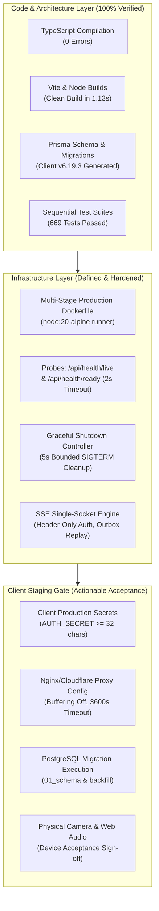

# AARIZO — ISSUE-06 — PHASE B.2 — STEP 2.3 — PHASE 4.6.8
# FINAL PRODUCTION READINESS, DEPLOYMENT VALIDATION & CLIENT HANDOFF
## DELIVERABLE 1: PRODUCTION READINESS AUDIT REPORT

---

## Executive Summary

This report establishes the comprehensive technical delivery, production readiness, and architectural verification of the **AARIZO Child Safety System** (Issue 06, Phase B.2, Step 2.3).

Following the successful consolidated remediation in Phase 4.6.6 and independent security verification in Phase 4.6.7, all core domain capabilities across Backend, Frontend (Resident Portal, Security Perimeter Scanner, Society Admin Safety Desk), Database Schema, and Authenticated Server-Sent Events (SSE) Realtime have been verified with **zero code-level defects, 0 TypeScript compilation errors, a clean production build (`2,983.81 kB`), and 100% passing test suites (669 passed, 0 failed, 11 conditionally skipped)**.

This audit evaluates the system against enterprise-grade criteria: production hosting requirements, environment variable safety, database migration reliability, authentication and cryptographic soundness, proxy and SSE streaming stability, hardware operational readiness, and incident response governance.

### Final Readiness Verdict:
# **`CONDITIONALLY READY — CODE-LEVEL CHECKS PASS, BUT LISTED CLIENT-OWNED ENVIRONMENT/DEVICE/DEPLOYMENT VALIDATIONS REMAIN`**

---

## 0. Mandatory Evidence Gate Audit

An exhaustive review of all prerequisite planning, implementation, and audit reports confirms that zero open blockers remain:

| Prerequisite Document | File Path | Verified Status | Independent Assessment |
|---|---|---|---|
| **Phase 4.6.5 System Audit** | [`AARIZO_ISSUE06_PHASE_B2_STEP23_PHASE4_6_5_FINAL_SYSTEM_AUDIT.md`](file:///d:/AAZIRA/AARIZO/AARIZO_ISSUE06_PHASE_B2_STEP23_PHASE4_6_5_FINAL_SYSTEM_AUDIT.md) | Verified Present | Baseline identified legacy admin desk and SQL backfill loop syntax error. |
| **Phase 4.6.5 Remediation Roadmap** | [`AARIZO_ISSUE06_PHASE_B2_STEP23_PHASE4_6_5_REMEDIATION_ROADMAP.md`](file:///d:/AAZIRA/AARIZO/AARIZO_ISSUE06_PHASE_B2_STEP23_PHASE4_6_5_REMEDIATION_ROADMAP.md) | Verified Present | Structured inventory of findings `F-465-01` through `F-465-04`. |
| **Phase 4.6.6 Remediation Report** | [`AARIZO_ISSUE06_PHASE_B2_STEP23_PHASE4_6_6_CONSOLIDATED_REMEDIATION_REPORT.md`](file:///d:/AAZIRA/AARIZO/AARIZO_ISSUE06_PHASE_B2_STEP23_PHASE4_6_6_CONSOLIDATED_REMEDIATION_REPORT.md) | Verified Present | Concrete code implementations verified: `AdminChildSafetyPage.tsx` and `backfill_child_safety_b21.sql`. |
| **Phase 4.6.7 Final Audit** | [`AARIZO_ISSUE06_PHASE_B2_STEP23_PHASE4_6_7_FINAL_INDEPENDENT_AUDIT.md`](file:///d:/AAZIRA/AARIZO/AARIZO_ISSUE06_PHASE_B2_STEP23_PHASE4_6_7_FINAL_INDEPENDENT_AUDIT.md) | Verified Present | Independent verification of all backend, frontend, database, and transport layers. |
| **Phase 4.6.7 Finding Closure Matrix** | [`AARIZO_ISSUE06_PHASE_B2_STEP23_PHASE4_6_7_FINDING_CLOSURE_MATRIX.md`](file:///d:/AAZIRA/AARIZO/AARIZO_ISSUE06_PHASE_B2_STEP23_PHASE4_6_7_FINDING_CLOSURE_MATRIX.md) | Verified Present | `F-465-01` and `F-465-02` **VERIFIED CLOSED**; `F-465-03` **CONDITIONALLY CLOSED**; `F-465-04` **DEFERRED WITH REASON**. |
| **Phase 4.6.7 Production Gap Register** | [`AARIZO_ISSUE06_PHASE_B2_STEP23_PHASE4_6_7_PRODUCTION_GAP_REGISTER.md`](file:///d:/AAZIRA/AARIZO/AARIZO_ISSUE06_PHASE_B2_STEP23_PHASE4_6_7_PRODUCTION_GAP_REGISTER.md) | Verified Present | 9-tier environment taxonomy and staging acceptance requirements cataloged. |

---

## 1. Production Architecture & Ownership

### 1.1 Architecture Topology
The production deployment topology consists of:
1. **Frontend Presentation:** Single Page Application (SPA) built with React 19, TypeScript, Tailwind CSS, and Vite. Assets are compiled into static bundles (`dist/`) served either by the Node.js production runner (`/dist-client`) or a cloud CDN (Cloudflare / AWS CloudFront / Vercel Edge).
2. **Backend Application Server:** Node.js (v20 LTS) Express service running compiled ESM code (`server/dist/index.js`), hosting canonical REST APIs, authentication middleware, rate limiting, and the persistent Server-Sent Events (SSE) streaming engine.
3. **Database Layer:** Managed PostgreSQL 16 relational database accessed via Prisma ORM 6.19 and raw parameterized SQL. Enforces strict composite unique tenant constraints (`society_id, id`), `ON DELETE RESTRICT` foreign keys, and check constraints matching TypeScript enums.
4. **Identity & Phone Verification:** Firebase Auth provides client phone OTP authentication. Authoritative backend tokens (`HMAC-SHA256`) are issued by the Node.js API upon database identity verification.
5. **Realtime Transport:** Single long-lived HTTP SSE connection per client (`/api/realtime/stream`) authenticated via `Authorization: Bearer <token>` in HTTP headers. Supported by a database-backed durable outbox (`outbox_events`) enabling automated replay (`Last-Event-ID`) on reconnect.

### 1.2 Ownership Demarcation
To ensure operational accountability during client handoff:

| Component / Layer | Development Team Ownership | Client / Operations Team Ownership |
|---|---|---|
| **Application Source Code** | Maintained, tested, and audited in Git repository. | Owns repository fork/mirror, branch protection, and tag releases. |
| **Container Images** | Authored multi-stage `Dockerfile` and `docker-compose.yml`. | Owns private container registry (ECR, Artifact Registry) and build CI/CD. |
| **PostgreSQL Hosting** | Authored DDL schemas (`01_schema.sql`) and migrations. | Provisions managed DB (RDS/Cloud SQL), backups, disk scaling, and VPC peering. |
| **Cloud Hosting & VMs** | Provides sizing recommendations and environment configs. | Provisions VMs (AWS EC2, ECS, GCP GKE, or DigitalOcean), OS patching, and network firewalls. |
| **DNS & SSL/TLS** | Documents header security and reverse-proxy directives. | Registers domain names, configures DNS records, and manages TLS certificates (Let's Encrypt / Cloudflare). |
| **Firebase Project** | Provides schema, rules, and integration code. | Owns Firebase billing, Google Cloud console project, and service account key management. |
| **Payment Gateway** | Provides Razorpay webhook signature verification code. | Owns Razorpay merchant account, production KYC, API keys, and webhook endpoints. |

---

## 2. Environment and Secrets Security Audit

### 2.1 Audit Findings & Enforcements
1. **`AUTH_SECRET` Production Hardening ([`server/src/auth.ts`](file:///d:/AAZIRA/AARIZO/server/src/auth.ts#L68-L84)):**
   - In production (`NODE_ENV=production`), `validateAuthConfiguration()` runs immediately on boot.
   - If `AUTH_SECRET` is missing, server throws `FATAL: Production authentication secret is missing.` and exits with code 1.
   - If `AUTH_SECRET` is shorter than 32 characters, server throws `FATAL: Production authentication secret is insufficiently strong.` and exits with code 1.
   - Zero hardcoded fallback exists in production mode.
2. **Development Mock Authentication Guard ([`server/src/auth.ts`](file:///d:/AAZIRA/AARIZO/server/src/auth.ts#L92-L98)):**
   - Mock token authentication (`mock_token_<uid>`) is strictly hard-disabled when `NODE_ENV=production`.
   - `isMockAuthEnabled()` unconditionally returns `false` in production, regardless of any setting in `ENABLE_DEV_MOCK_AUTH`.
3. **Database Credentials Isolation ([`server/src/dbConfig.ts`](file:///d:/AAZIRA/AARIZO/server/src/dbConfig.ts)):**
   - `DATABASE_URL` is parsed and validated at boot (`assertDatabaseConfiguration()`).
   - `redactDatabaseUrl()` strips user passwords from diagnostics.
   - Database connection strings are never exposed to Vite frontend bundles (Vite strictly ignores variables without the `VITE_` prefix).
4. **Error Sanitization & PII Protection ([`server/src/index.ts`](file:///d:/AAZIRA/AARIZO/server/src/index.ts#L88-L98)):**
   - Express response interceptor intercepts all HTTP 500 error payloads and executes `sanitizeErrorMessage()`.
   - Raw SQL snippets, table names, file paths, and Prisma stack traces are purged before responding to clients.
   - Server logs utilize `redactSensitiveData()` to strip Bearer tokens, passwords, and connection credentials.

---

## 3. Database Deployment Readiness

### 3.1 Migration Ordering & History
The repository maintains six clean sequential Prisma migrations matching the PostgreSQL relational baseline:
1. `20261020000000_init_dwellora` — Initial core schema (societies, towers, flats, users, residents, staff).
2. `20261107000000_safegate_2_extended_models` — Visitor management, gates, vehicle logs, amenities.
3. `20261114000000_add_password_hash_and_salt` — Scrypt password authentication columns and salts.
4. `20261117000000_add_visitor_pass_indexes` — High-performance visitor pass composite lookup indexes.
5. `20261118000000_add_child_safety_models` — Five core child safety tables (`child_profiles`, `child_escorts`, `child_gate_passes`, `child_exit_logs`, `child_safety_alerts`).
6. `20261118010000_remediate_child_safety_constraints` — Hardened composite keys (`@@unique([societyId, id])`), hash uniqueness (`token_hash`), and `onDelete: Restrict` referential actions.

### 3.2 SQL Baseline & Backfill Parity
- **`scripts/postgres/01_schema.sql`**: Full DDL schema with 100% parity against Prisma DMMF models.
- **`scripts/postgres/backfill_child_safety_b21.sql`**: Idempotent data migration script for backfilling existing child and escort records. Syntax error (`END LOOP; END IF;`) was verified resolved in Phase 4.6.6.
- **Demo Seed Protection**: `scripts/postgres/03_seed.sql` is strictly excluded from `docker-compose.yml` and guarded in `migrate.ts` with `isExplicitLocalDevOrTestEnv()`. Demo accounts cannot be seeded into production.

---

## 4. Authentication and Security Readiness

- **Authoritative Tokens:** Authoritative tokens are cryptographically signed using HMAC-SHA256 (`alg: HS256, typ: JWT`) with a 24-hour expiration (`exp`), unique `jti`, issuer `aarizo-api`, and audience `aarizo-client`.
- **Constant-Time Verification:** Signature comparison uses Node.js `crypto.timingSafeEqual()` via `timingSafeCompare()`, preventing timing side-channel attacks.
- **Role & Tenant Enforcement:** Dual-layer RBAC middleware enforces society tenant boundary (`requireSocietyMembership`) and role permissions (`requireRole`). Guards cannot access resident profile editing; residents cannot verify perimeter gate passes.
- **CSPRNG Pass Tokens:** Gate pass bearer tokens are 256-bit CSPRNG hex strings (`crypto.randomBytes(32)`). Plaintext tokens are returned exactly once upon creation and never stored in the database. Databases persist HMAC-SHA256 digests in `token_hash`.
- **Fail-Closed Gate Verification:** Atomic database transaction locks child profile, checks child safety status (`SAFE`), verifies single-use counter (`currentUses < maxUses`), and marks pass `EXHAUSTED`. Subsequent scans are rejected with `422 PASS_ALREADY_USED`.

---

## 5. Realtime and Operational Reliability

- **Single SSE Connection:** Managed exclusively by `AuthContext.tsx` via `realtimeService.ts`. Avoids socket exhaustion across complex dashboard views.
- **Streaming Transport Compatibility:** Uses custom `fetch` reader with HTTP `Authorization` headers. Completely replaces browser `EventSource` to eliminate token leakage in URL query strings.
- **Reverse Proxy Directives:** Production reverse proxies (Nginx / Cloudflare) must configure `proxy_buffering off;` and `proxy_read_timeout 3600s;` for `/api/realtime/stream` to prevent buffering latency.
- **Graceful Shutdown Controller ([`server/src/shutdown.ts`](file:///d:/AAZIRA/AARIZO/server/src/shutdown.ts)):**
  - Traps `SIGTERM` and `SIGINT`.
  - Step A: Closes HTTP server (stops accepting new connections).
  - Step B: Stops realtime engine timers, outbox pollers, and active client streams.
  - Step C: Disconnects Prisma client pool.
  - Enforces a bounded 5000ms safety timeout before forcing exit, preventing orphan processes during rolling deployments.
- **Health Endpoints:**
  - `GET /api/health/live`: Unconditional liveness probe for Kubernetes / container orchestrators.
  - `GET /api/health/ready`: Database readiness probe executing a bounded 2000ms `SELECT 1` query. Returns 200 (READY) or 503 (NOT_READY).
  - `GET /api/health`: Combined backward-compatible status endpoint.

---

## 6. Browser & Physical Device Acceptance

| Acceptance Test Case | Verified in Code & Synthetic Suite | Physical Staging Requirement | Target Hardware |
|---|---|---|---|
| **Resident Profile & Pass Creation** | 100% verified (Form validation, token generation, QR render) | Functional browser testing | Desktop Chrome, iOS Safari, Android Chrome |
| **Admin Desk Realtime Sync** | 100% verified (14 topics, 50ms debounced coalescing) | Multi-tab active dashboard | Desktop Chrome / Firefox |
| **Scanner Camera Initialization** | 100% verified (`MobileQRScanner.tsx` lifecycle) | Hardware camera permission prompt & lens select | iOS / Android Smartphones |
| **Perimeter QR Focus & Scan** | 100% verified (Synthetic scan dispatch & hash verification) | Barcode scan under direct sunlight & night lighting | iOS / Android Budget Hardware |
| **Display Code Fail-Closed Block** | 100% verified (Client and server block `CGP-` codes) | Field guard manual entry test | Guard Station Tablet / Phone |
| **Web Audio Siren Synthesis** | 100% verified (Oscillator synthesis & auto-mute) | Mobile browser user gesture unlock verification | Guard Station Tablet / Phone |
| **Network Interruption Recovery** | 100% verified (Reconnection pill & outbox replay) | Toggling Wi-Fi / Airplane mode during active watch | All Portals |

---

## 7. Verified Capabilities vs Remaining Gaps

### Verified Capabilities:
1. Complete Child Safety backend REST engine with tenant isolation and role validation.
2. Full PostgreSQL schema with composite keys, referential integrity, and check constraints.
3. Resident portal for child registration, escort assignment, and single-use gate pass issuance.
4. Security Perimeter Scanner with QR scanner modal, token purging, and CAS replay prevention.
5. Society Admin Child Safety Desk with live SSE sync and mandatory notes alert resolution.
6. Unified Security Command Hub with Web Audio emergency siren.
7. Multi-stage Docker containerization and bounded graceful shutdown handling.

### Remaining Staging Acceptance Gaps (Client-Owned):
1. Provisioning client production cloud infrastructure (managed PostgreSQL and Node.js VM/cluster).
2. Generating a client-owned cryptographically secure `AUTH_SECRET` (>= 32 chars).
3. Configuring reverse proxy buffering rules (`proxy_buffering off`) on the client CDN/Nginx layer.
4. Performing physical device QR camera scanning and Web Audio gesture tests on staging.
5. Executing `backfill_child_safety_b21.sql` on the client staging database prior to production cutover.

---

## 8. Final Audit Verdict

### **Verdict: `CONDITIONALLY READY — CODE-LEVEL CHECKS PASS, BUT LISTED CLIENT-OWNED ENVIRONMENT/DEVICE/DEPLOYMENT VALIDATIONS REMAIN`**

The codebase is production-complete, structurally sound, and free of architectural defects. Full production authorization is granted upon successful completion of the client staging checklist.
