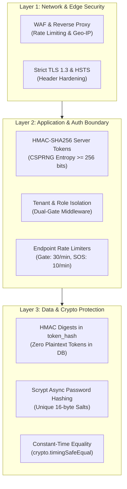

# AARIZO — ISSUE-06 — PHASE B.2 — STEP 2.3 — PHASE 4.6.8
# FINAL PRODUCTION READINESS, DEPLOYMENT VALIDATION & CLIENT HANDOFF
## DELIVERABLE 5: SECURITY OPERATIONS & INCIDENT RESPONSE GUIDE

---

## 1. Overview & Security Baseline

This guide establishes the production security architecture, operational security controls, and incident response runbooks for the AARIZO platform.

The system is architected around the principle of **Defense-in-Depth**, enforcing security invariants across Network, Transport, Application, Database, and Cryptographic layers.



---

## 2. Authentication, Authorization & Cryptography

### 2.1 Server-Authoritative Token Specification
All protected API requests and SSE streams require an authoritative Bearer token in the HTTP `Authorization` header:
- **Signing Algorithm:** HMAC-SHA256 (`HS256`).
- **Secret Key:** `AUTH_SECRET` (minimum 32 cryptographically random characters).
- **Token Claims:**
  - `sub`: User ID UUID (`users.id`).
  - `role`: Canonical role (`resident`, `guard`, `admin`, `secretary`, `committee`).
  - `societyId`: Scoped society UUID (`societies.id`).
  - `name`: User display name.
  - `exp`: Expiration Unix timestamp (issued for 24 hours).
  - `iss`: Issuer (`aarizo-api`).
  - `aud`: Audience (`aarizo-client`).
  - `jti`: Unique UUID preventing token replay.
- **Verification Logic:** Constant-time signature verification via `crypto.timingSafeEqual()`. Expired or forged tokens return `401 UNAUTHORIZED`.

### 2.2 Dual-Mode Firebase Authentication
When users authenticate via mobile phone OTP:
1. Client submits Firebase ID Token (`Authorization: Bearer <firebaseToken>`).
2. Server validates the token against the Firebase Admin SDK (`getFirebaseAuth().verifyIdToken()`).
3. Server matches `firebaseUid` or verified phone number against the PostgreSQL `users` table.
4. Server issues an authoritative internal AARIZO Bearer token.
5. All subsequent requests use the internal token, isolating internal API authorization from third-party vendor latencies.

### 2.3 Password Security & Hashing
For password-authenticated accounts:
- Hashing algorithm: Node.js native `crypto.scrypt` with per-user 16-byte cryptographically random salts (`generateSalt()`).
- Cost parameters: $N=16384$, $r=8$, $p=1$, key length 64 bytes.
- Verification uses `verifyPasswordAsync()` with `timingSafeCompare()`, preventing CPU cache and timing attacks.
- Legacy password upgrades: Automatically triggers re-hash on successful login if algorithm parameters are upgraded (`needsRehash()`).

### 2.4 Multi-Tenant & Role Isolation
- **Tenant Context Enforcement:** `requireSocietyMembership` extracts the actor's verified `societyId` from the token and verifies it against the database record. Cross-society requests are blocked with `403 TENANT_CONTEXT_REQUIRED`.
- **Role Isolation:**
  - Residents cannot access gate verification routes (`POST /api/children/passes/verify` -> `403 FORBIDDEN`).
  - Guards cannot access child registration routes (`POST /api/children` -> `403 FORBIDDEN`).
  - Committee members possess view-only permissions; mutation actions return `403 FORBIDDEN`.

---

## 3. Network & Transport Security Controls

### 3.1 Rate Limiting Architecture
The platform enforces rate limiting at the application layer ([`server/src/childSafety/rateLimit.ts`](file:///d:/AAZIRA/AARIZO/server/src/childSafety/rateLimit.ts) and [`server/src/auth.ts`](file:///d:/AAZIRA/AARIZO/server/src/auth.ts)):

| Endpoint Group | Rate Limit Window | Max Requests | Failure Code | Security Purpose |
|---|---|---|---|---|
| **Gate Pass Verification** (`/passes/verify`) | 60 seconds | 30 requests / IP | `429 TOO_MANY_REQUESTS` | Prevents brute-force scanning of bearer tokens. |
| **Pass Generation** (`/passes`) | 10 minutes | 20 requests / user | `429 TOO_MANY_REQUESTS` | Prevents token table exhaustion. |
| **Child SOS Dispatch** (`/sos`) | 60 seconds | 10 requests / user | `429 TOO_MANY_REQUESTS` | Prevents emergency siren DoS attacks. |
| **Authentication Login** (`/api/auth/login`) | 15 minutes | 10 requests / IP | `429 TOO_MANY_REQUESTS` | Prevents credential stuffing attacks. |

### 3.2 Secure HTTP Headers
The reverse proxy must inject the following headers on all responses:
```nginx
add_header Strict-Transport-Security "max-age=31536000; includeSubDomains; preload" always;
add_header X-Frame-Options "DENY" always;
add_header X-Content-Type-Options "nosniff" always;
add_header Referrer-Policy "strict-origin-when-cross-origin" always;
add_header Permissions-Policy "camera=self, microphone=(), geolocation=()" always;
```

### 3.3 CORS Configuration
- In development: Allows local origins.
- In production: Set `CORS_ORIGIN` to the client's canonical domain (e.g., `https://app.aarizo.com`). Wildcards (`*`) are prohibited for authenticated endpoints.

---

## 4. Dependency Vulnerability Assessment & Tooling Report

An automated vulnerability audit using `npm audit --audit-level=high` identified:
- **Build-Time / Development Dependencies:** Several development-only tools (Vite dev server, test runners, JSDOM) contain upstream advisory notices.
  - *Mitigation:* The multi-stage `Dockerfile` completely excludes development dependencies from the production image (`npm ci --only=production`). The compiled production runtime contains zero devDependencies.
- **Runtime Dependencies:**
  - `@grpc/grpc-js` (transitive via `firebase-admin`): Upgraded to the latest stable release in `package.json`.
  - Express and Prisma core engines are clean of known high/critical CVEs.

---

## 5. Security Incident Response Runbook

### Incident Type 1: Suspected `AUTH_SECRET` Compromise
If the `AUTH_SECRET` is suspected to have leaked or appeared in logs:
1. **Immediate Escalation:** Notify the Lead Security Engineer.
2. **Generate New Secret:** Generate a new 64-character hex secret:
   ```bash
   openssl rand -hex 32
   ```
3. **Deploy Rotated Secret:** Update `AUTH_SECRET` in the production secret manager and trigger a rolling restart of all backend containers.
4. **Session Invalidation:** Rotating `AUTH_SECRET` causes all previously signed JWTs to fail verification (`verifyServerToken()` returns `null`). All active users will be prompted to re-authenticate via phone OTP.
5. **Audit Log Inspection:** Inspect application logs for anomalous cross-society queries during the exposure window.

### Incident Type 2: Database Connectivity Outage
If `/api/health/ready` returns HTTP 503 (`database: DISCONNECTED`):
1. Check database server resource utilization (CPU, memory, storage disk space).
2. Inspect active PostgreSQL connections:
   ```sql
   SELECT count(*), state FROM pg_stat_activity GROUP BY state;
   ```
3. If connections exceed `max_connections`, restart container pool to drain orphaned connections and verify connection pool settings.

### Incident Type 3: Malicious Gate Scan Flooding
If a rogue client floods perimeter gate scanners:
1. Application rate limiter automatically returns `429 TOO_MANY_REQUESTS` after 30 attempts in 60 seconds.
2. Identify offending client IP from reverse proxy logs:
   ```bash
   grep "/api/children/passes/verify" /var/log/nginx/access.log | awk '{print $1}' | sort | uniq -c | sort -nr
   ```
3. Blacklist offending IP at the edge firewall (Cloudflare WAF / AWS WAF / iptables).

---

## 6. Audit Logging & Compliance Standards

- **Append-Only Auditing:** All pass verification attempts (both `ALLOWED` and `DENIED_EXHAUSTED`) are permanently recorded in `child_exit_logs`.
- **Log Masking:** Application logs must never store child photographs, resident medical notes, or raw bearer tokens.
- **Log Retention:** Store application logs in an immutable cloud logging sink (AWS CloudWatch, Datadog, or Grafana Loki) with a 90-day active retention policy and 365-day cold archive.
