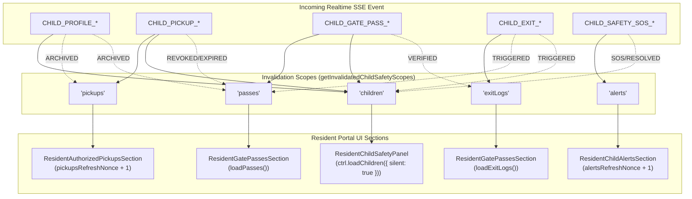

# AARIZO ISSUE-06 — PHASE B.2.3 — PHASE 4.6
## Complete Realtime Event-to-UI Contract Matrix

**Audit Date:** November 19, 2026  
**Repository:** `D:\AAZIRA\AARIZO`  
**Classification:** Canonical Contract Mapping & Data Flow Specification  

---

## 1. Event Contract Overview

The AARIZO Child Safety backend router (`server/src/childSafety/router.ts`) emits exactly **14 canonical Child Safety SSE topics** plus **1 general emergency topic**. All events are emitted strictly **AFTER** database transactions commit via `emitChildSafetyEvent()`.

Each event payload is sanitized, tenant-scoped, and filtered at the server transport layer through `isClientAuthorizedForEvent()` using `EventAudiencePolicy` (`allowedRoles` and `targetUserIds`).

---

## 2. Master Event-to-UI Contract Matrix

| Event # | Canonical Topic | Backend Mutation Source | Payload Contract | Authorized Publishers | Authorized Receivers | Resident Ownership Filter | Subscribed Screens / Components | Invalidated Scopes | UI Refresh Strategy |
| :---: | :--- | :--- | :--- | :--- | :--- | :--- | :--- | :--- | :--- |
| **1** | `CHILD_PROFILE_CREATED` | `POST /api/children` (`router.ts#L1854`) | `{ id: string, flatNumber: string, status: 'SAFE', societyId: string }` | `resident`, `admin` | `admin`, `security`, `guard`, `resident` | Delivered to resident **ONLY** if `client.userId` matches `guardianUserId` or creator | `ResidentChildSafetyPanel` `AdminChildSafetyPage` | `children` | Debounced silent reload of children profiles (`ctrl.loadChildren({ silent: true })`). |
| **2** | `CHILD_PROFILE_UPDATED` | `PATCH /api/children/:id` (`router.ts#L2086`) | `{ id: string, status: ChildStatus, societyId: string }` | `resident`, `admin` | `admin`, `security`, `guard`, `resident` | Delivered to resident **ONLY** if `client.userId` matches `guardianUserId` or creator | `ResidentChildSafetyPanel` `AdminChildSafetyPage` | `children` | Debounced silent reload of children profiles. Updates status badge and exit permission mode. |
| **3** | `CHILD_PROFILE_ARCHIVED` | `POST /api/children/:id/archive` (`router.ts#L2152`) | `{ id: string, status: 'ARCHIVED', societyId: string }` | `resident`, `admin` | `admin`, `security`, `guard`, `resident` | Delivered to resident **ONLY** if `client.userId` matches `guardianUserId` or creator | `ResidentChildSafetyPanel` `ResidentAuthorizedPickupsSection` `ResidentGatePassesSection` | `children`, `pickups`, `passes` | Cascade refresh: silently reloads children profiles, reloads passes (active passes automatically revoked), reloads pickups. |
| **4** | `CHILD_PICKUP_AUTHORIZED` | `POST /api/children/:id/pickups` (`router.ts#L2288`) | `{ id: string, childId: string, status: 'ACTIVE', societyId: string }` | `resident`, `admin` | `admin`, `security`, `guard`, `resident` | Delivered to resident **ONLY** if `client.userId` matches child guardian or creator | `ResidentChildSafetyPanel` `ResidentAuthorizedPickupsSection` `ResidentGatePassesSection` | `pickups`, `children` | Increments `pickupsRefreshNonce`. Re-evaluates eligible authorized escorts for gate-pass creation. |
| **5** | `CHILD_PICKUP_UPDATED` | `PATCH /api/children/pickups/:id` (`router.ts#L2491`) | `{ id: string, childId: string, status: PickupStatus, societyId: string }` | `resident`, `admin` | `admin`, `security`, `guard`, `resident` | Delivered to resident **ONLY** if `client.userId` matches child guardian or creator | `ResidentChildSafetyPanel` `ResidentAuthorizedPickupsSection` `ResidentGatePassesSection` | `pickups`, `children` (and `passes` if status is `REVOKED` or `EXPIRED`) | Increments `pickupsRefreshNonce`. If revoked/expired, reloads gate passes to reflect cascade pass revocations. |
| **6** | `CHILD_PICKUP_REVOKED` | `DELETE /api/children/pickups/:id` (`router.ts#L2574`) | `{ id: string, childId: string, status: 'REVOKED' \| 'ARCHIVED', societyId: string }` | `resident`, `admin` | `admin`, `security`, `guard`, `resident` | Delivered to resident **ONLY** if `client.userId` matches child guardian or creator | `ResidentChildSafetyPanel` `ResidentAuthorizedPickupsSection` `ResidentGatePassesSection` | `pickups`, `passes`, `children` | Cascade refresh: increments `pickupsRefreshNonce` and reloads gate passes (passes linked to revoked escort are revoked). |
| **7** | `CHILD_GATE_PASS_GENERATED` | `POST /api/children/passes` (`router.ts#L379`) | `{ id: string, childId: string, passCode: string, status: 'ACTIVE', validFrom: string, validUntil: string, societyId: string }` | `resident`, `admin` | `admin`, `security`, `guard`, `resident` | Delivered to resident **ONLY** if `client.userId` matches child guardian or creator | `ResidentChildSafetyPanel` `ResidentGatePassesSection` `ChildGateScannerPage` | `passes`, `children` | Reloads active passes for the selected child. Guard terminal reflects new verifiable pass code. |
| **8** | `CHILD_GATE_PASS_VERIFIED` | `POST /api/children/passes/verify` (`router.ts#L810`) | `{ passId: string, childId: string, status: 'USED' \| 'ACTIVE', currentUses: number, maxUses: number, societyId: string }` | `guard`, `security`, `admin` | `admin`, `security`, `guard`, `resident` | Delivered to resident **ONLY** if `client.userId` matches child guardian or pass creator | `ResidentChildSafetyPanel` `ResidentGatePassesSection` `ChildGateScannerPage` `SafetyCommandHub` | `passes`, `exitLogs`, `children` | Reloads gate passes (status changes to `USED`), reloads exit history (new exit record), updates child status to `OUT_OF_SOCIETY`. |
| **9** | `CHILD_GATE_PASS_REVOKED` | `POST /api/children/passes/:id/revoke` (`router.ts#L1018`) | `{ id: string, childId: string, passCode: string, status: 'REVOKED', societyId: string }` | `resident`, `guard`, `admin` | `admin`, `security`, `guard`, `resident` | Delivered to resident **ONLY** if `client.userId` matches child guardian or creator | `ResidentChildSafetyPanel` `ResidentGatePassesSection` `ChildGateScannerPage` | `passes`, `children` | Updates pass status to `REVOKED`. Guard terminal invalidates pass immediately. |
| **10** | `CHILD_EXIT_TRIGGERED` | `POST /api/children/passes/verify` (`router.ts#L795`) | `{ exitLogId: string, passId: string, childId: string, passCode: string, gateId: string, outcome: 'ALLOWED', societyId: string }` | `guard`, `security`, `admin` | `admin`, `security`, `guard`, `resident` | Delivered to resident **ONLY** if `client.userId` matches child guardian or pass creator | `ResidentChildSafetyPanel` `ResidentGatePassesSection` `SafetyCommandHub` | `exitLogs`, `passes`, `children` | Synthesizes chime + toast alert. Silently reloads exit history and active passes. |
| **11** | `CHILD_EXIT_DENIED` | `POST /api/children/passes/verify` (`router.ts#L834`) | `{ exitLogId: string, childId: string \| null, gateId: string, outcome: 'DENIED', reasonCode: string, societyId: string }` | `guard`, `security`, `admin` | `admin`, `security`, `guard`, `resident` | Delivered to resident **ONLY** if `client.userId` matches child guardian or pass creator | `ResidentChildSafetyPanel` `ResidentGatePassesSection` `SafetyCommandHub` | `exitLogs` | Synthesizes high-alert chime + toast alert (`⚠️ Child Gate Exit Denied`). Appends denial entry to exit history. |
| **12** | `CHILD_SAFETY_SOS_TRIGGERED` | `POST /api/children/sos` (`router.ts#L1293`) | `{ alertId: string, emergencyIncidentId: string, childId: string, alertType: string, severity: string, status: 'ACTIVE', location: string, societyId: string }` | `resident`, `guard`, `security`, `admin` | `admin`, `security`, `guard`, `resident` | Delivered to all society staff AND to resident **ONLY** if reporter or child guardian | `ResidentChildSafetyPanel` `ResidentChildAlertsSection` `SafetyCommandHub` `ChildGateScannerPage` | `alerts`, `children` | Synthesizes continuous emergency siren chime + critical toast. Silently reloads alerts (increments `alertsRefreshNonce`), updates child status to `MISSING`, and blocks gate passes. Staff command console alerts immediately. |
| **13** | `CHILD_SAFETY_ALERT_ACKNOWLEDGED` | `POST /api/children/alerts/:id/acknowledge` (`router.ts#L1447`) | `{ alertId: string, childId: string \| null, status: 'ACKNOWLEDGED', acknowledgedAt: string, societyId: string }` | `guard`, `security`, `admin` | `admin`, `security`, `guard`, `resident` | Delivered to resident **ONLY** if reporter or child guardian | `ResidentChildSafetyPanel` `ResidentChildAlertsSection` `SafetyCommandHub` | `alerts` | Increments `alertsRefreshNonce`. Alert card updates badge to `ACKNOWLEDGED` and displays patrol officer name. |
| **14** | `CHILD_SAFETY_ALERT_RESOLVED` | `POST /api/children/alerts/:id/resolve` (`router.ts#L1590`) | `{ alertId: string, childId: string \| null, status: 'RESOLVED' \| 'FALSE_ALARM', resolvedAt: string, societyId: string }` | `guard`, `security`, `admin` | `admin`, `security`, `guard`, `resident` | Delivered to resident **ONLY** if reporter or child guardian | `ResidentChildSafetyPanel` `ResidentChildAlertsSection` `SafetyCommandHub` | `alerts`, `children` | Increments `alertsRefreshNonce`. Alert moves to collapsible past section. Child status is restored from `MISSING` to `SAFE`. Gate pass creation is re-enabled. |
| **15** | `EMERGENCY_INCIDENT_CREATED` | `POST /api/children/sos` (`router.ts#L1309`) | `{ id: string, incidentType: 'CHILD_SAFETY', severity: string, location: string, dispatchStatus: 'DISPATCHED', societyId: string }` | `resident`, `guard`, `security`, `admin` | `admin`, `security`, `guard` | Staff-only broadcast; residents receive through linked `CHILD_SAFETY_SOS_TRIGGERED` | `SafetyCommandHub` (Command Console) | `incidents` | Staff command console mounts active incident banner with dispatch timer. |

---

## 3. Data Invalidation & Scope Cascades

The pure helper `getInvalidatedChildSafetyScopes()` in `src/hooks/useChildSafetyRealtime.ts` maps incoming topics to specific cache invalidations:

---

## 4. UI Invalidation Rules & Debounce Policy

To prevent rapid consecutive SSE events from causing UI thrashing or race conditions:
1. **Debounce Interval:** `250ms` debouncing window on scoped refreshes.
2. **Monotonic Request Sequencing:** Every backend fetch request triggered by a realtime event increments a `requestIdRef`. If a later request completes before an earlier slow request, the earlier response is dropped.
3. **Session Key Validation:** If the user logs out or switches accounts while an SSE-triggered fetch is in flight, the response is discarded immediately.
4. **Targeted vs Full Refresh:**
   - Full Refresh (`all` scopes) occurs **ONLY** on initial component mount and on reconnection from an offline network drop (`onReconnect`).
   - Normal operation uses **Targeted Scoped Refreshes**, invalidating only the affected slice (e.g., an alert acknowledgment only updates alerts without re-fetching profiles or pickups).

