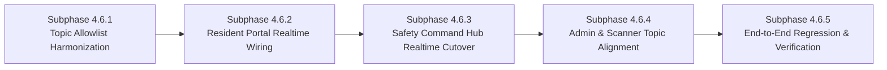

# AARIZO ISSUE-06 — PHASE B.2.3 — PHASE 4.6
## Realtime SSE Integration Implementation Plan

**Date:** November 19, 2026  
**Repository:** `D:\AAZIRA\AARIZO`  
**Target Scope:** Phase 4.6 — Production-Grade Authenticated Realtime SSE Integration  
**Classification:** Phased Engineering Implementation Plan  

---

## 1. Overview & Execution Strategy

Phase 4.6 implements production-grade, authenticated, server-authoritative realtime synchronization for Child Safety across Resident, Security, and Administrative portals.

To ensure safety, zero regression of Phase 4.1–4.5 deliverables, and clean testability, the work is strictly divided into **5 sequential subphases**:

---

## 2. Detailed Subphase Breakdowns

### Subphase 4.6.1 — Realtime Service Topic Harmonization

- **Objective:** Add the 3 authorized pickup topics (`CHILD_PICKUP_AUTHORIZED`, `CHILD_PICKUP_UPDATED`, `CHILD_PICKUP_REVOKED`) to `CANONICAL_CHILD_SAFETY_TOPICS` in `src/services/realtimeService.ts` so that all 14 canonical backend Child Safety topics are recognized under the `CHILD_SAFETY` category.
- **Exact Files in Scope:**
  - Modify: `src/services/realtimeService.ts` (lines 110–121)
  - Test: `tests/issue06_b23_realtime_sse.test.ts`
- **Required Behavior:**
  - `classifyRealtimeTopic('CHILD_PICKUP_AUTHORIZED')` returns `category: 'CHILD_SAFETY'`, `isEmergency: false`, `isProtected: true`.
  - `classifyRealtimeTopic('CHILD_PICKUP_UPDATED')` returns `category: 'CHILD_SAFETY'`, `isEmergency: false`, `isProtected: true`.
  - `classifyRealtimeTopic('CHILD_PICKUP_REVOKED')` returns `category: 'CHILD_SAFETY'`, `isEmergency: false`, `isProtected: true`.
  - Audio chimes and floating toasts operate consistently for pickup lifecycle events.
- **Security Invariants:**
  - All 3 pickup topics remain `isProtected: true` and `canClientNetworkBroadcast: false` (fail-closed on client network broadcast).
- **Tests to Add / Update:**
  - Add classification assertions in `tests/issue06_b23_realtime_sse.test.ts` for the 3 pickup topics.
- **Acceptance Criteria:**
  - `classifyRealtimeTopic` returns `category: 'CHILD_SAFETY'` for all 14 backend topics.
  - All existing `tests/issue06_b23_realtime_sse.test.ts` tests continue to pass.
- **Dependencies & Blockers:** None.

---

### Subphase 4.6.2 — Resident Portal Realtime Integration

- **Objective:** Wire `useChildSafetyRealtime` into `ResidentChildSafetyPanel.tsx` with debounced, scoped refreshes, monotonic request guards, session lifecycle isolation, and a live connection status indicator.
- **Exact Files in Scope:**
  - Modify: `src/domains/safety/components/ResidentChildSafetyPanel.tsx`
  - Modify: `src/domains/safety/components/ResidentChildAlertsSection.tsx` (optional minor prop passing for status if needed, or panel-level badge)
  - Create: `tests/issue06_b23_phase4_6_resident_realtime.test.ts`
  - Modify: `tests/issue06_b23_phase4_2_resident_panel_render.test.ts` (preserve render expectations)
- **Required Behavior:**
  1. **Hook Integration:** Mount `useChildSafetyRealtime({ enabled: true, notifyServiceInvalidation: true, ... })` inside `ResidentChildSafetyPanel`.
  2. **Scoped Invalidation Handlers:**
     - `onProfilesChange`: Debounced `ctrl.loadChildren({ silent: true })`.
     - `onPickupsChange`: Debounced `setPickupsRefreshNonce((n) => n + 1)`.
     - `onPassesChange`: Debounced `setPickupsRefreshNonce((n) => n + 1)` (triggers both pickup and pass list refresh in child sections).
     - `onAlertsChange`: Debounced `setAlertsRefreshNonce((n) => n + 1)`.
     - `onReconnect`: Triggers authoritative full reload across all scopes (`ctrl.loadChildren({ silent: true })`, `setPickupsRefreshNonce`, `setAlertsRefreshNonce`).
  3. **Debounce & Race Guard:**
     - `250ms` debouncing timer prevents rapid multi-event storms from thrashing the backend.
     - Monotonic `requestIdRef` ensures stale responses from slow network requests are dropped.
     - Session key verification drops responses if user logs out or switches accounts mid-flight.
  4. **Live Connection Status Badge:**
     - Subscribe to `realtimeService.subscribeToStatus()`.
     - Display subtle indicator badge:
       - `CONNECTED`: Green dot + "Live Sync"
       - `RECONNECTING`: Amber pulse + "Reconnecting..."
       - `OFFLINE`: Slate dot + "Offline"
- **Security Invariants:**
  - Zero polling.
  - Zero browser `EventSource` or `BroadcastChannel`.
  - Zero unauthenticated subscriptions.
  - Ephemeral in-memory state; zero `localStorage` or `sessionStorage` writes.
- **Tests to Add:**
  - `tests/issue06_b23_phase4_6_resident_realtime.test.ts` verifying:
    - Incoming `CHILD_PROFILE_UPDATED` silently reloads children profiles.
    - Incoming `CHILD_PICKUP_AUTHORIZED` increments `pickupsRefreshNonce`.
    - Incoming `CHILD_GATE_PASS_VERIFIED` updates passes and exit logs.
    - Incoming `CHILD_SAFETY_ALERT_ACKNOWLEDGED` updates alerts section.
    - SSE reconnect triggers full data resync.
    - Offline status displays offline badge.
    - Unmount cleans up all listeners cleanly.
- **Acceptance Criteria:**
  - All 14 backend events trigger the exact expected UI slice refresh without manual clicking.
  - All tests in `tests/issue06_b23_phase4_6_resident_realtime.test.ts` pass 100%.
- **Dependencies & Blockers:** Subphase 4.6.1.

---

### Subphase 4.6.3 — Safety Command Hub Realtime Synchronization

- **Objective:** Modernize `SafetyCommandHub.tsx` by replacing the legacy, fictitious `realTimeSync.subscribe('CHILD_SAFETY_UPDATED')` subscription with canonical Child Safety SSE event listeners.
- **Exact Files in Scope:**
  - Modify: `src/domains/safety/components/SafetyCommandHub.tsx`
  - Modify: `tests/issue06_b23_phase4_5_resident_sos_render.test.ts` (preserve hub card assertions)
- **Required Behavior:**
  - Remove dead line `realTimeSync.subscribe('CHILD_SAFETY_UPDATED', () => loadData())`.
  - Wire real Child Safety emergency topics (`CHILD_SAFETY_SOS_TRIGGERED`, `CHILD_SAFETY_ALERT_ACKNOWLEDGED`, `CHILD_SAFETY_ALERT_RESOLVED`, `EMERGENCY_INCIDENT_CREATED`) via `useChildSafetyRealtime` or canonical `realtimeService.subscribe()`.
  - When a Child Safety emergency is dispatched by a resident, security staff's Command Console reflects the incident immediately.
  - Preserve all non-child emergency categories (`MEDICAL`, `FIRE`, `SECURITY`, `LIFT`, `ELECTRICAL`) and `realTimeSync.subscribe('EMERGENCY_ALERTS')`.
- **Security Invariants:**
  - Role-based tab isolation: Staff views command console; residents view `ResidentChildSafetyPanel`.
- **Tests to Add / Update:**
  - Verify that `SafetyCommandHub` reloads incidents on `CHILD_SAFETY_SOS_TRIGGERED` and `EMERGENCY_INCIDENT_CREATED`.
- **Acceptance Criteria:**
  - Security staff's console updates in real time when resident triggers Child Safety SOS.
  - Zero regression on non-child emergency workflows.
- **Dependencies & Blockers:** Subphase 4.6.2.

---

### Subphase 4.6.4 — Admin & Security Scanner Realtime Alignment

- **Objective:** Audit and align topic subscriptions in `ChildGateScannerPage.tsx` and `AdminChildSafetyPage.tsx` to canonical topics, removing fictitious client publish calls in preparation for Phase 5 scanner cutover.
- **Exact Files in Scope:**
  - Modify: `src/pages/dashboard/security/ChildGateScannerPage.tsx`
  - Modify: `src/pages/dashboard/admin/AdminChildSafetyPage.tsx`
- **Required Behavior:**
  - In `ChildGateScannerPage.tsx`, replace subscriptions to `CHILD_SAFETY_UPDATED`, `CHILD_ALERT_TRIGGERED`, and `CHILD_EXIT_SCANNED` with canonical topics (`CHILD_GATE_PASS_GENERATED`, `CHILD_GATE_PASS_VERIFIED`, `CHILD_GATE_PASS_REVOKED`, `CHILD_SAFETY_SOS_TRIGGERED`).
  - Remove prohibited client `realtimeService.publish()` calls that attempt to broadcast sensitive Child Safety events.
  - Note: Phase 5 will execute the complete scanner migration to `verifyChildExitStrict`. Phase 4.6 ensures zero dead/hostile event publishes remain.
- **Security Invariants:**
  - Clients never attempt to broadcast sensitive domain events over the network.
- **Acceptance Criteria:**
  - Clean compilation; zero fictitious topic subscriptions.
- **Dependencies & Blockers:** Subphase 4.6.3.

---

### Subphase 4.6.5 — End-to-End Realtime Integration & UI Regression Verification

- **Objective:** Run exhaustive automated test verification across the entire repository to prove complete system stability.
- **Exact Verification Steps:**
  1. Run dedicated Phase 4.6 test suite (`tests/issue06_b23_phase4_6_resident_realtime.test.ts`).
  2. Run all Phase 4 resident test suites (helpers, profiles, pickups, passes, alerts, SOS, and realtime).
  3. Run full offline Jest suite (all 35+ suites / 530+ tests).
  4. Run frontend TypeScript check (`npx tsc -b`).
  5. Run backend TypeScript check (`npm --prefix server run build`).
  6. Run production application build (`npm run build`).
- **Acceptance Criteria:**
  - 100% test pass rate across all offline test suites.
  - 0 TypeScript compiler errors.
  - Production build generates clean minified bundles without error.
- **Dependencies & Blockers:** Subphases 4.6.1–4.6.4.

---

## 3. Strict Prohibitions & Non-Scope Items

To prevent scope creep, the following items are strictly out of scope for Phase 4.6:
- **NO database schema modifications or Prisma migrations.**
- **NO new backend routes or endpoints.** (Existing SSE routes and outbox event publishing are complete).
- **NO UI redesign.** (Existing clean Tailwind/Aarizo component designs are preserved).
- **NO native browser `EventSource` or `BroadcastChannel` introduction.**
- **NO modification of Phase 4.1–4.5 closure reports or previous audit sign-offs.**

