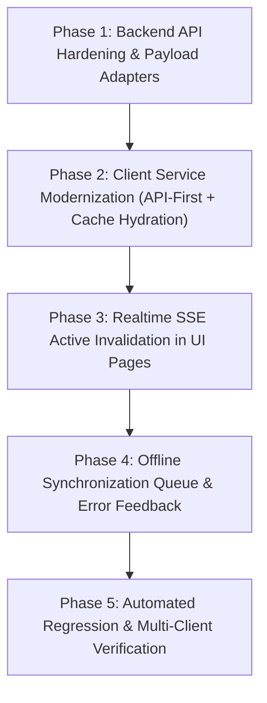

# AARIZO — ISSUE-06 Remediation Plan

**Target**: ISSUE-06 — Tri-Tier State Desynchronization (LocalStorage vs PostgreSQL vs Firestore / BaseRepository)  
**Priority**: P1 (High Severity — Data Integrity & Cross-Device Operational Blocker)  
**Mode**: REMEDIATION SPECIFICATION — PENDING APPROVAL BEFORE IMPLEMENTATION  
**Date**: 2026-11-17  
**Workspace**: `D:\AAZIRA\AARIZO`  

---

## 1. Remediation Architecture & Guiding Principles

To resolve the tri-tier desynchronization permanently without introducing breaking changes or regressing existing UI behavior, the remediation follows five strict engineering principles:

1. **Authoritative API-First Single Source of Truth**:
   - The relational PostgreSQL database accessed via Express REST API (`/api/*`) is the sole authority for state.
   - Browser `localStorage` is demoted from an independent data store to a **read-through cache and offline fallback**.
2. **Elimination of Redundant Dual Writes**:
   - Retire unstructured writes to `*Repository` -> `/api/collections/*` (`entityRecord` table) for core relational entities (`VisitorPass`, `Society`, `Tower`, `Flat`, `Resident`, `Child`).
   - Route all domain CRUD operations exclusively through typed, relational `apiClient` endpoints.
3. **Bidirectional Schema Normalization & Payload Adapters**:
   - Bridge the gap between frontend camelCase domain models (`SmartVisitorPass`) and Prisma relational models (`VisitorPass`) with robust serialization adapters on both client (`apiClient` / `visitorService`) and server (`server/src/index.ts`).
   - Prevent Prisma schema rejection (HTTP 500) caused by unmapped fields.
4. **Realtime Reactive Cache Hydration**:
   - UI pages subscribing to SSE events (`realtimeService.subscribe('*', ...)`) must trigger network re-fetching from the authoritative API rather than re-reading stale `localStorage`.
   - Incoming events update both the React component state and the local cache simultaneously.
5. **Fail-Safe Offline Resilience with Explicit State**:
   - Replace silent fire-and-forget `.catch(() => {})` handlers with explicit async/await error handling.
   - When offline or when the server is unreachable, persist mutation into an explicit `pending_sync` queue and show visual badges (`Pending Sync` / `Offline Mode`), rather than pretending server persistence succeeded.

---

## 2. Phased Implementation Roadmap



---

## 3. Detailed File-by-File Remediation Blueprint

### 3.1 Backend: `server/src/index.ts` — Payload Adapter & Endpoint Hardening

* **Target File**: [server/src/index.ts](file:///d:/AAZIRA/AARIZO/server/src/index.ts)
* **Changes Required**:
  1. **Normalize `POST /api/visitor-passes`**:
     - Adapt incoming frontend fields (`visitorPhone` -> `phone`, `category` -> `passType`, `validUntil` -> `validTo`, `passCode` -> `qrCodeHash`).
     - Strip unmapped UI-only properties before invoking `prisma.visitorPass.create()`.
     - Automatically link `flatId` and `residentId` if provided.
     - Return the canonical relational entity with transformed fields to satisfy frontend interfaces.
  2. **Harden `PATCH /api/visitor-passes/:id`**:
     - Map status transitions (`CHECKED_IN`, `CHECKED_OUT`, `REVOKED`).
     - Populate timestamps (`checkInTime = new Date()`, `checkOutTime = new Date()`).
     - Broadcast appropriate realtime events (`VISITOR_ENTRY`, `VISITOR_EXIT`, `VISITOR_STATUS_CHANGE`).
  3. **Verify `POST /api/visitor-passes/verify`**:
     - Enhance query logic to match against `id`, `qrCodeHash`, `passCode`, or telephone number.
     - Return full pass metadata including linked flat and resident details.
  4. **Complete Society Hierarchy Routes**:
     - Ensure `POST /api/towers` exists and is accessible by `secretary` and `admin`.

---

### 3.2 Client API Client: `src/services/apiClient.ts`

* **Target File**: [src/services/apiClient.ts](file:///d:/AAZIRA/AARIZO/src/services/apiClient.ts)
* **Changes Required**:
  1. Add missing visitor pass endpoints:
     ```typescript
     updateVisitorPass: (id: string, data: any) =>
       apiRequest<any>(`/visitor-passes/${id}`, {
         method: 'PATCH',
         body: JSON.stringify(data),
       }),
     ```
  2. Add missing tower endpoints:
     ```typescript
     getTowers: (societyId?: string) => apiRequest<any[]>('/towers', { societyId }),
     createTower: (data: any) =>
       apiRequest<any>('/towers', {
         method: 'POST',
         body: JSON.stringify(data),
       }),
     ```
  3. Add missing child safety endpoints:
     ```typescript
     updateChildPass: (id: string, data: any) =>
       apiRequest<any>(`/children/passes/${id}`, {
         method: 'PATCH',
         body: JSON.stringify(data),
       }),
     deleteChildPass: (id: string) =>
       apiRequest<any>(`/children/passes/${id}`, {
         method: 'DELETE',
       }),
     ```
  4. Ensure all responses are typed and return unwrapped entity payloads.

---

### 3.3 Domain Services Modernization

#### A. `src/services/visitorService.ts`
* **Target File**: [src/services/visitorService.ts](file:///d:/AAZIRA/AARIZO/src/services/visitorService.ts)
* **Changes Required**:
  1. **Async Primary Methods**:
     - `fetchPasses(societyId: string): Promise<SmartVisitorPass[]>`: Calls `apiClient.getVisitorPasses(societyId)`, updates `localStorage`, and returns normalized passes.
     - `createVisitorPass(data, actor): Promise<SmartVisitorPass>`: Sends normalized payload to `apiClient.createVisitorPass(payload)`, updates local cache on success, broadcasts SSE event, and returns created pass.
     - `checkInVisitor(passId, gateDetails, actor): Promise<SmartVisitorPass>`: Calls `apiClient.updateVisitorPass(passId, { status: 'CHECKED_IN', gateName, officerName })`, updates cache, returns updated record.
     - `checkOutVisitor(passId, actor): Promise<SmartVisitorPass>`: Calls `apiClient.updateVisitorPass(passId, { status: 'CHECKED_OUT' })`, updates cache, returns updated record.
     - `validatePassCode(societyId, codeOrQr): Promise<PassValidationResult>`: Calls `apiClient.verifyVisitorPass(codeOrQr, societyId)`. If network is offline, falls back to local cache validation.
  2. **Backward Compatibility**:
     - Maintain synchronous `getPasses(societyId)` for initial component mount / skeleton rendering from cache.
     - Remove redundant `visitorRepository.create(...)` and `visitorRepository.update(...)` calls.
     - Replace empty `.catch(() => {})` with structured error handling.

#### B. `src/services/childSafetyService.ts`
* **Target File**: [src/services/childSafetyService.ts](file:///d:/AAZIRA/AARIZO/src/services/childSafetyService.ts)
* **Changes Required**:
  1. `fetchChildren(societyId)`: Calls `apiClient.getChildren(societyId)`, caches in `localStorage`.
  2. `fetchPickupQRs(societyId)`: Calls `apiClient.getChildPasses(societyId)`, caches in `localStorage`.
  3. `generatePickupQR(...)`: Awaits `apiClient.createChildPass(newQR)`, writes to cache, returns QR record.
  4. `verifyAndScanChildPickup(...)`: Calls `apiClient.verifyChildPass(qrCodeStr, societyId)`. Falls back to cached profiles if network is down.
  5. Remove redundant `childRepository.create(...)` writes.

#### C. `src/services/societyService.ts`
* **Target File**: [src/services/societyService.ts](file:///d:/AAZIRA/AARIZO/src/services/societyService.ts)
* **Changes Required**:
  1. Add `fetchSocieties()`, `fetchTowers()`, `fetchFlats()`, `fetchResidents()` calling `apiClient`.
  2. Update `createTower` to call `apiClient.createTower(newTower)` instead of only `towerRepository.create`.
  3. Remove redundant `*Repository.create/update/delete` writes to eliminate dual table fragmentation.
  4. Rehydrate `db.ts` cache on every successful API fetch.

---

### 3.4 Frontend UI Pages: Reactive SSE Cache Hydration

#### A. `SecurityTerminalPage.tsx`
* **Target File**: [src/pages/dashboard/security/SecurityTerminalPage.tsx](file:///d:/AAZIRA/AARIZO/src/pages/dashboard/security/SecurityTerminalPage.tsx)
* **Changes Required**:
  1. In `useEffect`, call `await visitorService.fetchPasses(currentSocietyId)` on mount.
  2. In realtime subscriber:
     ```typescript
     const unsub = realtimeService.subscribe('*', async (event) => {
       if (event.type.startsWith('VISITOR_') || event.topic?.startsWith('VISITOR_')) {
         await visitorService.fetchPasses(currentSocietyId);
         refreshData();
       }
     });
     ```
  3. In QR Scanner / Code verification, use async `visitorService.validatePassCode(...)` to ensure live database verification.

#### B. `VisitorPassHubPage.tsx`
* **Target File**: [src/pages/dashboard/resident/VisitorPassHubPage.tsx](file:///d:/AAZIRA/AARIZO/src/pages/dashboard/resident/VisitorPassHubPage.tsx)
* **Changes Required**:
  1. Fetch live passes on component mount via `visitorService.fetchPasses(currentSocietyId)`.
  2. In realtime subscriber, re-fetch from API when `VISITOR_ENTRY` or `VISITOR_EXIT` arrives, showing live badge update from `EXPECTED` to `INSIDE` or `EXITED`.

#### C. `ChildGateScannerPage.tsx` & `AdminChildSafetyPage.tsx`
* **Target Files**:
  - [src/pages/dashboard/security/ChildGateScannerPage.tsx](file:///d:/AAZIRA/AARIZO/src/pages/dashboard/security/ChildGateScannerPage.tsx)
  - [src/pages/dashboard/admin/AdminChildSafetyPage.tsx](file:///d:/AAZIRA/AARIZO/src/pages/dashboard/admin/AdminChildSafetyPage.tsx)
* **Changes Required**:
  1. Hydrate children and pickup passes on mount via `childSafetyService.fetchChildren` and `fetchPickupQRs`.
  2. Rehydrate on realtime events (`CHILD_SAFETY_UPDATED`, `CHILD_ALERT_TRIGGERED`, `CHILD_EXIT_SCANNED`).

---

## 4. Risk Mitigation & Backward Compatibility

| Potential Risk | Severity | Mitigation Strategy |
| :--- | :--- | :--- |
| **Breaking UI components expecting synchronous return** | Medium | Keep synchronous methods (`getPasses()`, `getChildren()`) reading from the updated local cache. Components render immediately from cache and update via React state when `fetch*()` resolves. |
| **Offline mode degradation** | Medium | If `apiClient` network call fails (e.g. offline device), fall back to `localStorage` cache gracefully, set an `isOffline: true` flag, and surface an informational badge. |
| **Prisma Foreign Key Constraint Errors** | High | Provide valid default/fallback relationships (`flatId`, `residentId`, `societyId`) or allow nullable foreign keys in Prisma where appropriate. |
| **Existing Test Suite Regressions** | High | The existing 242 tests test auth middleware, crypto, seed detection, and differentiators. All existing unit tests must remain 100% passing. |

---

## 5. Verification Gate Criteria (Phase B, Task B.1)

1. A visitor pass created on Client A (Resident) immediately persists in PostgreSQL `visitor_passes` table.
2. The created pass is broadcast over SSE and immediately appears on Client B (Security Terminal) without manual page reload.
3. Checking in the visitor on Client B updates `visitor_passes` in PostgreSQL and dispatches an alert to Client A showing status `INSIDE`.
4. Child pickup QR passes generated by parents are immediately verifiable on Gate Scanner terminals.
5. All 242 existing repository tests pass without regression.

