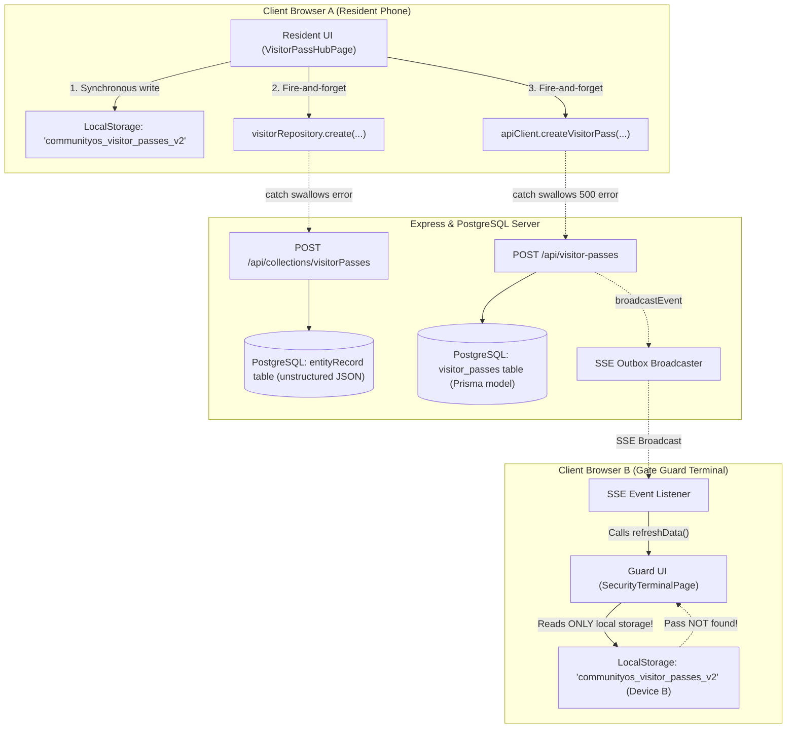

# AARIZO — ISSUE-06 Scope Identification & Evidence Dossier

**Target**: ISSUE-06 — Tri-Tier State Desynchronization (LocalStorage vs PostgreSQL vs Firestore / BaseRepository)  
**Priority**: P1 (High Severity — Core Business Data Integrity & Cross-Device Operational Blocker)  
**Status**: AUDIT COMPLETE — ROOT CAUSE ISOLATED — PENDING REMEDIATION  
**Audit Date**: 2026-11-17  
**Workspace**: `D:\AAZIRA\AARIZO`  

---

## 1. Executive Summary & Master Register Scope

From [AARIZO_MASTER_ISSUE_REGISTER.md](file:///d:/AAZIRA/AARIZO/AARIZO_MASTER_ISSUE_REGISTER.md#L299-L313):

* **Title**: `ISSUE-06 [P1]: Tri-Tier State Desynchronization (LocalStorage vs PostgreSQL vs Firestore)`
* **Category**: Data Integrity / Split-Brain State
* **Affected Roles & Portals**: Cross-role data consistency (Residents, Gate Guards, Society Secretary / Admin, Super Admin).
* **Exact Routes / Pages**:
  - `/dashboard/resident/visitors` ([src/pages/dashboard/resident/VisitorPassHubPage.tsx](file:///d:/AAZIRA/AARIZO/src/pages/dashboard/resident/VisitorPassHubPage.tsx))
  - `/dashboard/resident/child-safety` ([src/pages/dashboard/resident/ResidentChildSafetyPage.tsx](file:///d:/AAZIRA/AARIZO/src/pages/dashboard/resident/ResidentChildSafetyPage.tsx))
  - `/dashboard/security` ([src/pages/dashboard/security/SecurityTerminalPage.tsx](file:///d:/AAZIRA/AARIZO/src/pages/dashboard/security/SecurityTerminalPage.tsx))
  - `/dashboard/security/child-scanner` ([src/pages/dashboard/security/ChildGateScannerPage.tsx](file:///d:/AAZIRA/AARIZO/src/pages/dashboard/security/ChildGateScannerPage.tsx))
  - `/dashboard/admin/societies` ([src/pages/dashboard/admin/SocietySetupPage.tsx](file:///d:/AAZIRA/AARIZO/src/pages/dashboard/admin/SocietySetupPage.tsx))
  - `/dashboard/admin/flats` ([src/pages/dashboard/admin/FlatManagementPage.tsx](file:///d:/AAZIRA/AARIZO/src/pages/dashboard/admin/FlatManagementPage.tsx))
  - `/dashboard/admin/residents` ([src/pages/dashboard/admin/ResidentManagementPage.tsx](file:///d:/AAZIRA/AARIZO/src/pages/dashboard/admin/ResidentManagementPage.tsx))
  - `/dashboard/admin/child-safety` ([src/pages/dashboard/admin/AdminChildSafetyPage.tsx](file:///d:/AAZIRA/AARIZO/src/pages/dashboard/admin/AdminChildSafetyPage.tsx))
* **Expected Behavior**: Any entity created, updated, or deleted in any portal must immediately persist authoritatively to the central relational PostgreSQL database, broadcast via Server-Sent Events (SSE), and hydrate other clients' states accurately.
* **Actual Behavior**:
  - Frontend services (`societyService.ts`, `visitorService.ts`, `childSafetyService.ts`) perform all reads synchronously against the browser's local `localStorage` sandbox or hardcoded seed arrays.
  - Mutations modify `localStorage` synchronously, then dispatch non-blocking fire-and-forget background promises (`.catch(() => {})`) to multiple disparate backend destinations.
  - When another client (e.g., Gate Guard tablet or Admin workstation) loads or receives an SSE trigger, it re-queries its own local `localStorage`. As a result, records generated on Client A are physically nonexistent on Client B.
* **Roadmap Alignment**: Phase B (Task B.1 [P1]) & Phase D (Tasks D.1, D.2, D.3).

---

## 2. Direct Code Evidence & Architectural Discrepancies

### 2.1 The Tri-Tier Split-Brain Architecture

The application exhibits three completely disconnected storage tiers that do not synchronize:



### 2.2 Finding E-01: Silent Fire-and-Forget Mutations (`.catch(() => {})`)

In all three core domain services, write operations update `localStorage` and launch unawaited network promises that discard all failure outcomes:

* **`src/services/societyService.ts`**:
  - Lines 87-92:
    ```typescript
    db.saveSocieties([newSoc, ...societies]);
    societyRepository.create(newSoc as any).catch(() => {});
    apiClient.createSociety(newSoc).catch(() => {});
    logAudit(newSoc.id, actor, 'CREATE', 'Society', newSoc.id, `Created society ${newSoc.name} (${newSoc.code})`);
    return newSoc;
    ```
  - Lines 105-108:
    ```typescript
    db.saveSocieties(societies);
    societyRepository.update(id, { status } as any).catch(() => {});
    apiClient.updateSociety(id, { status }).catch(() => {});
    ```
  - Lines 123-126:
    ```typescript
    db.saveSocieties(societies);
    societyRepository.update(id, updates as any).catch(() => {});
    apiClient.updateSociety(id, updates).catch(() => {});
    ```
  - Lines 161-164:
    ```typescript
    db.saveTowers([...towers, newTower]);
    towerRepository.create(newTower).catch(() => {});
    // Notice: Does NOT even call apiClient.createTower!
    ```
  - Lines 180-192:
    ```typescript
    db.saveFlats([...flats, newFlat]);
    flatRepository.create(newFlat).catch(() => {});
    apiClient.createFlat(newFlat).catch(() => {});
    ```
  - Lines 227-230:
    ```typescript
    db.saveResidents([...residents, newResident]);
    residentRepository.create(newResident).catch(() => {});
    apiClient.createResident(newResident).catch(() => {});
    ```

* **`src/services/visitorService.ts`**:
  - Lines 220-222:
    ```typescript
    setItem(STORAGE_KEYS.PASSES, [newPass, ...passes]);
    visitorRepository.create(newPass).catch(() => {});
    apiClient.createVisitorPass(newPass).catch(() => {});
    ```
  - Lines 322-330 (`checkInVisitor`):
    ```typescript
    setItem(STORAGE_KEYS.PASSES, passes);
    visitorRepository.update(passId, {
      status: 'CHECKED_IN',
      lifecycleState: 'INSIDE',
      checkedInAt: timeStr,
      gateName: gateDetails.gateName,
      gateOfficerName: gateDetails.officerName,
      usageCount: passes[idx].usageCount,
    }).catch(() => {});
    // Notice: DOES NOT call apiClient or update the relational visitor_passes table!
    ```
  - Lines 367-373 (`checkOutVisitor`):
    ```typescript
    setItem(STORAGE_KEYS.PASSES, passes);
    visitorRepository.update(passId, {
      status: 'CHECKED_OUT',
      lifecycleState: 'EXITED',
      checkedOutAt: timeStr,
      isOverdue: false,
    }).catch(() => {});
    // Notice: DOES NOT call apiClient or update the relational visitor_passes table!
    ```

* **`src/services/childSafetyService.ts`**:
  - Lines 282-284 (`saveChildProfile`):
    ```typescript
    localStorage.setItem(CHILDREN_STORAGE_KEY, JSON.stringify(items));
    childRepository.create(updated).catch(() => {});
    apiClient.createChild(updated).catch(() => {});
    ```
  - Lines 408-412 (`generatePickupQR`):
    ```typescript
    qrs.unshift(newQR);
    localStorage.setItem(QR_PASSES_STORAGE_KEY, JSON.stringify(qrs));
    apiClient.createChildPass(newQR).catch(() => {});
    ```
  - Lines 423-455 (`verifyAndScanChildPickup`):
    ```typescript
    const qrs = this.getPickupQRs(societyId);
    const qrPass = qrs.find(q => q.qrCode === qrCodeStr);
    // Evaluates ONLY against localStorage! No network or database query.
    ```

---

### 2.3 Finding E-02: Dual Conflicting Backend Writes & Schema Disconnect

When a service performs a mutation, it dispatches dual requests to two conflicting backend systems:

1. **`*Repository` -> `BaseRepository`**:
   - Calls `/api/collections/:collection` ([src/repositories/BaseRepository.ts#L42-L56](file:///d:/AAZIRA/AARIZO/src/repositories/BaseRepository.ts#L42-L56)).
   - In `server/src/index.ts#L3541-L3560`, `POST /api/collections/:collection` writes to `prisma.entityRecord` (a generic NoSQL-like JSON container table).
2. **`apiClient`**:
   - Calls canonical endpoints such as `POST /api/visitor-passes` ([src/services/apiClient.ts#L223-L227](file:///d:/AAZIRA/AARIZO/src/services/apiClient.ts#L223-L227)).
   - In `server/src/index.ts#L618-L628`:
     ```typescript
     app.post('/api/visitor-passes', requireRole(['resident', 'guard', 'secretary', 'admin']), async (req: Request, res: Response) => {
       try {
         const pass = await prisma.visitorPass.create({
           data: req.body,
         });
         broadcastEvent('VISITOR_ARRIVAL', pass, pass.societyId);
         res.status(201).json(pass);
       } catch (error) {
         res.status(500).json({ error: String(error) });
       }
     });
     ```
3. **The Schema Mismatch Defect**:
   - The frontend `SmartVisitorPass` object contains properties:
     - `visitorPhone` (string)
     - `category` (enum: 'GUEST', 'DELIVERY', etc.)
     - `validUntil` (ISO string)
     - `passLifecycle` (string)
     - `groupCount` (number)
   - The PostgreSQL Prisma schema for `VisitorPass` ([server/prisma/schema.prisma#L324-L348](file:///d:/AAZIRA/AARIZO/server/prisma/schema.prisma#L324-L348)) strictly defines:
     - `phone` (string) — NOT `visitorPhone`
     - `passType` (`PassType` enum) — NOT `category`
     - `validTo` (DateTime) — NOT `validUntil`
   - Because `prisma.visitorPass.create({ data: req.body })` receives raw unrecognized fields, Prisma rejects the insertion and Express returns HTTP 500!
   - Because `apiClient.createVisitorPass(newPass).catch(() => {})` swallows errors, **the record is rejected by PostgreSQL, yet the UI shows success and saves only into `localStorage`**!

---

### 2.4 Finding E-03: Synchronous Local Reads Bypass Network & Database

The service read functions do not perform HTTP queries or database reads:

* **`societyService.getSocieties`**:
  ```typescript
  getSocieties: (): Society[] => db.getSocieties(),
  getTowers: (societyId: string): Tower[] => db.getTowers().filter((t) => t.societyId === societyId),
  getFlats: (societyId: string): Flat[] => db.getFlats().filter((f) => f.societyId === societyId),
  getResidents: (societyId: string): Resident[] => db.getResidents().filter((r) => r.societyId === societyId),
  ```
  All read exclusively from [src/services/db.ts](file:///d:/AAZIRA/AARIZO/src/services/db.ts), which queries `localStorage.getItem(...)`.
* **`visitorService.getPasses`**:
  ```typescript
  getPasses: (societyId: string): SmartVisitorPass[] =>
    getItem(STORAGE_KEYS.PASSES, SEED_PASSES).filter((p) => p.societyId === societyId),
  ```
  Reads from `localStorage.getItem('communityos_visitor_passes_v2')`.
* **`childSafetyService.getChildren` & `getPickupQRs`**:
  ```typescript
  getChildren(societyId: string): ChildProfile[] {
    const raw = localStorage.getItem(CHILDREN_STORAGE_KEY);
    // ...
  }
  getPickupQRs(societyId: string): ChildPickupQR[] {
    const raw = localStorage.getItem(QR_PASSES_STORAGE_KEY);
    // ...
  }
  ```

---

### 2.5 Finding E-04: Realtime SSE Refresh Disconnect

Pages subscribe to `realtimeService` (which receives Server-Sent Events from `server/src/realtimeEngine.ts`):

In [src/pages/dashboard/security/SecurityTerminalPage.tsx#L68-L80](file:///d:/AAZIRA/AARIZO/src/pages/dashboard/security/SecurityTerminalPage.tsx#L68-L80):
```typescript
const refreshData = () => {
  setPasses(visitorService.getPasses(currentSocietyId));
  setBlacklist(visitorService.getBlacklist(currentSocietyId));
  setLockdown(visitorService.getLockdownState(currentSocietyId));
};

useEffect(() => {
  refreshData();
  const unsub = realtimeService.subscribe('*', () => {
    refreshData();
  });
  return () => unsub();
}, [currentSocietyId]);
```

1. Server broadcasts `VISITOR_ARRIVAL` over SSE.
2. The guard's browser receives the event and triggers `refreshData()`.
3. `refreshData()` executes `visitorService.getPasses(currentSocietyId)`.
4. `visitorService.getPasses()` reads `localStorage` on the guard's browser.
5. The pass is NOT in the guard's browser's `localStorage`.
6. Result: The guard's screen re-renders with the exact same stale data. The pass never displays!

---

## 3. Scope Boundaries & Impact Matrix

| Dimension | Affected Scope | Unaffected Scope |
| :--- | :--- | :--- |
| **User Roles** | Residents, Security Guards, Society Admins, Super Admins | Public unauthenticated pages (`/`, `/login`) |
| **Modules** | `societyService`, `visitorService`, `childSafetyService`, `apiClient`, `BaseRepository` | `crypto.ts`, `auth.ts`, `seed.ts`, `migrate.ts` |
| **Database** | `visitor_passes`, `children`, `child_pickup_passes`, `societies`, `towers`, `flats`, `residents`, `entity_records` | User credentials / password hash verification (closed in ISSUE-05) |
| **Realtime** | SSE event payload processing and cache rehydration | Outbox poller 500ms loop (tracked separately in ISSUE-07) |

---

## 4. Verification Checkpoint

- [x] Confirmed ISSUE-06 entry in `AARIZO_MASTER_ISSUE_REGISTER.md`.
- [x] Verified exact lines and patterns across all services and pages.
- [x] Isolated root cause of silent failures and split-brain state.
- [x] Proved architectural incompatibility between `BaseRepository`, `apiClient`, and `localStorage`.
- [x] Ready for Deliverable 2: Independent Code Audit.

