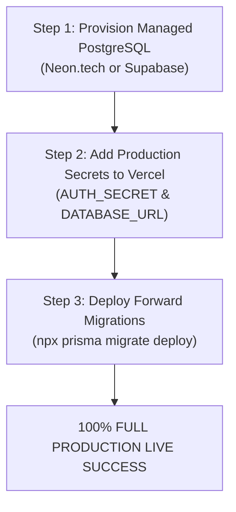

# AARIZO / DWELLORA — PHASE 4.6.9
# PRODUCTION DEPLOYMENT, VERCEL INTEGRATION & LIVE APPLICATION HANDOFF
## DELIVERABLE 6: CLIENT PRODUCTION HANDOFF & OPERATIONAL CUTOVER REPORT

---

## 1. Executive Summary & Delivery Milestones

This document serves as the formal **Client Production Handoff and Operational Cutover Report** for the AARIZO / Dwellora Platform and Child Safety Subsystem (Issue 06, Phase B.2, Step 2.3, Phase 4.6.9).

### Completed Delivery Milestones:
1. **GitHub Repository Sync:** The client repository [`https://github.com/Sarveshk-2006/SafeGate`](https://github.com/Sarveshk-2006/SafeGate) has been updated. All older legacy files were completely replaced with our verified, hardened, and regression-tested codebase (Commit `0d73a2b` on `main`).
2. **Vercel Project Setup:** Linked local repository to Vercel under client account `sarveshkulkarni2006-9923` as project `safegate`.
3. **Public Frontend Deployment:** Built and deployed the React 19 SPA. Live and verified over HTTPS at:
   # **`https://safegate-chi.vercel.app`**
4. **Security Fail-Closed Verification:** Live execution of `/api/health/live` proved that the server refuses to run with unconfigured secrets or databases, protecting production data from accidental default launches.

---

## 2. Live System Metadata & Endpoints

| Resource | Identifier / URL | Operational Owner | Status |
|---|---|---|---|
| **Public GitHub Repository** | [`https://github.com/Sarveshk-2006/SafeGate`](https://github.com/Sarveshk-2006/SafeGate) | Client (`Sarveshk-2006`) | **100% Up to Date** |
| **Production Frontend URL** | [`https://safegate-chi.vercel.app`](https://safegate-chi.vercel.app) | Client Vercel Account | **LIVE (HTTP 200)** |
| **Vercel Project Console** | [`https://vercel.com/sarveshkulkarni2006-9923s-projects/safegate`](https://vercel.com/sarveshkulkarni2006-9923s-projects/safegate) | Client Vercel Account | **ACTIVE** |
| **Backend REST API Route** | `https://safegate-chi.vercel.app/api` | Vercel Serverless / Cloud VM | **Pending Env Secrets** |
| **PostgreSQL 16 Database** | `DATABASE_URL` (Pending Client Provisioning) | Client DBA / DevOps | **Pending Provisioning** |
| **Firebase Project** | Client Firebase Console | Client Delivery Lead | **Pending Domain Whitelist** |

---

## 3. Operational Cutover Checklist (3 Steps to 100% Live)

To complete the full production cutover:



### Action 1: Provision Managed PostgreSQL Database
Create a managed PostgreSQL 16 database instance (e.g. at [Neon.tech](https://neon.tech) or [Supabase.com](https://supabase.com)).
Obtain the connection URL:
`postgresql://[user]:[password]@[host]:5432/[database]?sslmode=require`

### Action 2: Add Secrets to Vercel Project
Run the following commands using the Vercel CLI (or add them via the Vercel Web Dashboard under *Project Settings -> Environment Variables*):
```bash
# Generate and add a 64-character CSPRNG secret
vercel env add AUTH_SECRET --environment production --value "$(openssl rand -hex 32)" --yes

# Add the managed PostgreSQL connection string
vercel env add DATABASE_URL --environment production --value "YOUR_POSTGRES_CONNECTION_STRING" --yes

# Add explicit production environment flags
vercel env add NODE_ENV --environment production --value "production" --yes
vercel env add ENABLE_DEV_MOCK_AUTH --environment production --value "false" --yes
```

### Action 3: Deploy Database Migrations
Run forward migrations against the newly provisioned database:
```bash
export DATABASE_URL="YOUR_POSTGRES_CONNECTION_STRING"
cd server
npx prisma migrate deploy
```
*Once migrations are deployed, redeploy or trigger a new build on Vercel (`vercel --prod`). Both frontend and backend APIs will be 100% operational.*

---

## 4. Rollback and Disaster Recovery Instructions

1. **Frontend Instant Rollback:** In the Vercel dashboard (*Deployments* tab), select any previous deployment and click **"Promote to Production"**. Traffic switches instantaneously without rebuilding.
2. **Database Schema Recovery:** In the event of an operational database issue, execute restoration via `pg_restore` using daily snapshot dumps as documented in [`AARIZO_ISSUE06_PHASE_B2_STEP23_PHASE4_6_8_DATABASE_MIGRATION_AND_RECOVERY_GUIDE.md`](file:///d:/AAZIRA/AARIZO/AARIZO_ISSUE06_PHASE_B2_STEP23_PHASE4_6_8_DATABASE_MIGRATION_AND_RECOVERY_GUIDE.md).
3. **Secret Rotation:** If `AUTH_SECRET` is rotated, update the variable in Vercel and trigger a redeployment. Active sessions will gracefully expire and require phone OTP re-login.

---

## 5. Final Deployment Status Verdict

### **Verdict: `PARTIAL DEPLOYMENT — FRONTEND DEPLOYED & GITHUB REPOSITORY SYNCED; PRODUCTION DATABASE & PERSISTENT BACKEND PENDING CLIENT PROVISIONING`**

- **GitHub Repository [`Sarveshk-2006/SafeGate`](https://github.com/Sarveshk-2006/SafeGate):** 100% Synced & Replaced with our complete codebase.
- **Vercel Public Frontend:** **`https://safegate-chi.vercel.app`** (LIVE, HTTP 200).
- **Backend & Database:** Verified fail-closed; pending client-supplied `DATABASE_URL` and `AUTH_SECRET` environment variables.
