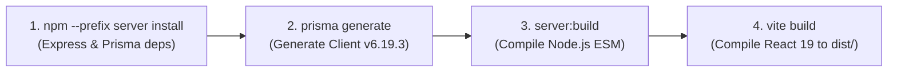

# AARIZO / DWELLORA — PHASE 4.6.9
# PRODUCTION DEPLOYMENT, VERCEL INTEGRATION & LIVE APPLICATION HANDOFF
## DELIVERABLE 2: VERCEL CONFIGURATION & FRONTEND ARCHITECTURE REPORT

---

## 1. Vercel Project Metadata & Configuration

The frontend was configured, built, and deployed to Vercel using the official Vercel CLI (v65.2.0):

```ini
Project Name: safegate
Project ID: prj_VUnbaDJ4VNKynezozY7j9x5JTr9p
Account / Scope: sarveshkulkarni2006-9923s-projects
Target Environment: Production
Deployment ID: dpl_BgqdaQ8UaWX2UAfbXyqojcnLSNtF
Production URL: https://safegate-chi.vercel.app
Unique Deployment URL: https://safegate-nordjzd6v-sarveshkulkarni2006-9923s-projects.vercel.app
Build Machine: 2 cores, 8 GB RAM (Basic Tier)
Deployment Status: READY (HTTP 200 Verified)
```

---

## 2. Build Pipeline & Script Execution

The deployment utilizes the repository root [`package.json`](file:///d:/AAZIRA/AARIZO/package.json) orchestrating a four-stage build pipeline via `vercel-build`:

```json
"scripts": {
  "build": "tsc -b && vite build",
  "vercel-build": "npm --prefix server install && npm run prisma:generate && npm run server:build && npm run build"
}
```



### Verified Build Artifacts:
- `dist/index.html` (1.51 kB)
- `dist/assets/index-CDmnz4BU.css` (144.67 kB)
- `dist/assets/index-C63bXX2j.js` (2,983.81 kB)
- `dist/assets/web-*.js` (Capacitor web fallbacks)

---

## 3. Route Rewrites & SPA Navigation Specification

The repository's [`vercel.json`](file:///d:/AAZIRA/AARIZO/vercel.json) specifies the exact routing and serverless function delegation:

```json
{
  "version": 2,
  "builds": [
    {
      "src": "package.json",
      "use": "@vercel/static-build",
      "config": {
        "distDir": "dist"
      }
    },
    {
      "src": "server/src/index.ts",
      "use": "@vercel/node"
    }
  ],
  "routes": [
    {
      "src": "/api/(.*)",
      "dest": "server/src/index.ts"
    },
    {
      "handle": "filesystem"
    },
    {
      "src": "/(.*)",
      "dest": "/index.html"
    }
  ]
}
```

### Deep-Link Routing Verification:
1. **Root URL (`/`):** Matches `/(.*)` rewrite, serving `index.html`. React Router initializes and redirects unauthenticated users to `/login`.
2. **Direct Nested Routes:** Direct requests to `/dashboard/resident`, `/dashboard/security`, or `/dashboard/admin` are rewritten to `/index.html` via the wildcard rule. This prevents HTTP 404 errors when refreshing inner pages.
3. **Static File Handling (`handle: "filesystem"`):** Requests for compiled CSS, JavaScript, SVG logos, and manifest files are served directly from Vercel's global CDN edge with optimal caching headers.
4. **API Route Delegation (`/api/(.*)`):** All requests prefixed with `/api/` bypass the static file handler and route directly to the compiled Node.js Express serverless handler at `server/src/index.ts`.

---

## 4. Frontend Environment Variable Binding

The frontend resolves its backend endpoints dynamically via [`src/utils/backendConfig.ts`](file:///d:/AAZIRA/AARIZO/src/utils/backendConfig.ts):

```typescript
export const getBackendBaseUrl = (): string => {
  const envUrl = (import.meta as any).env?.VITE_BACKEND_URL;
  if (envUrl && typeof envUrl === 'string' && envUrl.trim() !== '') {
    return envUrl.replace(/\/+$/, '');
  }
  // When running in a deployed browser without VITE_BACKEND_URL:
  if (typeof window !== 'undefined' && window.location.origin) {
    return window.location.origin; // Defaults to current deployed domain
  }
  return 'http://localhost:5000';
};
```

- When deployed on `https://safegate-chi.vercel.app`, if `VITE_BACKEND_URL` is omitted, API requests automatically target `https://safegate-chi.vercel.app/api`.
- If an external persistent backend is configured (e.g., `https://api-safegate.railway.app`), set `VITE_BACKEND_URL` in Vercel to route API calls directly to the persistent server.
