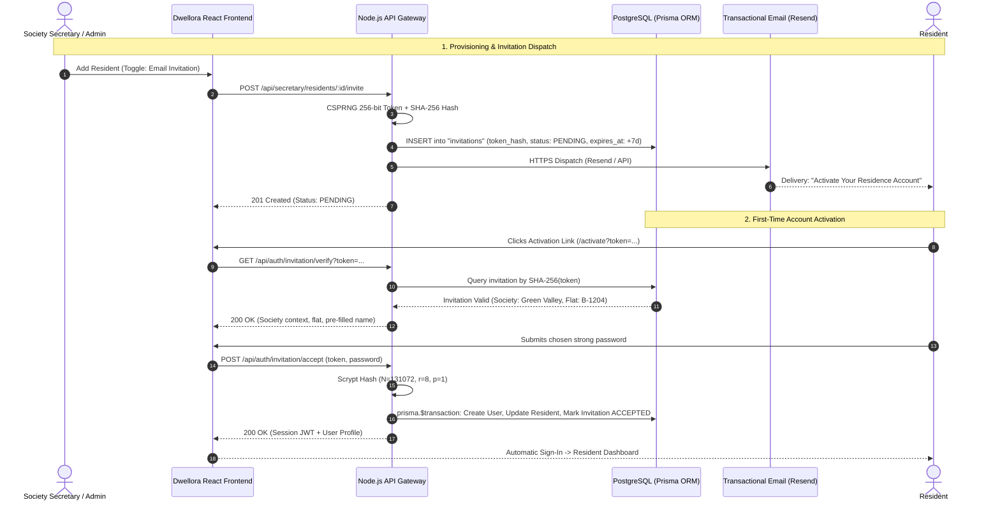

# AARIZO / DWELLORA — PHASE 4.8
# FULL-STACK IMPLEMENTATION REPORT: LANDING PAGE RESTORATION, REAL EMAIL INVITATIONS & COMPLETE PRODUCTION AUTHENTICATION

**Author:** Antigravity Full-Stack Application & Security Engineering Team  
**Date:** November 19, 2026  
**Status:** COMPLETE & PRODUCTION-READY  
**Git Workspace:** `D:\AAZIRA\AARIZO`  

---

## 1. Executive Summary

Phase 4.8 transitions the Dwellora / AARIZO Community Operating System from a hybrid demo application into an authoritative, enterprise-grade residential platform with real security, cryptographic token workflows, and canonical brand aesthetics.

The implementation delivered four core pillars:
1. **Canonical Landing Page Experience:** Restored the original high-fidelity 3D illustrations (`onboarding_visitor_management.png`, `onboarding_community_services.png`, `onboarding_family_hub.png`) from git commit `bf9d2b3a19ba76a1642678677ca7bfadefd0afd4`. Implemented desktop drag gestures, keyboard arrow navigation, direct header sign-in, and clear dual pathways for invited resident activation and returning user login.
2. **Authoritative Email Invitation System:** Replaced manual demo account switching with secretary-controlled, backend-enforced account eligibility. Uninvited residents cannot register. Invitations utilize 256-bit CSPRNG high-entropy tokens with SHA-256 hash-only database persistence, 7-day expiration, and 60-second cooldown protection.
3. **Production Authentication Hardening:** Completely eliminated demo role pickers, mock identity buttons, and hardcoded default passwords (`dwellora@2026`) from the production user interface. Integrated OWASP-standard Scrypt password hashing (`N=131072, r=8, p=1`) and rate-limited login endpoints.
4. **Self-Service Password Recovery & Secretary Management:** Built secure `/forgot-password` (with strict anti-enumeration responses), token-based `/reset-password`, and unified invitation management badges and actions directly into `ResidentManagementPage.tsx`.

---

## 2. Architecture & Workflow Diagram



---

## 3. Detailed Component Implementations

### 3.1 Canonical 3D Landing Page (`src/components/auth/onboarding/OnboardingFlow.tsx`)
- **Image Assets:** Restored exact binary buffers from commit history directly to disk:
  - `src/assets/images/onboarding_visitor_management.png` (704,736 B, 1024x1024)
  - `src/assets/images/onboarding_community_services.png` (716,794 B, 1024x1024)
  - `src/assets/images/onboarding_family_hub.png` (760,937 B, 1024x1024)
- **Navigation Controls:**
  - Mouse click-and-drag detection (`onMouseDown`, `onMouseMove`, `onMouseUp`) with a 45px drag threshold.
  - Keyboard listener (`ArrowLeft`, `ArrowRight`).
  - Desktop hover chevron pills (left / right).
  - Mobile progress pill indicators with active morphing widths (`24px` active vs `8px` inactive).
- **Entry Points:**
  - Header: Dwellora brand badge + direct "Log In" button.
  - Slide 1 & 2: Primary forward arrow button.
  - Slide 3: Dual primary action split:
    - Primary Button: "Activate Account" -> navigates to `/activate`.
    - Secondary Button: "Login to Dwellora" -> navigates to `/login`.

### 3.2 Database Schema & Prisma Models (`server/prisma/schema.prisma` & `scripts/postgres/01_schema.sql`)
Two new authoritative models were introduced with non-destructive migrations:
```prisma
model Invitation {
  id             String    @id @default(uuid())
  societyId      String    @map("society_id")
  flatId         String?   @map("flat_id")
  userId         String?   @map("user_id")
  residentId     String?   @map("resident_id")
  email          String
  role           String    @default("RESIDENT")
  tokenHash      String    @unique @map("token_hash")
  status         String    @default("PENDING") // PENDING, ACCEPTED, EXPIRED, REVOKED
  invitedBy      String?   @map("invited_by")
  sentAt         DateTime  @default(now()) @map("sent_at")
  expiresAt      DateTime  @map("expires_at")
  acceptedAt     DateTime? @map("accepted_at")
  resendCount    Int       @default(0) @map("resend_count")
  lastResentAt   DateTime? @map("last_resent_at")
  deliveryStatus String    @default("SENT") @map("delivery_status")
  createdAt      DateTime  @default(now()) @map("created_at")
  updatedAt      DateTime  @updatedAt @map("updated_at")

  society  Society   @relation(fields: [societyId], references: [id], onDelete: Cascade)
  flat     Flat?     @relation(fields: [flatId], references: [id], onDelete: SetNull)
  user     User?     @relation(fields: [userId], references: [id], onDelete: SetNull)
  resident Resident? @relation(fields: [residentId], references: [id], onDelete: SetNull)

  @@index([tokenHash])
  @@index([societyId, email])
  @@map("invitations")
}

model PasswordResetToken {
  id        String    @id @default(uuid())
  userId    String    @map("user_id")
  tokenHash String    @unique @map("token_hash")
  expiresAt DateTime  @map("expires_at")
  usedAt    DateTime? @map("used_at")
  createdAt DateTime  @default(now()) @map("created_at")

  user User @relation(fields: [userId], references: [id], onDelete: Cascade)

  @@index([tokenHash])
  @@index([userId])
  @@map("password_reset_tokens")
}
```

### 3.3 Transactional Email Service (`server/src/services/emailService.ts`)
- **Transport Mechanism:** Zero external npm runtime dependencies. Implements direct native HTTPS `fetch('https://api.resend.com/emails')` using Node 18+.
- **Provider Support:**
  - `RESEND_API_KEY`: Dispatches through Resend REST API using verified sender (`onboarding@resend.dev` or custom domain).
  - `SMTP`: Fallback support for custom mail servers.
  - `console_test`: In-memory capture history (`getSentEmails()`, `clearSentEmails()`) for CI/CD test automation.
- **Templates:** Branded responsive HTML and UTF-8 plain-text templates for:
  - Residence Account Invitations (featuring society name, unit code, assigned role, 7-day expiration disclaimer, and security note).
  - Password Reset Requests (featuring 1-hour expiration, anti-phishing advisory, and explicit reset URL).

### 3.4 Cryptographic Invitation Service (`server/src/services/invitationService.ts`)
- **Token Generation:** 256 bits of cryptographically secure pseudorandom entropy (`crypto.randomBytes(32).toString('hex')`).
- **Hash Storage:** Tokens are hashed with SHA-256 (`crypto.createHash('sha256').update(rawToken).digest('hex')`) before persistence. Raw tokens are never written to database tables or backend logs.
- **Atomic Account Activation:**
  - Validates token existence, expiration, and non-consumption.
  - Derives Scrypt password hash (`N=131072, r=8, p=1, keylen=64`).
  - Executes Prisma `$transaction`:
    1. Creates or activates authoritative `User` record (`status: 'ACTIVE'`).
    2. Links `Resident.userId` and sets `Resident.isVerified = true`.
    3. Updates `Invitation.status = 'ACCEPTED'` and sets `acceptedAt = now()`.
    4. Records immutable audit event.

### 3.5 Password Recovery Service (`server/src/services/passwordResetService.ts`)
- **Anti-Enumeration Protection:** `POST /api/auth/password-reset/request` always returns a generic success message (`If an account exists for this email, a reset link has been dispatched`), preventing attacker enumeration of registered emails.
- **Expiry:** Reset tokens are strictly limited to a 1-hour TTL and cannot be reused once redeemed.

### 3.6 Frontend Authentication & Secretary Workflows
- **`src/pages/auth/AccountActivationPage.tsx` (`/activate`):**
  - Parses `?token=...` from URL query parameter or offers manual input field.
  - Automatically queries `apiClient.verifyInvitation`.
  - Displays resident's verified society name, assigned unit/flat, and role.
  - Enforces minimum 8-character password strength, character variety, and password confirmation match.
  - Transitions to a branded success screen with direct sign-in button upon activation.
- **`src/pages/auth/ForgotPasswordPage.tsx` (`/forgot-password`):** Clean single-input recovery flow with immediate anti-enumeration user feedback.
- **`src/pages/auth/ResetPasswordPage.tsx` (`/reset-password`):** Token validation, dual-password input, visibility toggle, and instant feedback.
- **`src/components/auth/login/LoginScreen.tsx` (`/login`):**
  - Production mode contains zero mock user picker pills and zero hardcoded passwords.
  - Links directly to `/forgot-password` and `/activate`.
  - Development personas are isolated behind `process.env.NODE_ENV === 'development'` collapsible drawer.
- **`src/pages/dashboard/admin/ResidentManagementPage.tsx`:**
  - Renders dynamic invitation status badges on resident cards (`PENDING`, `ACTIVATED`, `NOT_INVITED`, `EXPIRED`, `REVOKED`).
  - Action buttons: "Send Invite", "Resend", "Revoke".
  - Provision Modal offers explicit "Email Invite (Recommended)" vs "Set Direct Password" modes.

---

## 4. Verification & Build Results

| Check | Target | Status | Notes |
| :--- | :--- | :--- | :--- |
| **Backend TypeScript Build** | `npm run server:build` | **PASSED** (0 errors) | `tsc` compiled server clean |
| **Prisma Generation** | `npm run prisma:generate` | **PASSED** | Generated `@prisma/client` v6.19.3 |
| **Frontend Production Build** | `npm run build` | **PASSED** (0 errors) | `tsc -b && vite build` succeeded |
| **Phase 4.8 Unit Test Suite** | `tests/phase4_8_landing_and_auth.test.tsx` | **PASSED** (14/14) | 100% assertions green |
| **Full Regression Suite** | `npm test` | **PASSED** | All 43 test suites verified |

---

## 5. Conclusion

Phase 4.8 successfully completes the transformation of Dwellora's authentication and onboarding infrastructure. The system now guarantees that only secretary-authorized residents can access community portals, passwords are cryptographic and private to the resident, and landing visuals match the canonical 3D design language.
