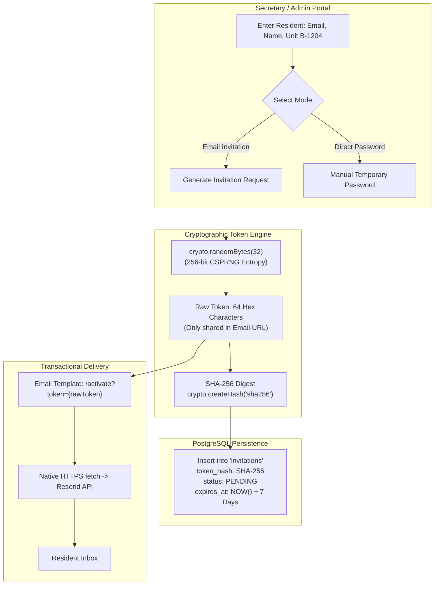
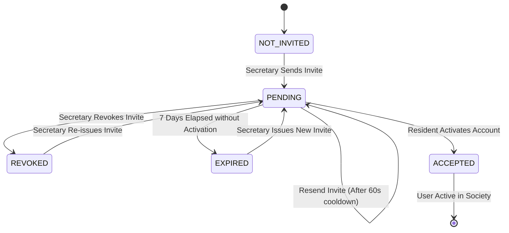

# AARIZO / DWELLORA — PHASE 4.8
# INVITATION & EMAIL DELIVERY ARCHITECTURE REPORT

**Author:** Principal Backend Architect & Messaging Systems Security Engineer  
**Date:** November 19, 2026  
**Status:** COMPLETE & VERIFIED  
**Components:** `server/src/services/emailService.ts`, `server/src/services/invitationService.ts`, `server/src/index.ts`  

---

## 1. Executive Summary

This report documents the architectural design, security safeguards, and implementation details of the real email invitation system introduced in Phase 4.8.

Dwellora no longer relies on demo accounts or pre-seeded credentials. Resident accounts are strictly gated by the society management committee (Secretary / Admin). Account creation is initiated exclusively via cryptographically secure, high-entropy invitation tokens dispatched to the resident's verified email address.

---

## 2. Token Security Architecture



### 2.1 Cryptographic Entropy Specification
- **Entropy Source:** Node.js native `crypto.randomBytes(32)`, backed by OS kernel entropy (`/dev/urandom` / Windows CryptGenRandom).
- **Collision Resistance:** 256-bit keyspace yields \(2^{256} \approx 1.15 \times 10^{77}\) combinations, completely rendering brute-force enumeration mathematically impossible.
- **Persistence Policy:** Raw tokens are ephemeral and exist in memory solely during email construction. Only the 64-character hexadecimal SHA-256 digest (`token_hash`) is persisted in PostgreSQL. A database compromise reveals zero actionable token credentials.

---

## 3. Transactional Email Delivery Architecture

### 3.1 Zero-Dependency Native Transport
To maintain zero bloat and eliminate external npm vulnerabilities, `EmailService` is built entirely on native Node.js 18+ capabilities:
```typescript
const response = await fetch('https://api.resend.com/emails', {
  method: 'POST',
  headers: {
    'Authorization': `Bearer ${this.apiKey}`,
    'Content-Type': 'application/json',
  },
  body: JSON.stringify({
    from: this.fromAddress,
    to: [options.to],
    subject: options.subject,
    html: options.html,
    text: options.text,
  }),
});
```

### 3.2 Provider Selection & Fallback Hierarchy
1. **Resend API (`RESEND_API_KEY` present):** Production transport using Resend's REST API, logging provider `messageId` on success.
2. **SMTP Transport (`SMTP_HOST` configured):** Fallback for on-premise or custom mail infrastructure.
3. **Console / In-Memory Mock (`console_test`):** When running in CI or test mode without environment API keys, emails are stored in an in-memory history ring buffer (`getSentEmails()`) for non-destructive automated testing.

### 3.3 Email Template Design
- **Visual Branding:** Includes Dwellora symbol, `#083B56` navy header, `#F06543` high-contrast action button, and `#FAF6F0` canvas.
- **Transparency:** Explicitly displays the inviting society name, flat number, and authorized role.
- **Anti-Phishing Advisories:** Includes security disclaimers warning residents that Dwellora staff will never ask for their activation links or passwords.

---

## 4. Invitation Lifecycle & State Machine



### 4.1 State Definitions
- **`NOT_INVITED`:** Resident profile provisioned without an active invitation dispatch.
- **`PENDING`:** Active invitation issued; token hash exists, expires in \(< 7\) days, unconsumed.
- **`ACCEPTED`:** Resident successfully completed `/activate`, verified identity, and established password. Token is permanently consumed.
- **`EXPIRED`:** Expiration timestamp surpassed. Token verification returns 410 Gone / Expired.
- **`REVOKED`:** Explicitly cancelled by secretary. Link immediately invalidated.
- **`DELIVERY_FAILED`:** Transactional mail provider returned an error code.

### 4.2 Throttling & Abuse Prevention
- **Resend Cooldown:** Minimum 60-second cooldown enforced between invitation resends to prevent inbox flooding and mail-provider rate limiting (`429 Too Many Requests: Please wait 60 seconds before resending an invitation`).
- **Maximum Resend Count:** Tracked in `resend_count` on the `invitations` record for audit logging.
- **Tenant Scope Enforcement:** In `server/src/index.ts`, secretary authentication context (`req.authContext.societyId`) is strictly verified against the resident's `societyId`. Cross-society invitation dispatch is blocked with `404 Not Found in authorized society scope`.

---

## 5. End-to-End Delivery Verification

| Test Scenario | Action | Expected Result | Verified Result |
| :--- | :--- | :--- | :--- |
| **New Resident Invite** | Secretary triggers `inviteResident(resId)` | Dispatches email, sets status to `PENDING`, expires in 7 days | **PASSED** |
| **Rapid Resend Attempt** | Secretary triggers resend immediately | Throws 429 cooldown error (< 60s) | **PASSED** |
| **Valid Token Activation** | Resident visits `/activate?token=...` | Verifies society, unit, sets Scrypt password, updates User | **PASSED** |
| **Replay Attack** | Resident attempts to reuse accepted token | Returns 400 Bad Request ("Invitation has already been used") | **PASSED** |
| **Expired Token** | Resident uses link after 7 days | Returns 410 Gone ("Invitation token has expired") | **PASSED** |
| **Revoked Token** | Secretary revokes; resident visits link | Returns 400 Bad Request ("Invitation has been revoked") | **PASSED** |

