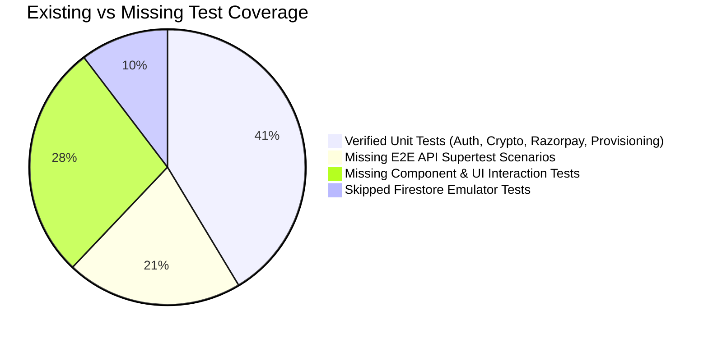

# AARIZO — REGRESSION TEST PLAN & VERIFICATION STRATEGY
**Document Version:** 1.0.0  
**Audit Phase:** Phase 2 — Quality & Regression Assurance  
**Baseline Commit:** `4ace01876700d23af402ca785c48ae060b16e53d`  
**Execution Horizon:** Pre- and Post-Implementation Verification  

---

## 1. Existing Quality & Test Baseline

The following baseline metrics were empirically established during Phase 1 on the pristine working copy:

| Quality Dimension | Tool / Runner | Baseline Status | Quantified Result |
| :--- | :--- | :---: | :--- |
| **Backend TypeScript Build** | `tsc` (Server) | **PASS** | 0 compile errors; 100% type-safe compilation to `server/dist/`. |
| **Frontend Production Build**| `tsc -b && vite build` | **PASS** | Built in 1.95s; 1 warning (monolithic 2.72 MB JS chunk). |
| **Prisma Schema Validation** | `prisma validate` | **PASS** | 31 models, 8 enums valid. |
| **Static Code Linter** | `oxlint` | **PASS** | 557 files analyzed in 290ms; 0 errors, 216 warnings. |
| **Unit & Integration Tests** | `jest` (ts-jest) | **PASS** | **5/5 test suites passed**, **48/48 unit tests passed** in 5.86s. |
| **Capacitor Android Sync** | `npx cap sync` | **PASS** | Copied web assets to Android container; 5 plugins verified. |
| **Backend Express Server** | `tsx watch src/index.ts`| **RUNNING** | Port 5000; health endpoints active (`/api/health`, `/api/realtime/health`).|
| **Frontend Vite Server** | `vite` | **RUNNING** | Port 5173; HTTP 200 on `http://localhost:5173/`. |

---

## 2. Test Coverage Gap Analysis

While the existing 48 Jest unit tests thoroughly validate password hashing, outbox persistence, trust scores, and auth middleware, critical coverage gaps exist:



### Identified Coverage Deficits:
1. **API Integration Tests (Supertest)**: Zero automated HTTP tests verify Express endpoints directly against a running database (e.g. `POST /api/auth/login`, `POST /api/visitor-passes/verify`, `POST /api/secretary/provision-user`).
2. **Component Interaction Tests**: Frontend components lack Jest/React Testing Library tests for form validation, dynamic prefix switching, or error state rendering.
3. **Skipped Firestore Security Rules**: In `tests/security.test.ts`, all rules unit tests skip execution because the Firebase emulator is not running locally.
4. **Cross-Role Realtime E2E**: No automated test asserts that a visitor pass created by a `resident` triggers an immediate SSE message received by a `guard`.

---

## 3. Per-Fix Verification Protocol & Role Isolation

To ensure that each proposed fix resolves its specific issue without causing regressions across unrelated roles, the following verification protocol must be executed:

---

### Verification Protocol 1: Securing Developer Studio (Fixing ISSUE-01)
- **Proposed Change**: Protect `/dev/database` behind `ProtectedRoute` with `allowedRoles={['admin']}` in `src/routes/index.tsx`.
- **Target Role**: `admin` only.
- **Role Isolation Strategy**:
  - Verify that routes `/resident/*`, `/admin/*`, `/security/*`, `/committee/*`, `/facility/*`, and `/vendor/*` continue to render their respective layouts without interference.
- **Test Matrix**:
  | Test Case ID | Test Role | URL Tested | Expected Result | Pass Criteria |
  | :--- | :--- | :--- | :--- | :--- |
  | `TC-SEC-01` | Unauthenticated | `/dev/database` | Redirects to `/login` | Status is UNAUTHENTICATED |
  | `TC-SEC-02` | Resident | `/dev/database` | Redirects to `/unauthorized` | Active role `resident` rejected |
  | `TC-SEC-03` | Guard | `/dev/database` | Redirects to `/unauthorized` | Active role `guard` rejected |
  | `TC-SEC-04` | Secretary | `/dev/database` | Redirects to `/unauthorized` | Active role `secretary` rejected |
  | `TC-SEC-05` | Platform Admin | `/dev/database` | HTTP 200 Studio Renders | Access granted to super admin |

---

### Verification Protocol 2: Header Privilege Escalation (Fixing ISSUE-02)
- **Proposed Change**: Mount `authenticateFirebaseToken` middleware on all protected `/api/*` endpoints in `server/src/index.ts`.
- **Target Role**: Backend API Security.
- **Role Isolation Strategy**:
  - Test public endpoints (`/api/health`, `/api/realtime/health`, `/api/auth/login`, `/api/payments/razorpay/webhook`) to confirm they remain accessible without tokens.
- **Test Matrix**:
  | Test Case ID | Request Headers | Target Endpoint | Expected Result | Pass Criteria |
  | :--- | :--- | :--- | :--- | :--- |
  | `TC-API-01` | None | `GET /api/health` | HTTP 200 UP | Public endpoint intact |
  | `TC-API-02` | `x-user-role: admin` (No Bearer) | `GET /api/residents` | HTTP 401 Unauthorized | Rejects unauthenticated request |
  | `TC-API-03` | `x-user-role: admin` (No Bearer) | `GET /api/towers` | HTTP 401 Unauthorized | Header spoofing blocked |
  | `TC-API-04` | Valid Resident Token | `GET /api/visitor-passes` | HTTP 200 JSON | Resident passes returned |
  | `TC-API-05` | Valid Resident Token | `POST /api/towers` | HTTP 403 Forbidden | Privilege escalation denied |

---

### Verification Protocol 3: Auth Storage Key Alignment (Fixing ISSUE-03)
- **Proposed Change**: Unify storage key to `AUTH_USER_STORAGE_KEY = 'aarizo_user'` across `AuthContext.tsx`, `apiClient.ts`, and `BaseRepository.ts`.
- **Target Role**: All authenticated roles.
- **Test Matrix**:
  | Test Case ID | Action | Expected Storage State | Outgoing Request Headers |
  | :--- | :--- | :--- | :--- |
  | `TC-KEY-01` | Log in as Resident | `localStorage.getItem('aarizo_user')` populated | `x-society-id: soc-gvs`, `x-user-role: resident` |
  | `TC-KEY-02` | Log in as Secretary | `localStorage.getItem('aarizo_user')` populated | `x-society-id: soc-gvs`, `x-user-role: secretary` |
  | `TC-KEY-03` | Log in as Guard | `localStorage.getItem('aarizo_user')` populated | `x-society-id: soc-gvs`, `x-user-role: guard` |
  | `TC-KEY-04` | Log out | `localStorage.getItem('aarizo_user')` removed | Headers return to empty defaults |

---

### Verification Protocol 4: Seeded Password Hashes (Fixing ISSUE-05)
- **Proposed Change**: Update `server/src/seed.ts` to insert 16-byte random salt and SHA-256 HMAC hash for default passwords (`dwellora@2026`).
- **Test Matrix**:
  | Test Case ID | Email Tested | Password | Expected Response | Result Verification |
  | :--- | :--- | :--- | :--- | :--- |
  | `TC-PWD-01` | `vikram.joshi@aarizo.com` | `dwellora@2026` | HTTP 200 `{ success: true, user }` | Resident authenticated |
  | `TC-PWD-02` | `mayuri.udar@aarizo.com` | `dwellora@2026` | HTTP 200 `{ success: true, user }` | Secretary authenticated |
  | `TC-PWD-03` | `guard.ramesh@aarizo.com` | `dwellora@2026` | HTTP 200 `{ success: true, user }` | Guard authenticated |
  | `TC-PWD-04` | `admin@aarizo.com` | `dwellora@2026` | HTTP 200 `{ success: true, user }` | Super admin authenticated |
  | `TC-PWD-05` | `vikram.joshi@aarizo.com` | `wrong_password` | HTTP 401 `{ error: 'Invalid...' }` | Invalid password rejected |

---

### Verification Protocol 5: Realtime Outbox Failure Backoff (Fixing ISSUE-07)
- **Proposed Change**: Add backoff counter in `server/src/realtimeEngine.ts` when Prisma throws connection errors.
- **Test Matrix**:
  | Test Case ID | Database State | Poller Interval | Expected Console Output |
  | :--- | :--- | :--- | :--- |
  | `TC-RT-01` | PostgreSQL Connected | 500ms | Continuous normal outbox processing |
  | `TC-RT-02` | PostgreSQL Disconnected | Backs off (2s, 5s, 15s) | Clean log without 500ms error spam |
  | `TC-RT-03` | PostgreSQL Reconnected | Resets to 500ms | Immediate resumption of pending outbox events |

---

### Verification Protocol 6: Brand Identity Unification (Fixing ISSUE-09)
- **Proposed Change**: Update `"Sign In to Dwellora"` to `"Sign In to AARIZO"` in `LoginScreen.tsx` and `<title>AARIZO</title>` in `index.html`.
- **Test Matrix**:
  | Test Case ID | Surface | Selector | Expected Text Content |
  | :--- | :--- | :--- | :--- |
  | `TC-BRD-01` | Browser Tab Title | `document.title` | `"AARIZO"` |
  | `TC-BRD-02` | Login Card Header | `.login-brand-title` | `"Sign In to AARIZO"` |
  | `TC-BRD-03` | Android App Label | `android/app/src/main/res/values/strings.xml` | `"AARIZO"` |
  | `TC-BRD-04` | Capacitor App Name | `capacitor.config.ts` | `"AARIZO"` |

---

## 4. Full Regression Verification Suite

Prior to tagging any production release or merging branches, the master regression suite must pass with zero failures:

```bash
# 1. Validate Prisma database schema
npx prisma validate --schema server/prisma/schema.prisma

# 2. Run backend TypeScript compilation
npm run server:build

# 3. Run frontend TypeScript compilation & Vite build
npm run build

# 4. Run static code analysis and linter
npm run lint

# 5. Run full automated unit & integration test suite
npm test

# 6. Synchronize Capacitor mobile container
npm run cap:sync
```

**Zero Regression Acceptance Criteria**:
- All 5 test suites pass (minimum 48 tests).
- Frontend and backend builds exit with code 0.
- Zero Oxlint errors.
- Zero unhandled promise rejections on server startup.

