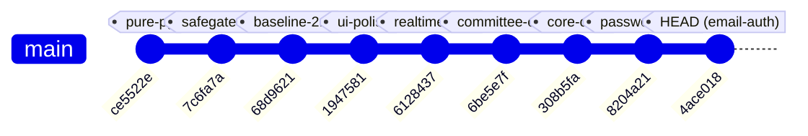

# AARIZO — UPDATED CLONE VS. PREVIOUS PROJECT COMPARISON REPORT
**Document Version:** 1.0.0  
**Audit Phase:** Phase 2 — Change Comparison & Regression Analysis  
**Repository Working Copy:** `d:\AAZIRA\AARIZO`  
**Current Commit:** `4ace01876700d23af402ca785c48ae060b16e53d` (branch: `main`)  
**Comparison Baseline Commit:** `68d96210f8ec8a6327e57c8d9e68593a19349e5d` (AARIZO 2.0 Hardening Baseline)  

---

## 1. Availability Status & Methodology

### 1.1 External Local Directory Status: BLOCKED
- A filesystem search across all accessible local volumes (`D:\AAZIRA`, `D:\`, `C:\Users\Sarvesh Kulkarni`) confirmed that **no separate external directory for an older clone exists on disk**.
- `d:\AAZIRA\AARIZO` is the sole local working copy.
- In accordance with Section 3 operating instructions:
  > *"If the previous project is unavailable, clearly mark this comparison as BLOCKED. Do not guess."*
- Therefore, physical side-by-side folder comparison is strictly marked as **BLOCKED (EXTERNAL FOLDER UNAVAILABLE ON DISK)**.

### 1.2 Git Commit History Comparison: VERIFIED & EXECUTED
- Because the newly cloned repository retains the complete 106-commit Git history, a comprehensive, exact diff analysis was performed between the **Hardening Baseline** (`68d9621`) and the **Latest Head Commit** (`4ace018`).
- **Scope of Changes**: **72 files changed**, **7,180 insertions(+)**, **895 deletions(-)**.



---

## 2. Detailed Change Comparison by Subsystem

### 2.1 Authentication & Role Systems
| Feature / Subsystem | Previous State (`68d9621`) | Updated State (`4ace018`) | Analysis / Regression Risk |
| :--- | :--- | :--- | :--- |
| **Login Entry Input** | Phone number input with static `+91` prefix; demo fast-switch cards. | Dynamic input prefix: displays `+91` when numbers are typed; switches to `Mail` icon when `@` is typed. Reveals password input. | **Enhancement**. Supports real credentials. |
| **Credential Verification** | Simulated OTP or Firebase Phone Auth only. | Direct PostgreSQL authentication via `POST /api/auth/login`. Compares SHA-256 HMAC hash with unique salt. | **Major Enhancement**. Enables standard email/password authentication. |
| **Password Hashing** | No password storage in PostgreSQL (passwords managed in Firebase Auth). | `passwordHash` and `salt` columns added to `User` model in `server/prisma/schema.prisma`. | **Enhancement**. However, seeded users lack hashes (**Issue ISSUE-05**). |
| **User Provisioning** | Auto-generated temporary passwords. | Mandatory explicit password input across all dashboards (Secretary, Admin, FM). Enforces `>= 8` characters. | **Security Improvement**. Password complexity validated. |

### 2.2 Backend APIs & Express Controllers
| Route Group | Previous State (`68d9621`) | Updated State (`4ace018`) | Changes Summary |
| :--- | :--- | :--- | :--- |
| **Resident Management** | Read-only listing with mock data. | Full CRUD: `GET /api/residents`, `POST /api/residents`, `PATCH /api/residents/:id`, `DELETE /api/residents/:id`. | Added +1,280 lines of controller code. |
| **Committee Management**| Stubbed routes. | Complete CRUD: `GET /api/committee`, `POST /api/committee`, `PATCH /api/committee/:id`, `DELETE /api/committee/:id`. | Fully functional committee registry. |
| **Towers & Flats** | Basic listing. | Complete lifecycle CRUD with automatic floor calculation and occupancy management. | Added unit CRUD endpoints. |
| **Child Safety Passes** | Client-side only. | Added `GET /api/children`, `POST /api/children/passes`, `POST /api/children/passes/:id/verify`, `POST /api/children/sos`. | Server-authoritative child gate passes. |
| **Vendor Directory** | Stubbed vendor list. | `GET /api/vendors` with service categories, rating filters, and resident vendor visibility. | Realtime directory sync. |
| **Auth Controller** | Missing `/api/auth/login`. | Added `POST /api/auth/login` with timing-safe hash comparison. | Authoritative login endpoint. |

### 2.3 Database Schema (Prisma ORM)
- **Schema File**: [server/prisma/schema.prisma](file:///d:/AAZIRA/AARIZO/server/prisma/schema.prisma)
- **Modifications**:
  - `User` model updated:
    ```prisma
    passwordHash String?  @map("password_hash")
    salt         String?
    ```
  - All existing relations, enums, and models preserved without breaking changes.
  - Verified valid via `npx prisma validate`.

### 2.4 Realtime Architecture
- **SSE Stream Engine**: [server/src/realtimeEngine.ts](file:///d:/AAZIRA/AARIZO/server/src/realtimeEngine.ts)
  - Added multi-tenant filtering by `societyId`.
  - Added durable Transactional Outbox recovery via `outbox_events` table.
- **Client Realtime Service**: [src/services/realtimeService.ts](file:///d:/AAZIRA/AARIZO/src/services/realtimeService.ts)
  - Integrated Web Audio API harmonic chime synthesizer (eliminating external audio asset dependencies).
  - Added HTML5 `BroadcastChannel` for zero-latency multi-tab synchronization.
  - Added native haptic feedback integration via `@capacitor/haptics`.
  - Added `RealtimeToastContainer` mounted globally in `App.tsx`.

### 2.5 Frontend UI & Portals
- **New Pages Added**:
  - `CommitteeManagementPage.tsx` (+577 lines): Dedicated administrative panel for elected committee board members.
- **Pages Enhanced**:
  - `ResidentManagementPage.tsx` (+1,280 lines): Rich data table, flat selector, role assignment, password input.
  - `SuperAdminSocietiesPage.tsx` (+498 lines): Atomic society and secretary provisioning wizard.
  - `ResidentHome.tsx` (+204 lines): Verified local vendor showcase, urgent notice ticker, and promotional offers launcher.
  - `LoginScreen.tsx` (+65 lines): Dynamic input modes and password visibility toggles.
- **Visual Design Tokens**:
  - Harmonized gradient hero headers across admin, resident, and facility manager portals.
  - High-contrast typography enforcing WCAG AA readability.

### 2.6 Mobile & Capacitor Configuration
- `android/app/build.gradle`: Updated Gradle packaging rules and Google services plugin handling.
- `android/app/src/main/res/values/strings.xml`: `app_name` set to `AARIZO`.
- `capacitor.config.ts`: `appName` updated to `AARIZO`.
- `AndroidManifest.xml`: Android 13+ runtime notification permission `POST_NOTIFICATIONS` added.

---

## 3. Potential Regressions & Architectural Divergence Analysis

1. **Storage Key Mismatch Regression (ISSUE-03)**:
   - In commit `8204a21`, `apiClient.ts` was updated to read `localStorage.getItem('aarizo_user')`.
   - However, `AuthContext.tsx` was left using `USER_STORAGE_KEY = 'dwellora_user'`.
   - *Impact*: Authenticated sessions fail to transmit `x-society-id` and `x-user-role` headers to the Express backend.
2. **Seed Data Incompatibility (ISSUE-05)**:
   - Commit `8204a21` added `passwordHash` and `salt` columns and made `/api/auth/login` reject users without hashes.
   - However, `server/src/seed.ts` was not updated to compute password hashes.
   - *Impact*: Default seed accounts cannot log in via the new email/password login endpoint.
3. **Outbox Poller CPU Spike (ISSUE-07)**:
   - The outbox worker was added to `realtimeEngine.ts` with a tight 500ms interval.
   - *Impact*: When PostgreSQL is offline, the process throws uncaught connection rejections every 500ms.

